[English](README.md) | [简体中文](README.zh-CN.md) | [繁體中文](README.zh-TW.md) | **日本語**

# laPower

**WITRN / POWER-Z USB 電力計用デスクトップアプリ — リアルタイム監視 · USB-PD 分析 · データ記録**

## 📖 プロジェクトについて

laPower は WITRN USB 電力計および POWER-Z KM003C/KM002C 向けのデスクトップアプリです。USB HID または Vendor Bulk インターフェイスから測定フレームを読み取り、リアルタイム監視、長時間記録、USB-PD デコードをすべてローカル・オフラインで実行します。外部通信は手動の更新確認（GitHub）と、設定した TCP サーバーへの外部温度取得のみです。

**Tauri v2** を採用し、バックエンドの **Rust** がデバイス通信・USB-PD 解析・バックグラウンドスレッドを管理し、フロントエンドは **標準 JavaScript ES Modules** と uPlot で構築しています（リリース時は esbuild でバンドル）。実行時フロントエンド依存関係はすべてリポジトリに同梱され、外部 CDN は使用しません。

電圧・電流・電力・温度に加え、**D+ / D− / CC1 / CC2 信号線電圧**を記録し、**USB-PD メッセージをフィールド単位でデコード**して通知 PDO、要求 PPS 電圧、ネゴシエーション完了時刻を確認できます。

> **プラットフォームについて：** バージョンタグのプッシュにより GitHub Actions が Windows x64、Linux x64、macOS Intel／Apple Silicon をパッケージ化し、チェック通過後に Release を公開します（実際の配布物は各 Release を参照）。開発と主な検証は Windows で行っており、macOS／Linux の GUI・実機接続および macOS 12 互換性は実機確認が必要です。詳細は[開発とビルド](docs/ja/DEVELOPMENT.md#リリース手順)を参照してください。

> **補足：** 本ソフトウェアの多くは Claude Code、Grok Build、Codex などの AI コーディングツールを用いて制作しており、未知の問題が残っている場合があります。[Issues](https://github.com/KHWLGH/laPower/issues) からご報告ください。

## 📸 画面プレビュー

Windows 上の **0.3.0** における仮想デバイス・模擬データによる画面です（タイトルバー全体を含み、アプリの既定テーマはシステムに従います）。再生成手順は[開発用プレビュー](docs/ja/DEVELOPMENT.md#開発用プレビュー)を参照してください。

| ライトテーマ | ダークテーマ |
| :---: | :---: |
|  **モニター** · 測定値カード / 8 チャンネル・4 軸 / タイムライン | 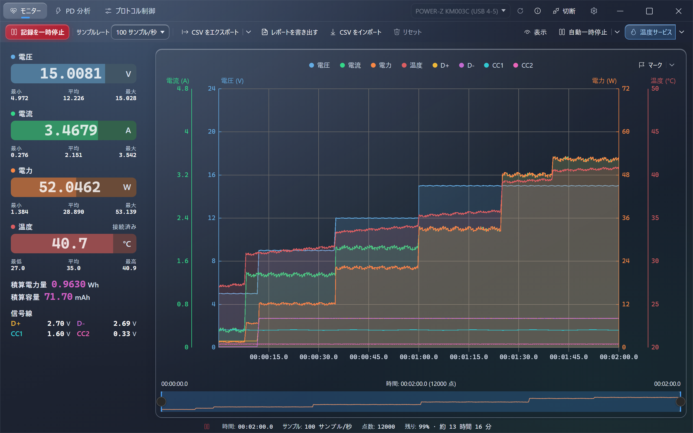 **モニター** · ダークテーマ |
| 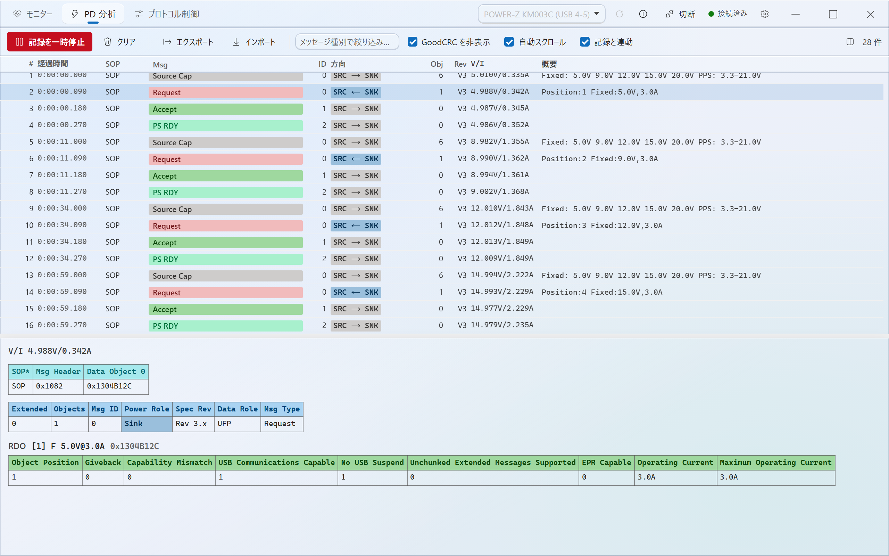 **PD 分析** · メッセージ一覧 / PDO 概要 / フィールドデコード | 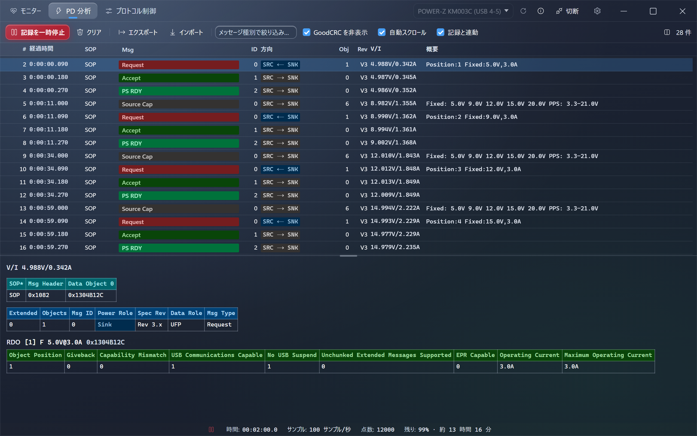 **PD 分析** · ダークテーマ |
| 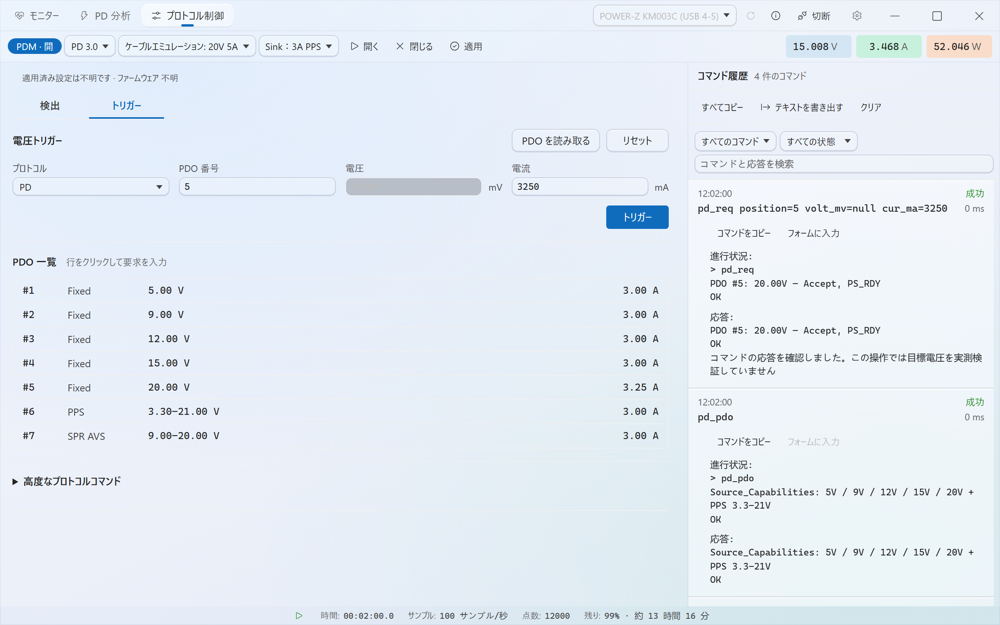 **プロトコル制御** · PDM / PDO / プロトコル検出・電圧要求 |  **プロトコル制御** · ダークテーマ |
| 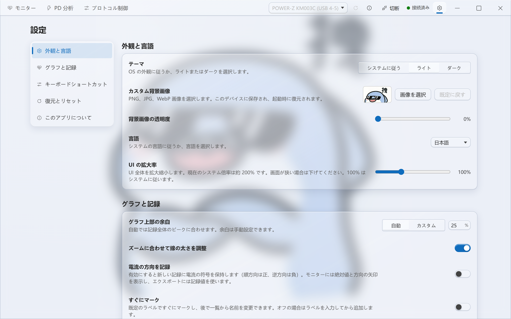 **設定** · テーマ / 保存されるカスタム背景 / 言語 / グラフと記録 | 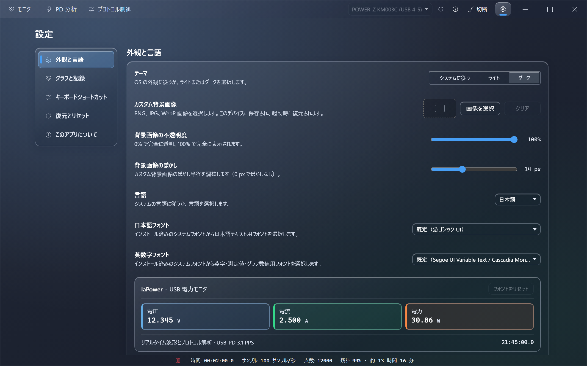 **設定** · ダークテーマ |
| 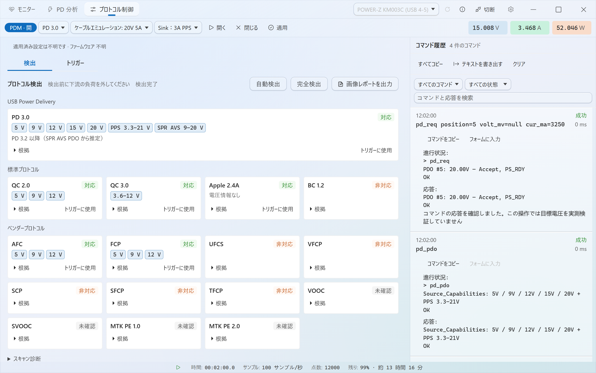 **プロトコル検出** · プロトコル別の状態 / 電圧 / 個別の根拠 | 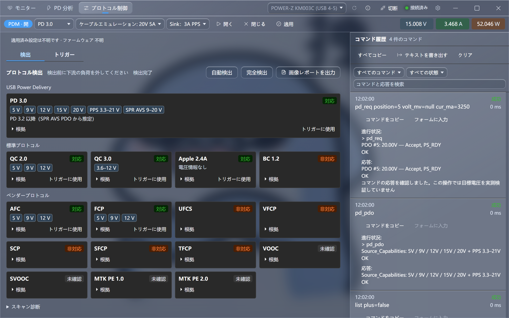 **プロトコル検出** · ダークテーマ |

### レポートの表示例

同じ 120 秒の仮想記録から実際に描画した出力例です。横長画像と動画は先頭 8 マーカー、縦長画像は全 12 マーカーを保持します（動画は再生途中のフレーム）。

| ライトテーマ | ダークテーマ |
| :---: | :---: |
| 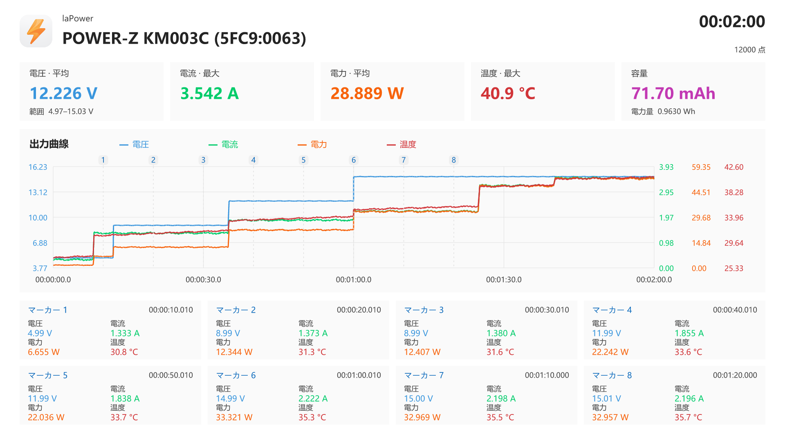 **画像レポート（16:9）** · 無損失 PNG / 全曲線 / 統計とマーカー | 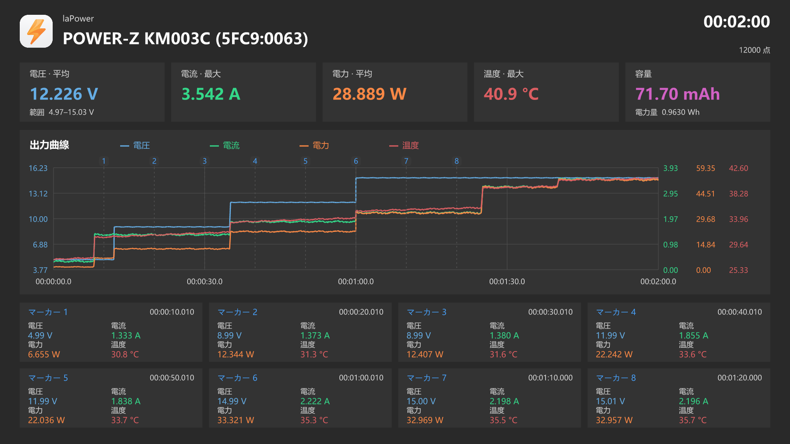 **画像レポート（16:9）** · ダークテーマ |
|  **画像レポート（縦長）** · 全 12 マーカー / 時刻と個別の測定値 | 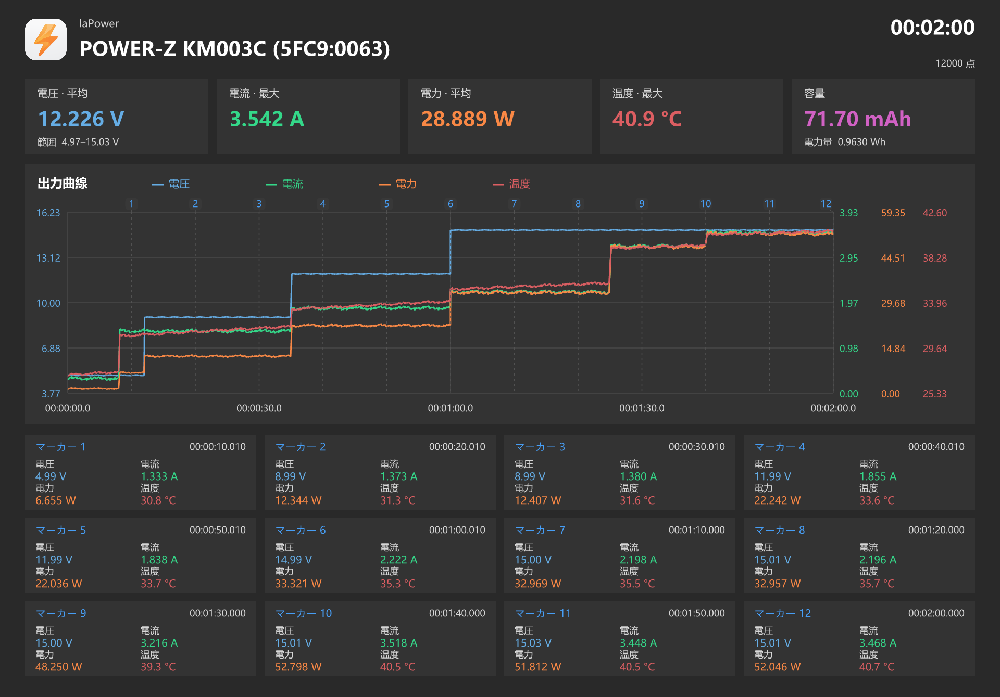 **画像レポート（縦長）** · ダークテーマ |
| 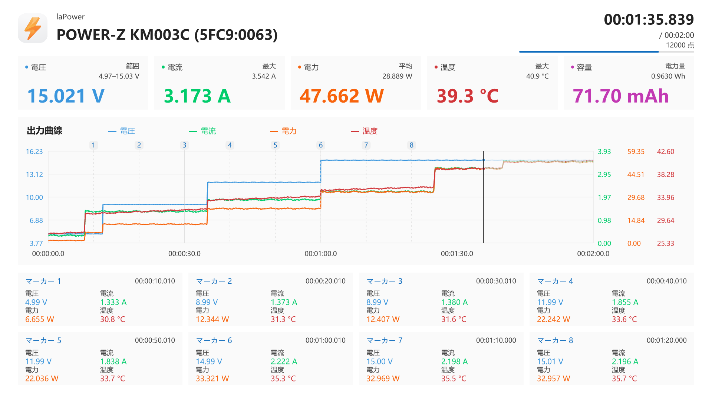 **動画レポートのフレーム** · 動画途中のフレーム / 現在値 / 再生カーソル | 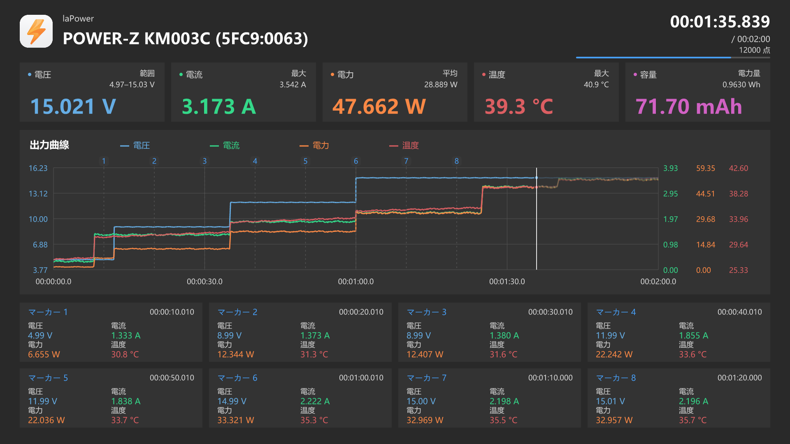 **動画レポートのフレーム** · ダークテーマ |
| 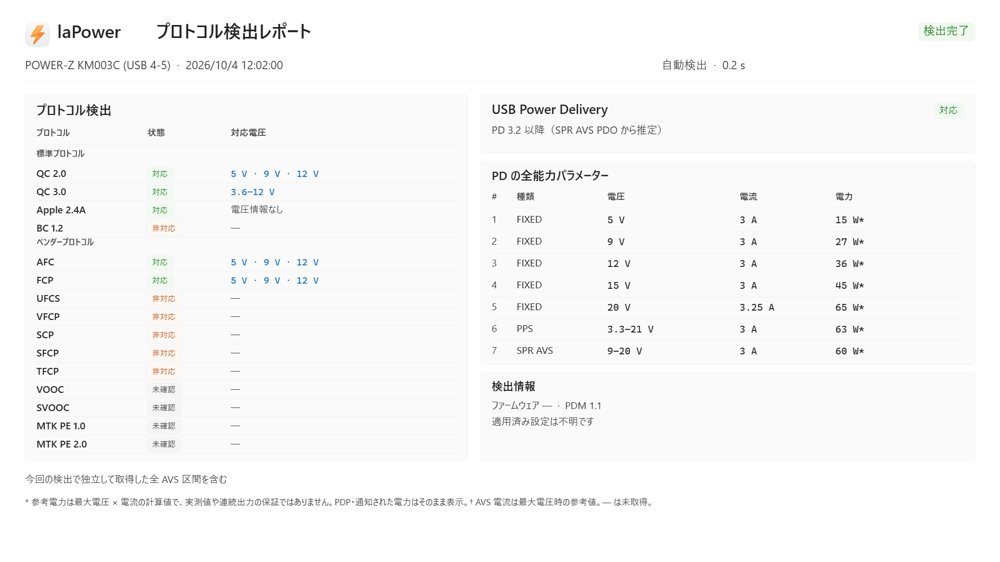 **プロトコル検出レポート** · 対応状態と電圧 / PD バージョン / 全 PDO |  **プロトコル検出レポート** · ダークテーマ |

## ✨ 主な機能

### リアルタイム監視

- 電圧・電流・電力・温度カードに最小値・最大値・平均値を表示します。
- **積算電力量（Wh）と積算容量（mAh）**をソフトウェアで積分し、スリープや NTP による時刻ジャンプ（サンプリング間隔の 8 倍超かつ 2 秒以上）は 1 周期分のみ進めて異常加算を防ぎます。
- **信号線電圧** D+ / D− / CC1 / CC2 をグラフに重ねて表示し、CSV にも出力します（分解能は計器依存、WITRN の CC1／CC2 は 0.1 V）。
- **電流の方向を記録**を有効にすると符号を保持し（順方向正、逆方向負、K2 は ±10 A ネイティブ対応）、サイドバーに方向矢印を表示します。
- **自動一時停止**：電圧・電流・電力がしきい値以下の状態で指定秒数続くと記録を停止し、無人の充放電テストに対応します。
- **POWER-Z 高速サンプリング**：KM003C／KM002C は認証後の AdcQueue で毎秒 1000 回取得し、認証失敗時は毎秒 100 回へ自動フォールバックします。
- **一時復元と上限**：約 1 秒ごとにキャッシュへ一時復元ファイルを保存（正常終了時に削除）し、既定上限 512 MB で自動一時停止します。長期保存には明示的にエクスポートします。

### USB-PD 分析

- SOP／SOP′ の制御・データ・拡張メッセージと Hard Reset／Cable Reset をデコードします。
- 役割・方向バッジ（`SRC → SNK`、`SRC|SNK → Plug`）と **PDO／RDO 概要**（例：`Fixed: 5.0V 9.0V 12.0V 15.0V 20.0V SPR AVS: 9-15V@3.0A PPS: 5.0-21.0V`、`Position:7 PPS:8.0V,3.45A`）を表示します。
- 詳細パネルでフレームを**ワード単位に展開**：Data Object の生の 16 進値 → ヘッダーフィールド表 → 各 PDO のビットフィールド表。
- メッセージ種別での絞り込みや、リンク層確認フレーム GoodCRC の非表示に対応します。
- **記録と連動**でモニターと開始・一時停止・クリアを同期でき、仮想リストにより数十万件でも快適にスクロールできます。

### 高性能グラフ

- uPlot と Canvas 2D / `OffscreenCanvas` 増分ピクセルバケットパイプラインにより、**8 曲線と厳密に整列した量子化 4 本の Y 軸**（電流 A、電圧 V、電力 W、温度 °C）および 2 段階補助グリッドを描画します。
- 密な波形は増分 min/max ピクセルバケットと部分汚れ矩形再描画へ切り替わり、**100 万点でも滑らかにドラッグ可能**です。全データは分割列形式で保持し、履歴表示はキャンバス解像度に合わせた詳細を維持し、拡大で元の点を復元、ホバー時は二分探索で実サンプルを参照します。
- 主グラフと下部タイムラインの両方でホイール横方向ズーム、ドラッグ移動、記録中の自動追従に対応します。毎秒 1000 回時は自動描画を約 10–20 fps に制御しつつ操作は独立更新し、極値インデックスを再利用します（詳細は[性能説明](docs/en/PERFORMANCE.md#measurement-and-hardware-limits)（英語）を参照）。
- ツールチップに有効な表示チャンネルを表示し、`表示` パネルから表示切替・曲線の塗りつぶし（既定オンで保存）・塗り不透明度（0–100%）・色・太さ・上下ずらし（表示投影のみ変更）を調整できます。

### 記録とデータ互換性

- **画像・動画レポート**：記録全体を 16:9／縦長の無損失 PNG または MP4/MOV 動画に書き出し可能（解像度・テーマ・曲線・マーカー選択可、ffmpeg 不要）。
- **POWER-Z プロトコル検出とレポート**：対応状態・電圧・根拠を確認し、PD PDO とバージョンを独立取得して 1080p–4K PNG に出力、またはトリガーフォームへ入力できます。
- **CSV 入出力**：温度・デバイス情報・マーカーを個別選択でき、CSV と PD JSON の同時出力にも対応します。インポートは列名照合で旧形式を読み込めます。
- **マーカー**：`M` キーまたは `マーク` で現在時点（グラフ上ホバー時はポインター位置の点）にラベルを付与でき、CSV の `Marker` 列で保存・復元します。
- **サンプルレートと PD 形式**：毎秒 0.1–100 回（POWER-Z は毎秒 1000 回も可、バックエンドはデバイス制限内で 1–60000 ms に対応）。PD キャプチャはバージョン付き JSON で旧 v1 も読み込めます。

### インターフェイス

- タブ式ワークスペース（モニター／PD 分析／プロトコル制御／設定）とタイトルバー常設のデバイス接続欄により、どの画面からでも接続・切断できます。
- **システムに従う／ライト／ダーク**の 3 テーマにすりガラス調デザインとアニメーションを備え、保存可能な**カスタム背景画像**（ローカル PNG／JPEG／WebP、既定壁紙なし）と不透明度・ぼかし調整に対応します。
- **English・简体中文・繁體中文・日本語**の 4 言語を接続・記録・グラフ状態を保ったまま即時切替でき、システムロケール自動検出に対応します（規則は[言語の選択](docs/ja/DEVELOPMENT.md#言語の選択)を参照）。
- **UI スケール 50–200%**。macOS は標準ウィンドウボタン、Windows は Win11 スナップレイアウト、Windows／Linux は右側のウィンドウボタンを使用します。

## 📱 対応デバイス

| モデル | VID | PID |
| --- | --- | --- |
| WITRN K2 | `0x0716` | `0x5060` |
| WITRN U3 | `0x0716` | `0x5063`、`0x5044` |
| WITRN C5 | `0x0716` | `0x5053`、`0x5064` |
| POWER-Z KM003C | `0x5FC9` | `0x0063` |
| POWER-Z KM002C | `0x5FC9` | `0x0061` |

WITRN は VID `0x0716` で列挙するため、表にないモデルや派生ファームウェアも一覧（「不明な WITRN デバイス (0716:XXXX)」）に表示され、レポート構造が互換であれば測定できます。POWER-Z は `0x5FC9` Vendor Bulk で列挙します。複数 HID インターフェイスがある場合はベンダー定義 Usage Page を優先し、取得できた USB ポート（例：`WITRN K2 (USB 4-4)`）を付加します。

## 📦 ダウンロードとインストール

旧名称 WITRN-RS から `io.github.khwlgh.lapower` へ移行し、設定・キャッシュは分離されています（旧設定は自動移行しませんが、既存 CSV と PD キャプチャは読み込み可能です）。

- **Windows 10／11（x64）**：[Releases](https://github.com/KHWLGH/laPower/releases/latest) から `.msi`、`.exe`（NSIS）、またはポータブル版 `*_windows-x64_portable.zip`（展開して `laPower.exe` を実行、Microsoft Edge WebView2 Runtime が必要）を取得します。標準 HID／WinUSB を使用するため通常は追加ドライバー不要です（未署名のため初回 SmartScreen が表示される場合があります）。
- **macOS 12+**：Intel Mac は `macos-x64` `.dmg`、Apple Silicon は `macos-arm64` `.dmg` を開き `laPower.app` を Applications へコピーします。ad-hoc 署名のみのため、初回 Gatekeeper 遮断時は「システム設定 → プライバシーとセキュリティ」で許可してください。ビルド詳細と互換範囲は[macOS でのビルド](docs/ja/DEVELOPMENT.md#macos-でのビルド)を参照してください。
- **Linux（x64）**：`linux-x64` の `.deb`（`sudo apt install ./laPower_<version>_linux-x64.deb`）、`.rpm`（`sudo dnf install ./laPower_<version>_linux-x64.rpm`）、または `.AppImage`（`chmod +x` 後に実行、FUSE 2 が必要な場合あり）を利用します。接続前に [udev ルール](docs/ja/DEVELOPMENT.md#udev-ルール必須)を設定してください。`SHA256SUMS` で全 8 パッケージを検証できます。

## 🚀 クイックスタート

1. **接続**：計器を接続し、タイトルバーの更新アイコンからデバイスを選択して `接続` をクリックします。
2. **記録**：`モニター` タブで `記録開始`（ショートカット `P`）を押すとグラフと電力量・容量の積算が始まります（一時停止中は加算しません）。
3. **PD キャプチャ**：`PD 分析` へ移動（既定で `記録と連動` が有効）し、充電器を挿し直すとハンドシェイク全体を取得できます。
4. **マークと出力**：`M` キーまたは `マーク` で印を付け、`CSV をエクスポート`（矢印から温度・デバイス情報・マーカー・CSV/PD 同時出力を設定）または `レポートを書き出す` で保存します。

全画面・設定・ファイル形式の詳細は[使用ガイド](docs/ja/USAGE.md)を参照してください。

## 📚 ドキュメント

| ドキュメント | 内容 |
| --- | --- |
| [使用ガイド](docs/ja/USAGE.md) | 各操作・全設定、CSV／PD キャプチャ形式、よくある質問 |
| [技術アーキテクチャ](docs/en/ARCHITECTURE.md)（英語） | スレッドモデル、Tauri コマンド、データフロー、HID 構造、テスト・セキュリティ境界 |
| [開発とビルド](docs/ja/DEVELOPMENT.md) | 環境、ビルドコマンド、CI、Linux／macOS ビルド、外部温度サービス、貢献方法 |
| [性能ベンチマークと限界](docs/en/PERFORMANCE.md)（英語） | グラフスケジューリング、データ完全性、性能測定、実機検証の限界 |
| [変更履歴](CHANGELOG.md)（英語／簡体字中国語） | バージョン索引、2 言語のノートと過去の中国語アーカイブ |

## 🙏 謝辞と関連プロジェクト

- USB-PD キャプチャハードウェアを提供する WITRN、POWER-Z に感謝します。
- WITRN HID および USB-PD 解析の上流実装（`witrnhid`、`usbpdparser`）を提供した [JohnScotttt](https://github.com/JohnScotttt) に感謝します。
- POWER-Z Bulk、認証、AdcQueue を公開研究した [km003c-protocol-research](https://github.com/okhsunrog/km003c-protocol-research) に感謝します。
- プロトコル検出 UI の情報構成と操作設計の参考にした [c-power](https://github.com/bruno-ntmr/c-power) に感謝します。
- コントリビューター [weixunkkkkk](https://github.com/weixunkkkkk)（#1）：macOS Apple Silicon（ARM64）ビルド対応と macOS ウィンドウ設定の追加。
- コントリビューター [asdmoment](https://github.com/asdmoment)（#4–#9）：macOS バックグラウンド取得維持とスリープ抑止、ネイティブウィンドウ制御とメニューバー設定項目、WITRN HID キュー滞留レポート排出とタイムスタンプ逆算、サンプリング窓平均集約、記録マーカー、CSV データ来歴メタデータの実装。
- コントリビューター [xiaokangzaina](https://github.com/xiaokangzaina)（#11）：すりガラス調 UI と保存可能なカスタム背景画像、主グラフ・タイムラインのホイールズーム／ドラッグ移動とチャンネル別表示調整、Canvas 2D ピクセルバケットの部分再描画最適化、KM003C ポーリング瞬時値取得、Windows ポータブル版ビルドの実装。

### プロトコルライブラリ

ワークスペース内のプロトコル crate は、Tauri に依存しない独立した Rust ライブラリ（`publish = false`）です。

- **`crates/witrn-hid`** — WITRN HID デバイスのラッパーと測定フレーム解析。
- **`crates/usbpd-parser`** — USB-PD デコードとフィールドツリー。
- **`crates/km003c`** — POWER-Z Vendor Bulk、AES 認証、AdcQueue、CDC 制御。

## 📄 ライセンス

Copyright (C) 2026 KHWLGH

この著作権表示は KHWLGH 自身の貢献のみを対象とします。他の著作者の権利は保持され、Git の著作者情報から著作権譲渡は推定しません。範囲・生成物・上流表示の詳細は [`COPYRIGHT`](COPYRIGHT) を参照してください。

| 自作の貢献の範囲（第三者の素材を除く） | ライセンス |
| --- | --- |
| アプリ `src/`、`src-tauri/`、`scripts/`、`tools/`、`test/`、`bench/`、`temperature-example/`、`.github/`、プロジェクト文書・設定の自作部分 | [GPL-3.0-only](LICENSE) |
| `crates/` 内のすべてのライブラリ、テスト、サンプル、自作の文書・設定 | [LGPL-3.0-or-later](LICENSE.LGPL-3.0) |

`usbpd-parser` と `witrn-hid` は JohnScotttt の Python パッケージ usbpdparser 1.1.6 と witrnhid 1.1.5 の移植です（両原版とも `Copyright (c) 2025 JohnScotttt`、LGPL-3.0-or-later）。全文は [`LICENSE`](LICENSE)（GPLv3）と [`LICENSE.LGPL-3.0`](LICENSE.LGPL-3.0)（LGPLv3）にあり、無保証で提供されます。アプリ内 `設定 → このアプリについて` で著作権、GPL/LGPL 全文、全実行時サードパーティーコンポーネントのライセンスをオフラインで閲覧できます。

## 🔗 関連リンク

- [問題・提案の報告](https://github.com/KHWLGH/laPower/issues)
- [WITRN 公式サイト](https://www.witrn.com/)
- [Tauri 公式ドキュメント](https://tauri.app/)
- [Rust 公式サイト](https://www.rust-lang.org/)
