[English](README.md) | **简体中文** | [繁體中文](README.zh-TW.md) | [日本語](README.ja.md)

# laPower

**维简 (WITRN) / POWER-Z USB 电压电流表的桌面上位机 —— 实时监控 · USB-PD 协议分析 · 数据记录**

## 📖 项目简介

laPower 是一款面向维简 (WITRN) USB 电压电流表与 POWER-Z KM003C/KM002C 的桌面上位机。应用通过 USB HID 或厂商 Bulk 接口采集测量帧，并在本地离线完成实时显示、长时记录与 USB-PD 逐字段解码；仅手动检查更新会请求 GitHub，外部温度源通过 TCP 连接用户配置的服务器。

技术上基于 **Tauri v2**：后端使用 **Rust** 负责设备通信、USB-PD 解析与后台线程生命周期管理；前端采用**原生 JavaScript ES Modules** 与 uPlot 图表，发布时通过 esbuild 打包合并。所有运行时前端依赖均已内置于仓库，不从外部 CDN 加载资源。

除常规的电压、电流、功率与温度外，laPower 还会记录 **D+ / D− / CC1 / CC2 四条信号线电压**，并把捕获到的 **USB-PD 报文逐字段展开**：可直观查看充电器广播的 PDO、设备请求的 PPS 电压以及协商完成的毫秒时刻。

> **平台说明：** 版本 Tag 会触发 GitHub Actions 自动打包 Windows x64、Linux x64、macOS Intel / Apple Silicon 并发布 Release（实际产物以各版本附件为准）。开发与主要验证基于 Windows；macOS / Linux 的 GUI、设备连接及 macOS 12 兼容性仍需实机验收。详见 [开发与构建](docs/DEVELOPMENT.md#发布流程)。

> **提示：** 本软件大部分借助 Claude Code、Grok Build、Codex 等 AI 编程工具完成，可能仍存在未知问题，欢迎通过 [Issues](https://github.com/KHWLGH/laPower/issues) 反馈。

## 📸 界面预览

以下截图基于 Windows 平台 **0.3.1** 版本，使用虚拟设备与模拟数据生成（保留完整标题栏，软件默认跟随系统主题）。重新生成整套截图见 [开发展示工具](docs/DEVELOPMENT.md#开发展示工具)。

| 浅色主题 | 深色主题 |
| :---: | :---: |
| 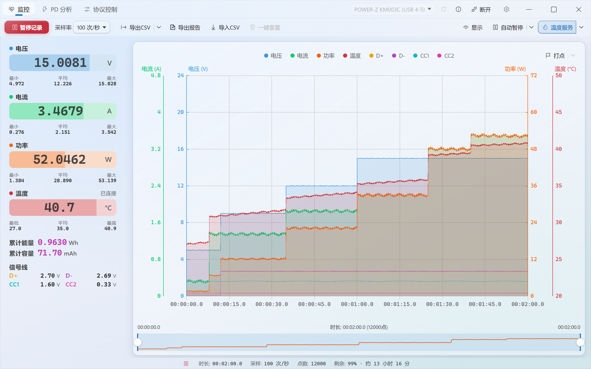 **监控** · 实时读数卡 / 8 通道 4 轴图表 / 时间线导航器 | 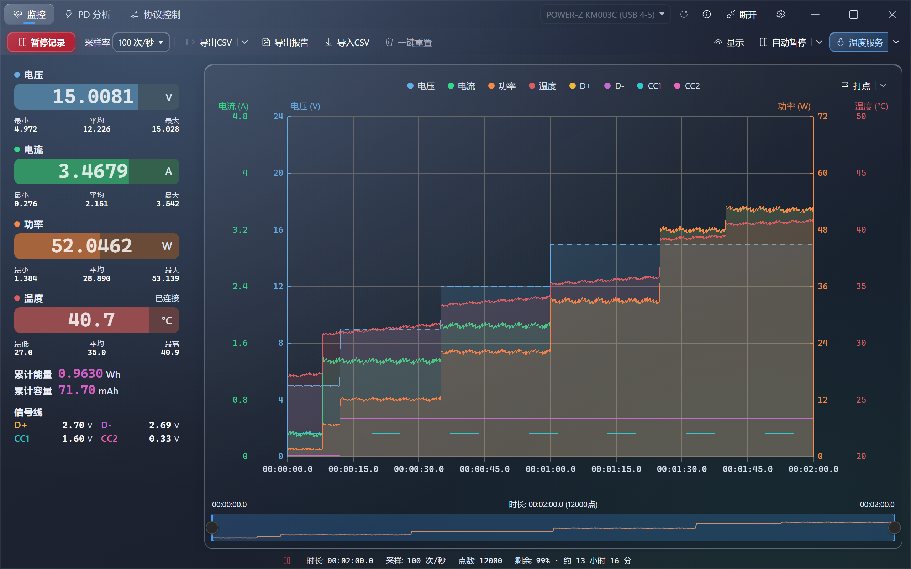 **监控** · 深色主题 |
| 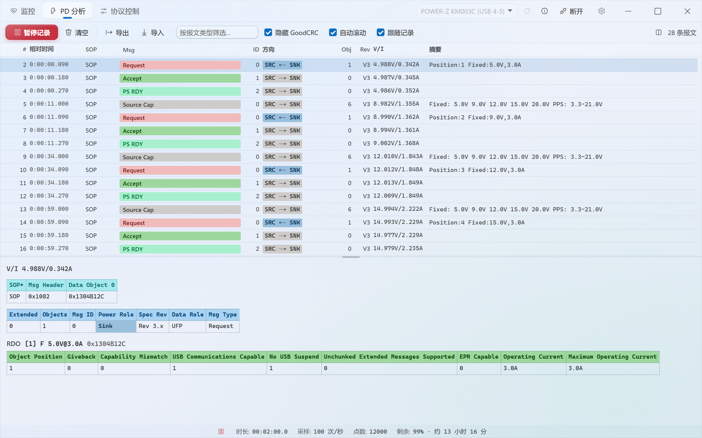 **PD 分析** · 报文列表 / PDO 速览 / 逐字段解码 | 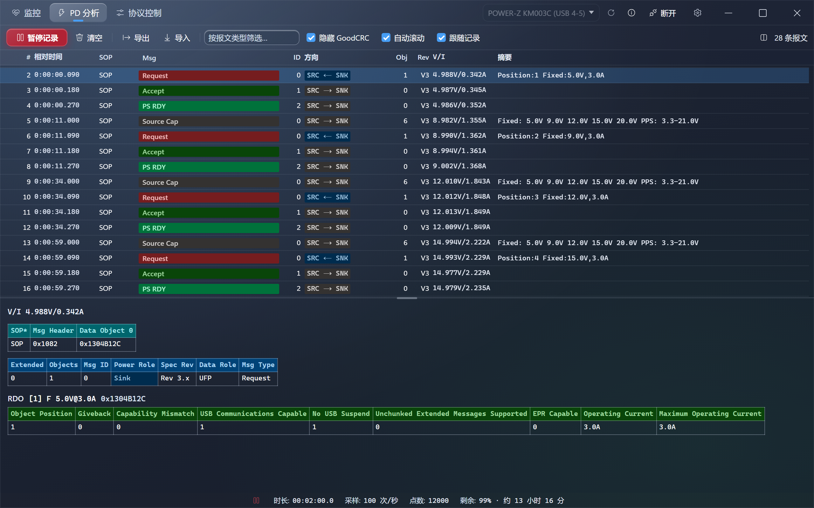 **PD 分析** · 深色主题 |
| 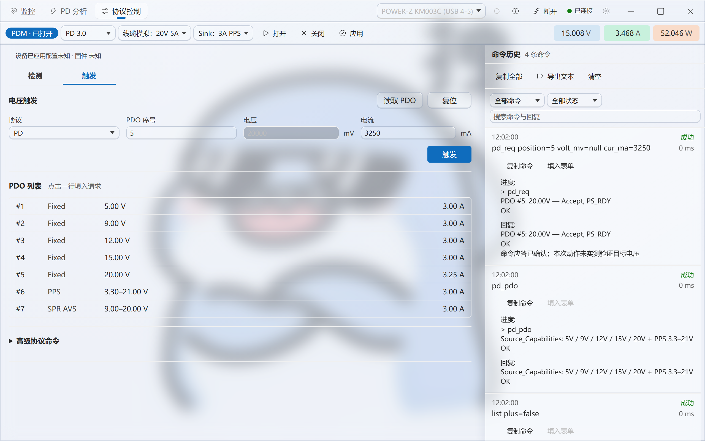 **协议控制** · PDM / PDO / 协议检测与电压触发 | 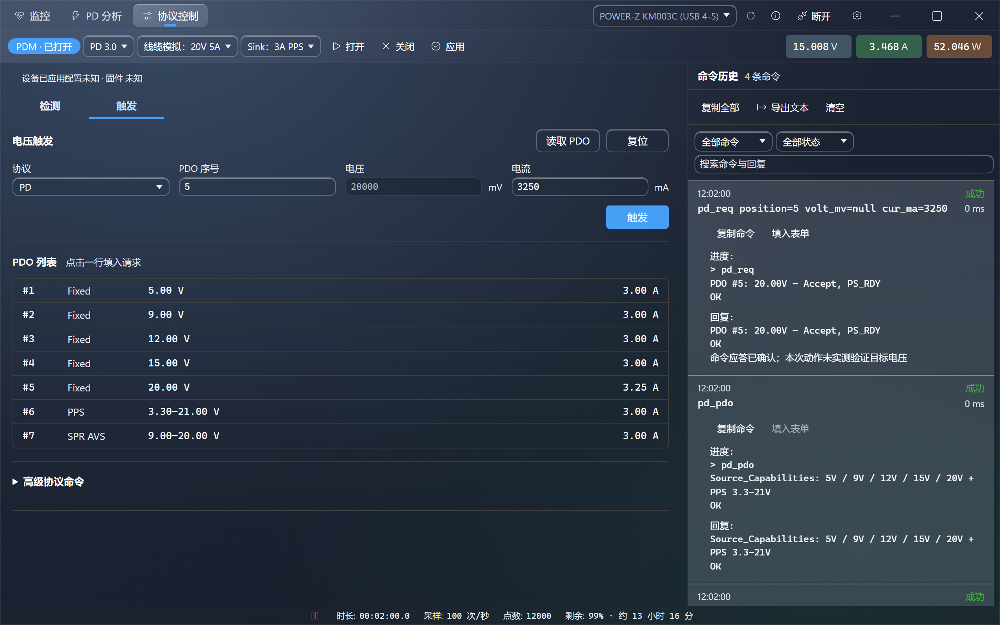 **协议控制** · 深色主题 |
| 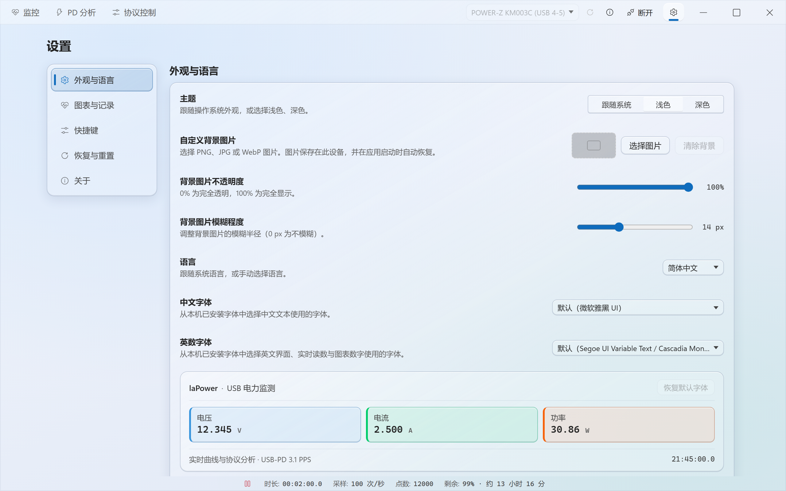 **设置** · 主题 / 持久化自定义背景 / 语言 / 图表与记录 | 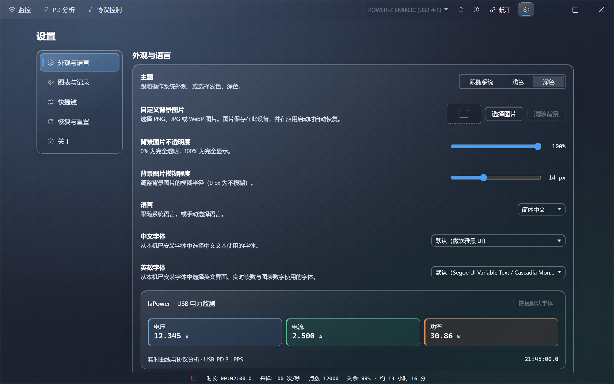 **设置** · 深色主题 |
| 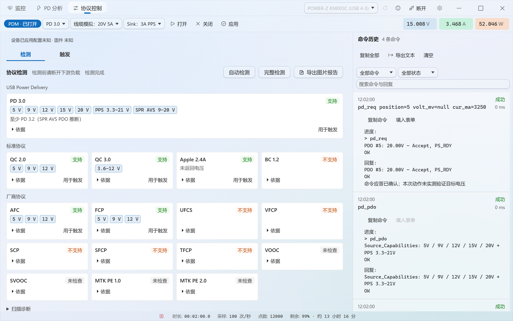 **协议检测** · 逐协议状态 / 电压档位 / 独立依据 | 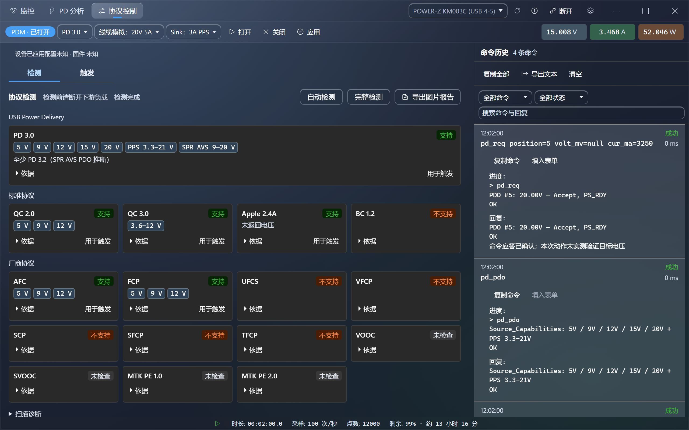 **协议检测** · 深色主题 |

### 报告样式

以下展示同一 120 秒模拟记录实际渲染的导出报告效果；16:9 横图与视频保留前 8 个打点，长图保留全部 12 个打点（视频取中间帧）。

| 浅色主题 | 深色主题 |
| :---: | :---: |
| 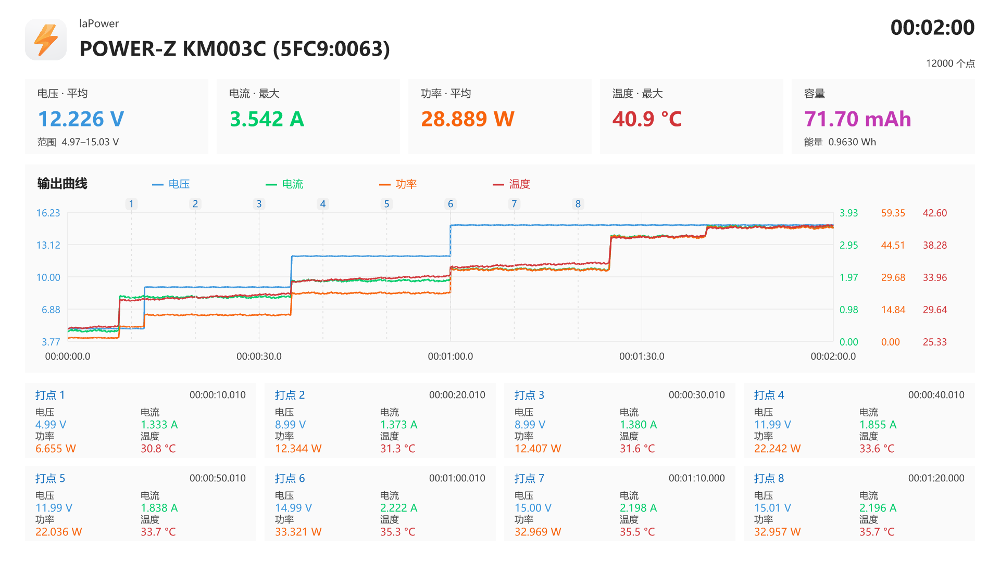 **图片报告（16:9）** · 无损 PNG / 完整曲线 / 统计与打点 |  **图片报告（16:9）** · 深色主题 |
|  **图片报告（长图）** · 全部 12 个打点 / 时间与逐项读数 |  **图片报告（长图）** · 深色主题 |
| 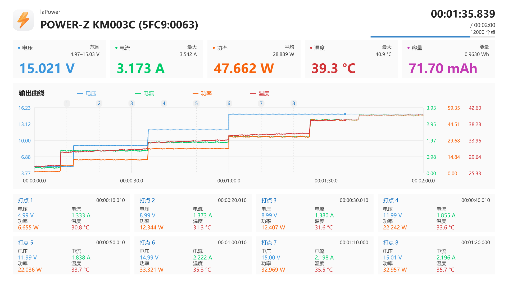 **视频报告画面** · 视频中间帧 / 动态读数 / 播放光标 |  **视频报告画面** · 深色主题 |
| 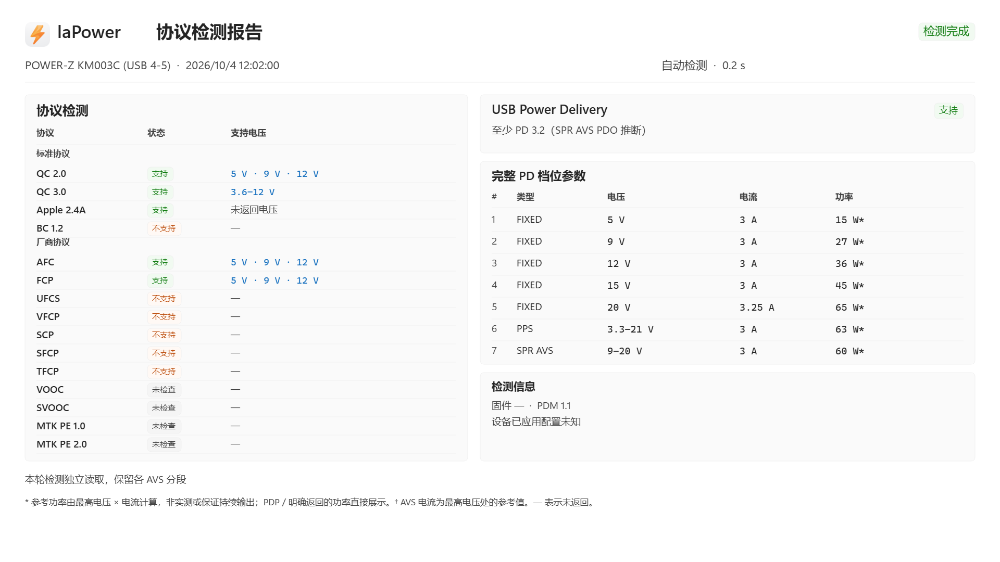 **协议检测报告** · 协议状态与电压 / PD 版本 / 完整 PDO | 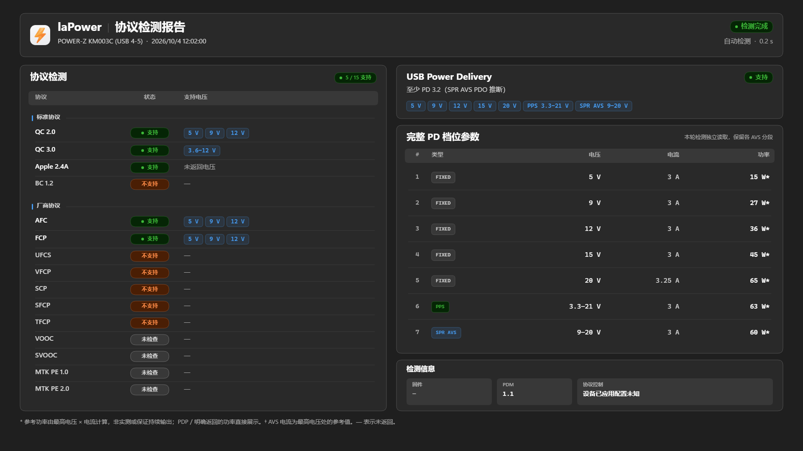 **协议检测报告** · 深色主题 |

## ✨ 功能特性

### 实时监控

- 电压、电流、功率与温度读数卡均附带最小值、最大值与平均值。
- **累计能量 (Wh) 与累计容量 (mAh)** 由软件基于采样点积分计算，并自动过滤休眠或系统时间跳变（超过 8 倍采样间隔且至少 2 秒）带来的异常时间增量。
- **信号线电压** D+ / D− / CC1 / CC2 可叠加绘图并随 CSV 导出（分辨率取决于仪表，WITRN 的 CC1 / CC2 为 0.1 V）。
- 可选**记录电流方向**，开启后保留正负符号（正向为正、反向为负，K2 原生支持 ±10 A），侧栏同步显示方向箭头。
- **自动暂停**：电压、电流或功率持续低于阈值达设定秒数后自动暂停，适用于无人值守充放电测试。
- **POWER-Z 高速采样**：KM003C / KM002C 支持经认证的 AdcQueue 1000 次/秒采样；认证失败自动回退至 100 次/秒。
- **崩溃恢复与容量上限**：记录按秒写入应用缓存临时文件（正常退出自动清理），单次记录默认上限 512 MB 并在达限时自动暂停；长期保存请显式导出 CSV。

### USB-PD 协议分析

- 解码 SOP / SOP′ 控制报文、数据报文、扩展报文及 Hard Reset / Cable Reset。
- 报文列表提供角色方向徽章（`SRC → SNK`、`SRC|SNK → Plug`）与 **PDO / RDO 速览**，如 `Fixed: 5.0V 9.0V 12.0V 15.0V 20.0V SPR AVS: 9-15V@3.0A PPS: 5.0-21.0V` 或 `Position:7 PPS:8.0V,3.45A`。
- 详情面板**逐字展开帧结构**：原始 Data Object 十六进制 → 报文头字段 → 各 PDO 完整位域表。
- 支持按消息类型筛选并一键隐藏 GoodCRC 链路确认帧（通常占总报文半数以上）。
- **跟随记录**模式让 PD 抓包与主监控联动启停及清空；配合虚拟列表可在数十万条报文规模下保持流畅滚动。

### 高性能图表

- 基于 uPlot 与 Canvas 2D / `OffscreenCanvas` 增量像素桶渲染管线，支持 **8 条曲线与 4 条严格共线量化 Y 轴**（电流 A、电压 V、功率 W、温度 °C）及两级密集子网格。
- 密集波形自动切换增量 min/max 像素桶与局部脏矩形重绘，**百万点仍可流畅拖动**；完整数据保留在分块列式存储中，回看保留画布像素级细节，放大还原原始点，悬停通过二分查找读取真实样本。
- 主图与底部时间线导航器均支持滚轮横向缩放、拖动平移及录制中的实时跟随；1000 次/秒采样时自动绘图保持在 10–20 fps，缩放与交互独立刷新并复用历史极值索引（详见 [性能说明](docs/PERFORMANCE.md#测量与硬件边界)）。
- 悬停 tooltip 显示当前启用的有效通道，可在 `显示` 面板独立调节各通道显隐、曲线阴影（默认开启且状态持久化）、填充不透明度（0–100%）、线条颜色、线宽及纵向偏移（仅改变显示投影）。

### 数据记录与互通

- **图片与视频报告**：将整段记录导出为 16:9 / 长图无损 PNG 或 MP4/MOV 短视频（可选分辨率、主题、曲线及打点），无需安装 ffmpeg。
- **POWER-Z 协议检测与报告**：查看各协议支持状态、电压档位与原始依据，独立读取 PD PDO 与版本，可导出 1080p–4K PNG 报告或一键填入触发表单。
- **CSV 导出与导入**：支持分别勾选温度、设备信息与打点，支持同时导出 CSV 与 PD JSON；导入按列名匹配并兼容历史文件。
- **打点标注**：按 `M` 或点击 `打点` 标记当前时刻（悬停图表时标记光标对应点），标签随 CSV 的 `Marker` 列保存与恢复。
- **采样率与 PD 捕获**：支持 0.1–100 次/秒（POWER-Z 额外支持 1000 次/秒，后端按设备限制接收 1–60000 ms）；PD 捕获采用带版本号的 JSON 格式并兼容旧版导入。

### 界面

- 多 Tab 工作区（监控 / PD 分析 / 协议控制 / 设置），设备连接栏常驻标题栏便于随时连断；协议控制入口常驻，连接支持的 POWER-Z 后启用操作。
- 支持**跟随系统 / 浅色 / 深色**主题，采用对齐 Fluent UI 的磨砂玻璃表面与过渡动效，并可选持久化**自定义本地背景图片**（PNG / JPEG / WebP，不内置壁纸）以及不透明度与模糊程度调节。
- 支持**简体中文、繁體中文、English、日本語**四语实时切换（不中断连接、记录与图表状态），默认自动检测系统语言（规则见 [语言选择](docs/DEVELOPMENT.md#语言选择)）。
- 支持 **50–200% 界面缩放**；macOS 采用原生窗口按钮，Windows 保留 Win11 贴靠布局支持，Windows / Linux 使用右侧窗口控制按钮。

## 📱 支持的设备

| 型号 | VID | PID |
| --- | --- | --- |
| WITRN K2 | `0x0716` | `0x5060` |
| WITRN U3 | `0x0716` | `0x5063`、`0x5044` |
| WITRN C5 | `0x0716` | `0x5053`、`0x5064` |
| POWER-Z KM003C | `0x5FC9` | `0x0063` |
| POWER-Z KM002C | `0x5FC9` | `0x0061` |

维简设备按 VID `0x0716` 枚举，未列出的型号或固件变体也会显示在列表中（标注为「未知 WITRN 设备 (0716:XXXX)」），报告格式兼容即可读取；POWER-Z 通过 `0x5FC9` Vendor Bulk 接口枚举。同一设备存在多个 HID 接口时优先选用厂商自定义 Usage Page，设备名自动附带 USB 拓扑端口（如 `WITRN K2 (USB 4-4)`）。

## 📦 下载与安装

本项目原名 WITRN-RS；laPower 使用独立应用标识 `io.github.khwlgh.lapower` 与配置/缓存目录，不自动迁移旧版设置，原有 CSV 与 PD 捕获文件仍可直接导入。

- **Windows 10 / 11 (x64)**：在 [Releases](https://github.com/KHWLGH/laPower/releases/latest) 下载 `.msi`、`.exe`（NSIS）安装包或免安装便携版 `*_windows-x64_portable.zip`（需系统已安装 Microsoft Edge WebView2 Runtime，解压运行 `laPower.exe`）。通常无需额外安装驱动；未签名安装包首次运行可能触发 SmartScreen 提示。
- **macOS 12+**：Intel Mac 下载 `macos-x64` `.dmg`，Apple Silicon（M1 及以后）下载 `macos-arm64` `.dmg`，将 `laPower.app` 拖入 Applications。构建采用 ad-hoc 签名，首次被 Gatekeeper 拦截时请在「系统设置 → 隐私与安全性」中允许打开；旧系统兼容性与编译说明见 [macOS 自行编译](docs/DEVELOPMENT.md#macos-自行编译)。
- **Linux (x64)**：下载 `linux-x64` `.deb`（`sudo apt install ./laPower_<版本>_linux-x64.deb`）、`.rpm`（`sudo dnf install ./laPower_<版本>_linux-x64.rpm`）或 `.AppImage`（`chmod +x` 后运行，可能需要 FUSE 2）。连接仪表前须先配置 [udev 规则](docs/DEVELOPMENT.md#udev-规则必需)。发布页 `SHA256SUMS` 可校验全部八个产物。

## 🚀 快速上手

1. **连接设备**：插入仪表后点击标题栏刷新图标，选择设备并点击 `连接`。
2. **开始记录**：在「监控」Tab 点击 `开始记录`（快捷键 `P`），实时曲线与能量/容量积分同步开始（暂停不计入）。
3. **抓 PD 报文**：切至「PD 分析」Tab（默认开启 `跟随记录` 与主监控同步）；插拔充电器即可捕获完整握手协商过程。
4. **打点与导出**：按 `M` 或点击 `打点` 标注关键节点；通过 `导出CSV`（右侧箭头可配置温度、设备信息、打点及 CSV/PD 联合导出）或 `导出报告` 生成文件。

完整界面操作、全部设置项与文件格式详见 [使用指南](docs/USAGE.md)。

## 📚 文档

| 文档 | 内容 |
| --- | --- |
| [使用指南](docs/USAGE.md) | 界面逐项说明、全部设置项、CSV 与 PD 捕获文件格式、常见问题 |
| [技术架构](docs/ARCHITECTURE.md) | 线程模型、Tauri 命令、数据流、HID 报文布局、测试与安全边界 |
| [开发与构建](docs/DEVELOPMENT.md) | 环境要求、构建命令、CI 门禁、Linux / macOS 自行编译、外部温度服务、参与贡献 |
| [性能基准与边界](docs/PERFORMANCE.md) | 图表调度、数据完整性、性能测量与硬件边界 |
| [更新日志](CHANGELOG.md) | 版本索引、中英双语发布说明与早期中文归档 |

## 🙏 致谢与相关项目

- 感谢 WITRN、POWER-Z 提供的 USB-PD 采集硬件支持。
- 感谢 [JohnScotttt](https://github.com/JohnScotttt) 的 WITRN HID 与 USB-PD 解析上游实现（`witrnhid`、`usbpdparser`）。
- 感谢 [km003c-protocol-research](https://github.com/okhsunrog/km003c-protocol-research) 对 POWER-Z Bulk、认证与 AdcQueue 协议的公开研究。
- 感谢 [c-power](https://github.com/bruno-ntmr/c-power) 项目，协议检测界面的信息组织与交互设计参考了该项目。
- 感谢贡献者 [weixunkkkkk](https://github.com/weixunkkkkk)（#1）：新增 macOS Apple Silicon（ARM64）构建支持与 macOS 窗口配置。
- 感谢贡献者 [asdmoment](https://github.com/asdmoment)（#4–#9）：实现 macOS 后台采集保活与防休眠、原生窗口控制与菜单栏设置入口、WITRN HID 积压报告排空与时间戳回推、降采样窗口均值聚合、记录打点标注及 CSV 数据来源元信息。
- 感谢贡献者 [xiaokangzaina](https://github.com/xiaokangzaina)（#11）：实现磨砂玻璃界面与持久化自定义背景、主图与时间线滚轮缩放／拖拽平移及分通道显示微调、Canvas 2D 像素桶局部重绘优化、KM003C 轮询瞬时采样及 Windows 免安装便携包。

### 协议库

工作区内的协议 crate 为独立 Rust 库（`publish = false`），不依赖 Tauri：

- **`crates/witrn-hid`** —— WITRN HID 设备封装与测量帧解析。
- **`crates/usbpd-parser`** —— USB-PD 报文解码与字段树。
- **`crates/km003c`** —— POWER-Z Vendor Bulk、AES 认证、AdcQueue 与 CDC 控制。

## 📄 许可证

Copyright (C) 2026 KHWLGH

上述版权行仅覆盖 KHWLGH 的自有贡献；其他作者保留各自权利，不因 Git 提交记录推定版权转让。完整范围、生成物及上游声明见 [`COPYRIGHT`](COPYRIGHT)。

| 自有贡献范围（排除第三方材料） | 许可证 |
| --- | --- |
| 应用 `src/`、`src-tauri/`；`scripts/`、`tools/`、`test/`、`bench/`、`temperature-example/`、`.github/`；项目文档与配置的自有部分 | [GPL-3.0-only](LICENSE) |
| `crates/` 下所有库、测试、例子及其自有文档与配置 | [LGPL-3.0-or-later](LICENSE.LGPL-3.0) |

`usbpd-parser` 与 `witrn-hid` 分别移植自 JohnScotttt 的 Python 包 usbpdparser 1.1.6 与 witrnhid 1.1.5（均声明 `Copyright (c) 2025 JohnScotttt`、LGPL-3.0-or-later）。本地许可全文见 [`LICENSE`](LICENSE)（GPLv3）与 [`LICENSE.LGPL-3.0`](LICENSE.LGPL-3.0)（LGPLv3），软件不提供担保。可在应用内 `设置 → 关于` 离线查阅项目版权、GPL/LGPL 全文及全部第三方运行组件许可。

## 🔗 相关链接

- [提交 Issue 或建议](https://github.com/KHWLGH/laPower/issues)
- [维简 (WITRN) 官方网站](https://www.witrn.com/)
- [Tauri 官方文档](https://tauri.app/)
- [Rust 官方网站](https://www.rust-lang.org/)
