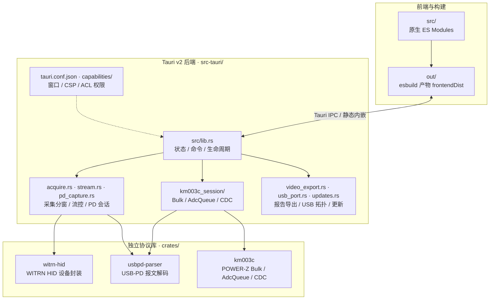
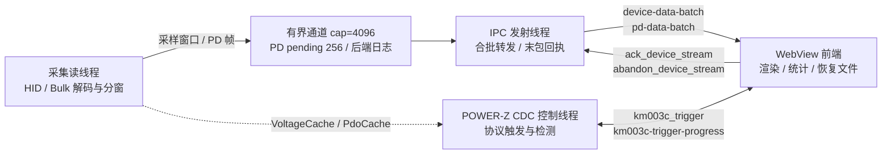
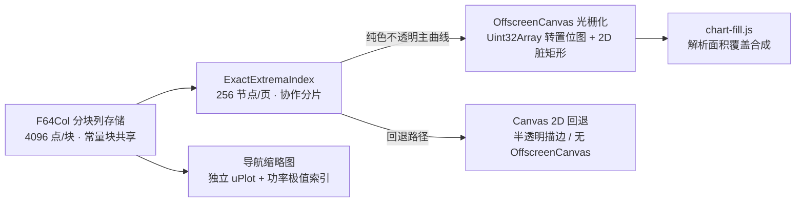
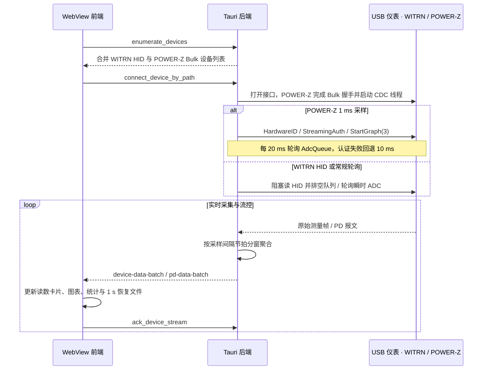

[English](en/ARCHITECTURE.md) | **简体中文**

← 返回 [README](../README.zh-CN.md)

# 技术架构

本文描述 laPower 的内部架构。操作说明见 [使用指南](USAGE.md)，构建与开发流程见 [开发与构建](DEVELOPMENT.md)。

- [仓库布局](#仓库布局)
- [后端](#后端)
- [协议库](#协议库)
- [前端](#前端)
- [数据流](#数据流)
- [HID 报文布局](#hid-报文布局)
- [测试](#测试)
- [安全边界](#安全边界)

## 仓库布局

Cargo workspace 包含四个成员 crate 与原生 JavaScript 前端源码目录；发布构建由 esbuild 生成 `out/`。

| 路径 | 职责 |
| --- | --- |
| `src-tauri/src/lib.rs` | 应用状态、Tauri 命令注册与生命周期管理 |
| `src-tauri/src/acquire.rs` | 采集循环、节拍网格分窗与时间戳回推 |
| `src-tauri/src/stream.rs` | 流会话管理、有界通道、背压与末包回执 |
| `src-tauri/src/pd_capture.rs` | USB-PD 捕获会话（`seq` / `generation` / 按需解码） |
| `src-tauri/src/km003c_session/` | POWER-Z Bulk / AdcQueue 与 CDC 控制会话 |
| `src-tauri/src/video_export.rs` | 静态图片与视频报告导出及其平台渲染编码子模块 |
| `src-tauri/src/usb_port.rs` | 分平台 USB 拓扑端口解析 |
| `src-tauri/src/updates.rs` | 手动 GitHub 更新检查与受限浏览器跳转 |
| `src-tauri/capabilities/` | Tauri ACL 能力声明 |
| `src-tauri/tauri.conf.json` | 窗口、CSP 与打包配置 |
| `crates/usbpd-parser/` | USB-PD 报文解码库 |
| `crates/km003c/` | POWER-Z Bulk 协议、AdcQueue、CDC 与协议检测 |
| `crates/witrn-hid/` | WITRN HID 设备封装 |
| `src/` | 前端源码（原生 ES Modules） |
| `out/` | 构建产物 `frontendDist`（不入库） |
| `tools/showcase/` | 虚拟设备与截图开发工具（不随应用发货） |
| `test/` | 前端核心测试（`node --test`） |
| `bench/` | 算法、存储、内存与渲染基准 |
| `temperature-example/` | 外部温度服务 Python 示例 |
| `docs/` | 文档目录 |

根目录 `Cargo.toml` 统一管理 `version`、`edition = 2021`、`rust-version = 1.85` 及公共依赖（`serde`、`serde_json`、`hidapi 2.6`、`chrono 0.4`）。

## 后端

### `src-tauri/src/lib.rs`

承载应用状态、设备命令与模块命令注册，共享状态仅在必要处加锁：

- `sample_rate: Arc<AtomicU64>` —— 采集读循环每次迭代均读取采样率，使用原子量避免每帧加锁。
- 其余共享状态使用 `Arc<Mutex<...>>`。

### 线程模型

每个设备连接拥有读线程与 IPC 发射线程；POWER-Z 额外拥有独立 CDC 协议控制线程：

- **采集读线程**：WITRN 阻塞读 HID 报告后再非阻塞排空主机队列；POWER-Z 读取 Vendor Bulk / AdcQueue（非队列轮询路径使用 `vbus_instant_v()` 与 `ibus_instant_a()` 瞬时字段并计算 `voltage × current`）。解码后按采样间隔节拍分窗求平均（电压、电流、功率、D+/D− 取窗口均值，同时保留逐帧电流幅值均值；时间、CC 与温度取窗口末帧），写入容量 4096 的有界通道。PD 事件在通道满时进入最多 256 条的 pending，完整报文保留在后端日志。未确认测量样本达 8192 时停止采集并报错。
- **IPC 发射线程**：在队列为空时阻塞等待，首条消息到达后启动合批期限，分别发出 `device-data-batch`（最多 64 点或 `clamp(4 × 采样间隔, 8 ms, 50 ms)`）与 `pd-data-batch`。前端消费后通过 `ack_device_stream` 确认；停止时排空残留并发出末包回执与断开事件。
- **macOS 后台保活与时间戳回推**：WKWebView 不可见时配置 `backgroundThrottling: "disabled"`（macOS 14+）；读线程存活期间持有 `NSProcessInfo` `LatencyCritical` activity（`src-tauri/src/app_nap.rs`）退出 App Nap，非零录制段切换为同时阻止系统空闲睡眠的 activity（先开新后关旧）。迟醒积压的 WITRN 报告由 `HidSource` 排空并经 `acquire::stamp_drained` 按设备节拍（≤ 10 ms）均匀回推时间戳；录制段与采样率切换先经 `HidSource::barrier` 排空并 `seal_boundary`。
- **有序停止与终态退休**：`BackgroundTask::stop()` 严格执行**先生产者、后消费者**停止；`shutdown` 为 `#[tauri::command(async)]` 以免主线程死锁，停完线程后 `destroy` 主窗口（避免 `close()` 重派发退出回环）。当流因空洞、背压或屏障超时进入终态并停止生产者后，前端改走 `abandon_device_stream` 退休已 join 会话而不伪造 `consumed` ACK，使断开、重连与退出重新可达。

### Tauri 命令

| 命令 | 作用 |
| --- | --- |
| `enumerate_devices` | 合并 WITRN HID 与 POWER-Z Vendor Bulk 设备枚举 |
| `connect_device_by_path` | 按设备路径连接 WITRN HID 或 POWER-Z Bulk |
| `disconnect_device` | 断开连接并停止对应后台线程 |
| `get_current_device_info` | 返回当前连接设备信息 |
| `set_sample_rate` | 设置采样间隔（1–60000 ms，按设备下限钳制） |
| `set_pd_capture_enabled` | 开关 PD 报文采集 |
| `pd_log_clear` / `pd_log_after` / `pd_log_import` / `pd_log_import_page` / `decode_pd_at` | PD 日志清空、分页补洞（≤ 512 条/页）、受控文件流式导入与 O(1) 详情查询 |
| `drain_device_stream` / `ack_device_stream` / `set_recording_segment` / `abandon_device_stream` | 流停止排空、消费确认、录制段边界与终态会话退休 |
| `connect_temp_service` / `disconnect_temp_service` | 外部 TCP 温度源连接管理 |
| `check_for_updates` / `open_project_page` | 手动请求 GitHub Releases（10 s 超时）与受限仓库页面跳转 |
| `shutdown` | 停止全部后台线程并销毁主窗口 |
| `km003c_trigger` / `km003c_cancel_trigger` | 执行或取消 POWER-Z 协议控制与检测命令 |
| `choose_custom_background` / `load_custom_background` / `clear_custom_background` | 本地自定义背景图片选择、加载与清除 |
| `csv_export_pick` / `pd_export_pick` / `text_export_pick` / `png_export_pick` / `paired_export_pick` / `csv_import_pick` / `pd_import_pick` | 选择文件并签发受控后端读写句柄（CSV/PD/文本日志/协议检测 PNG） |
| `video_export_capability` / `video_export_pick` / `video_export_start` / `video_export_status` / `video_export_current` / `video_export_cancel` | 报告图片/视频导出探测、一次性目标 ticket、后台单槽任务控制与进度查询 |

### `src-tauri/src/pd_capture.rs`

PD 日志为只追加 `Vec`，**`seq` 即报文下标**。捕获时即保留原始帧与上下文解码树，供 `decode_pd_at` 校验 `generation` 后 O(1) 查询（前端仅缓存最多 8 条已取得树；旧版导入保留自带 `meta`）。

- 清空或导入替换递增 `generation`，使旧补洞分页与详情请求失效；断开分隔行保留前端顺序而不占 `seq`。
- 前端仅推进连续消费游标，跳号时由单后台分页循环按固定 `throughSeq` 每次持锁克隆最多 512 条追赶。
- 硬上限 `PD_LOG_HARD_CAP = 1_000_000`，前端软上限 `PD_SOFT_CAP = 500_000` 弹出提示。

### `src-tauri/src/temperature_reader.rs`

TCP 温度线程每次读取固定 1024 字节并进入 256 字节行缓冲增量解析（含 CRLF）：超长行丢弃至下一换行，半行跨 250 ms 读超时续接；空闲超时保持连接，EOF 或读取错误触发断开通知。

### `src-tauri/src/usb_port.rs`

解析物理 USB 拓扑端口（如 `4-4`）以区分共享批号序列号的同型号仪表：Windows 使用 `CM_Get_DevNode_PropertyW` + `DEVPKEY_Device_LocationPaths`；Linux 只读遍历 `/sys/class/hidraw/<name>/device` 的 `devpath`（无需特权）；macOS 非独占读取 `get_location_id`。

### `src/protocol-report*.js`

协议检测图片报告在独立前端模块中以 1920×1080 逻辑 Canvas 绘制（从随包 CSS design tokens 解析当前选择主题），打开对话框即深拷贝本轮快照；`DetectionReport.pdos` 仅含本轮独立读取的 PDO（保留 SPR AVS 分段，`TriggerPdo.max_power_mw` 区分实报功率与参考计算），经 `png_export_pick` 受控暂存写盘。选项独立存于 `protocolReportExport`。

### `src-tauri/src/video_export.rs`

监控命令栏“导出报告”统一 PNG 图片与短视频导出，共享冻结载荷、单后台任务槽（`lapower-video`）、原生 `video_export_pick` 一次性 ticket（路径留在后端，写同目录隐藏暂存文件并在完成后原子替换）、500 ms 进度轮询及 `shutdown` 最长 2 秒取消等待：

- **前端冻结与投影**：`src/video-export.js` 冻结列快照，纯函数模块 `src/video-projection.js` 分片投影最多 256 桶 × 10 点（首尾与四通道极值，上限 2560 点）、视频逐帧读数与最多 8 个打点（长图保留全部打点并按详情行增高，后端对尺寸与总像素做安全上限校验）；`src/video-export-options.js` 与 `src/video-palette.js` 提供选项白名单、帧数公式与主题色板。
- **跨平台绘制与编码**：`model.rs` 校验载荷；`scene.rs` 按 1920×1080 逻辑布局通过 `Painter` 抽象分发至 Windows `windows.rs`（Direct2D / DirectWrite / WIC）或 macOS / Linux `skia.rs`（tiny-skia + 系统字体）。PNG 直接保存无损图像，绕过视频探测器。
- **视频码率与编码策略**：`VideoOptions::bitrate()` 按像素数与帧率线性缩放（1080p30 下 H.264 为 10 / 20 / 30 Mbps、HEVC 为 65%，下限 4 / 3 Mbps、上限 240 Mbps），空间预检留足 125% + 64 MiB。探测与编码共用 `acceleration`（auto / hardware / software）与 `quality`（standard / high / ultra）缓存：`windows` 自动模式依次尝试 `gpu.rs`（DXGI + `ID3D11VideoProcessor` BT.709 NV12 硬编）、WIC + CPU NV12 硬件变换与纯软件编码（MOV 由 `mov.rs` 原地改写）；`apple.rs` 使用 VideoToolbox（核验真实硬件标志，软件 H.264 可用内置编码器）；Linux 由 `software.rs`（内置 OpenH264）提供软件 H.264，`mp4.rs` 直接输出 MP4 / MOV。

## 协议库

工作区内置三个独立协议 crate（`publish = false`，不依赖 Tauri），`usbpd-parser` 与 `witrn-hid` 源于退役的 `WITRN-API-RS`（最后导入 `30c4bdb`），随应用共享 `workspace.package.version` 并采用 LGPL-3.0-or-later（来源与范围见 [`COPYRIGHT`](../COPYRIGHT)）。

### `crates/usbpd-parser`

拆分为 `header`、`data_msg`、`ext_msg`、`pdo`、`rdo`、`vdo`、`crc`、`context`、`render`，覆盖控制/数据/扩展报文、Hard/Cable Reset 与 Structured VDM 2.1，输出带位范围和渲染文本的字段树；默认开启 `vendor-ids`（内嵌 13,542 条 USB-IF 厂商表）与 `serde`。

### `crates/witrn-hid`

`device.rs` 封装设备打开与读取，`general.rs` 解码测量帧为 `GeneralSample`（`voltage`、`current`、`power = voltage × current`、`dp`/`dn`、`cc1`/`cc2`、`temperature: Option<f32>`、`ah`/`wh` 仪表累加器）。

### `crates/km003c`

Interface 0 Vendor Bulk 与 CDC 串口控制：`protocol::auth`（AES-128-ECB）、`protocol::queue`（20 字节 AdcQueue）、`transport::bulk`（连接、认证、StartGraph/StopGraph）、`trigger`（CDC 命令）及 `detection`（有时限可取消的扫描/回退/补探状态机，普通/完整预算 240/420 秒，正常结束或取消后 15 秒内复位并验证 5 V）。

- `TriggerSession::run_with_detection` 通过 `km003c-trigger-progress` 推送绑定 `generation` 与 `req_id` 的快照；协议能力项区分 PD 与 UFCS（保留 `NUM` 编号），`VoltageCache` 仅由唯一 Bulk 采集线程写入并用 5 个新鲜样本中位数按 `max(200 mV, 3%)` 校验（500 ms 稳定期、最长 12 秒）。
- 检测忽略列表扫描中的 PD 状态，独立执行 `reset → entry pd → pd pdo`；PD 版本优先采用完整非扩展 `Get_Revision` 帧，其次为扫描明确声明的 PD 3.0/3.1/3.2，最后为结构化 PDO 下限（PPS ≥ 3.0、EPR ≥ 3.1、SPR AVS ≥ 3.2）。

> 前端显示的累计能量（Wh）与容量（mAh）**不使用仪表自带累加器**，而是基于样本幅值积分（跳过 `max(2 s, 8 × 标称间隔)` 以上空档），以支持暂停排除、选区统计与一键归零。

## 前端

`src/` 为前端 ES Modules 源码，`frontendDist` 指向 `out/`（未配置 `devUrl`，改动后须重建前端并重连后端；`withGlobalTauri: true`，类型声明位于 `src/global.d.ts`，模块开启 `// @ts-check`）。关于页图标在构建时由 `src-tauri/icons/128x128@2x.png` 复制至 `out/assets/app-icon.png`；组件清单与许可阅读器按需读取 `src/third-party-components.json` 与 `src/legal-notices.json`。

| 分组 | 模块 | 职责 |
| --- | --- | --- |
| 装配与基础 | `app.js`、`shell.js`、`state.js`、`utils.js`、`dropdown.js`、`event-listeners.js`、`boot-timing.js` | 应用装配、Tab 路由、共享状态/类型与冷启动打点 |
| 国际化 | `i18n.js`、`i18n-messages.js` | 四语词典、locale 解析与无刷新切换订阅 |
| 图表 | `chart.js`、`chart-axes.js`、`chart-buckets.js`、`chart-extrema.js`、`chart-fill.js`、`chart-pacing.js`、`chart-plugins.js`、`chart-raster.js`、`chart-window.js`、`performance-diagnostics.js`、`theme.js` | uPlot 调度、坐标轴量化与绘制、像素桶与 `OffscreenCanvas` 栅格化、极值索引、解析填充、交互插件、帧压反馈、时间窗与诊断 |
| 数据与文件 | `data.js`、`data-display.js`、`data-range-ui.js`、`measurement.js`、`provenance.js`、`device-stream.js`、`recording-spool.js`、`recording-recovery.js`、`recording-limit.js`、`file-io.js`、`cooperative.js` | 采集、读数展示与时间窗 UI、纯函数积分、来源记录、流控制、按秒恢复文件、容量上限、分块文件句柄与协作调度 |
| 导出与报告 | `csv.js`、`csv-codec.js`、`csv-export.js`、`csv-export-worker.js`、`csv-import-core.js`、`csv-import-worker.js`、`export-options.js`、`export-session.js`、`export-ui.js`、`paired-export.js`、`range-stats*.js`、`video-export*.js`、`video-palette.js`、`video-projection.js`、`protocol-report*.js` | CSV/PD/联合导出、分块 Worker、统计 Worker、报告冻结与协作投影、协议图片报告 |
| 打点与快捷键 | `markers.js`、`marker-ui.js`、`shortcuts-core.js`、`shortcuts.js`、`shortcut-hints.js` | 数据集标记管理（纯函数）与全局快捷键绑定 |
| PD 与协议控制 | `pd-model.js`、`pd-export*.js`、`views/pd.js`、`views/pd-list.js`、`views/pd-transfer.js`、`km003c-model.js`、`views/trigger.js`、`views/trigger-detection.js`、`views/trigger-history.js` | PD 摘要/过滤/列表/导入导出、KM003C 模型与触发/检测/历史视图 |
| 设备与温度 | `device.js`、`temperature.js` | 设备连接生命周期、信息浮层与 TCP 温度状态 |
| 设置、外观与关于 | `settings.js`、`views/settings-view.js`、`custom-background.js`、`ui-scale.js`、`theme-boot.js`、`views/about-view.js` | 持久化设置、自定义本地壁纸、50–200% 缩放、首帧主题、组件清单与更新检查 |
| 界面原语 | `ui/` | `dialog` `toast` `menu` `flyout` `tabbar` `controlbar` `display-stepper` `windowcontrols` |
| 样式与依赖 | `styles/`、`vendor/` | `tokens` → `base` → `components` → `app` → `views` → `compact` → `glass`；内置 uPlot 与 Store shim |

`measurement.js`、`pd-model.js`、`chart-window.js`、`markers.js`、`km003c-model.js` 等纯函数模块不接触 DOM 与 Tauri，可在 Node 直接单测。窗口均值同时保存有符号净电流与逐帧电流幅值（`CurrentMagnitude(A)`），使双向充放电曲线显示净方向的同时，功率与 mAh 积分始终按幅值一致计算。

### 协议控制前端投影

- PD 版本展示同时校验 `pd_version_inference` 与独立读取的 `voltages`，取能力证明的较高下限，冲突时保留低 `Get_Revision` 响应并给出警告。
- 后端控制线程每条命令保留最多 256 KiB UTF-8 过程（按完整行淘汰）并在最终结果返回 `transcript`，前端历史上限 64,000 字符按命令 ID 复用 DOM 节点且不按文本去重，保持重复握手与状态时序。

### 图表渲染

- **分块列存储**：`F64Col` 按 4096 点分块，完整常量块在列内共享最近相同常量块（`Object.is` 区分正负零并保留缺失值），尾块独占缓冲，历史修改按块写时复制。
- **增量极值与协作切片**：`ExactExtremaIndex`（每页 256 节点保存 8 通道极值下标，24 KiB/页）复用已完成前缀，窗口缩短或回看无需全量扫描；已索引投影按每步 32 桶查询并先在 ~4 ms 内尝试完成，其余工作与冷建按 ~1.5 ms 协作分片。
- **Canvas 2D / `OffscreenCanvas` 管线**：密集主图在具备 `OffscreenCanvas` 且主曲线为纯色不透明描边时，把各通道有序极值段按设备像素列光栅化至转置位图（`Uint32Array`），跟踪二维脏矩形边界实现局部 `putImageData` / `drawImage` 并只清空上一帧脏区；3 点仿射探针跳过大部分样本投影调用；开启曲线阴影时使用 `chart-fill.js` 的解析面积覆盖在同一次上传中合成填充。非 `OffscreenCanvas` 或半透明颜色回退标准 Canvas 2D；导航缩略图维持独立的 uPlot 描边与单通道功率极值索引。
- **刷新调度与阴影语义**：绘图区分 `live`、`interaction`、`maintenance` 并按帧合并窗口（1 ms 采样时自动绘图在 50–100 ms 间调节）；曲线阴影完全由持久化设置 `chartFillEnabled` 与各通道透明度控制，不再受慢帧自动关闭。

### 后台任务复用

范围统计串行复用单个可复用 Worker（转移最多 4096 行 scratch 缓冲并归还，取消不发布部分结果）；PD 过滤与隐藏恢复合并投影并在页面不可见时取消 DOM 提交；图片/视频报告共用 `video-projection.js` 的 ~1.5 ms 协作分片内核，并在首次让出前冻结快照。

## 数据流

1. 前端调用 `enumerate_devices` 合并 WITRN HID 与 POWER-Z Bulk 设备。
2. `connect_device_by_path` 建立连接（POWER-Z 先完成 Bulk 握手并启动独立 CDC 线程）。
3. 1 ms 采样时执行 HardwareID、StreamingAuth 与 StartGraph(3)，每 20 ms 轮询 AdcQueue（认证失败回退 10 ms）；轮询模式使用 `vbus_instant_v()` / `ibus_instant_a()`。
4. 采集窗口聚合后经 `device-data-batch` 与 `pd-data-batch` 推送前端，驱动卡片、图表、统计与按秒刷新的临时恢复文件。

## HID 报文布局

WITRN 报告固定 **64 字节**（小端编码），第 0 字节为报告类型（`0xFF` 为测量帧）：

| 偏移 | 类型 | 字段 | 校验 |
| --- | --- | --- | --- |
| 0 | `u8` | 报告类型，必须为 `0xFF` | 不符则拒帧 |
| 14–17 | `f32` | 累计容量 Ah（仪表累加器） | 非有限值拒帧 |
| 18–21 | `f32` | 累计能量 Wh（仪表累加器） | 非有限值拒帧 |
| 26–29 | `u32` | 运行时长（秒） | — |
| 30–33 | `f32` | D+ 电压 | — |
| 34–37 | `f32` | D− 电压 | — |
| 42–45 | `f32` | 温度 (°C) | 超出 −40 – 150 视为无温度 |
| 46–49 | `f32` | 总线电压 (V) | 超出 0 – 60 拒帧 |
| 50–53 | `f32` | 总线电流 (A) | 超出 −20 – 20 拒帧 |
| 55 | `u8` | CC1 电压（值 ÷ 10） | — |
| 56 | `u8` | CC2 电压（值 ÷ 10） | — |

功率由 `voltage × current` 计算；电流范围放宽至 ±20 A 以容纳过冲，温度越界仅置空而不丢帧；协议暂未启用校验和验证，新增型号/固件须以实机样本确认布局。

## 测试

### 前端 —— `test/`

`npm test`（`node --test`）覆盖纯逻辑、数据处理、协议/文件契约、安全 CSP、发布同步与核心回归（实际数量与运行细节见 `npm test` 输出；新增测试边界见 [测试与回归边界](DEVELOPMENT.md#测试与回归边界)）：

| 领域 | 测试模块（`test/*.test.js`） |
| --- | --- |
| 图表渲染与帧调度 | `chart-binding`、`chart-buckets`、`chart-columns`、`chart-cooperative`、`chart-cursor`、`chart-extrema`、`chart-feedback`、`chart-fill`、`chart-pacing`、`chart-window`、`frame-scheduler` |
| 采集流、录制与统计 | `device-stream`、`ingest`、`markers`、`measurement`、`provenance`、`range-stats`、`recording`、`recording-spool`、`temp-disconnect` |
| 导入、导出与报告 | `csv-codec`、`csv-import`、`export-workflows`、`pd-capture-file`、`video-export` |
| PD 与协议控制 | `km003c-model`、`pd-model` |
| 界面、国际化与设置 | `i18n`、`macos-menu`、`marker-ui`、`settings-persistence`、`shortcuts` |
| 安全、基准、构建与发布 | `bench-gate`、`clean`、`release`、`security-csp`、`tauri-config`、`third-party-components`、`version-sync` |

### Rust workspace

`cargo test --workspace`、`cargo fmt --check --all`、workspace Clippy 与协议 crate 非默认 feature 组合检查在 CI 固定执行（详见 [CI 门禁](DEVELOPMENT.md#ci-门禁)）：

| 位置 | 覆盖 |
| --- | --- |
| `crates/usbpd-parser` | 协议字段、渲染及完整会话回放 |
| `crates/witrn-hid` | 设备接口筛选与测量帧解析 |
| `crates/km003c` | 协议、Bulk、CDC 与触发检测状态机 |
| `src-tauri` | 采集、合批、队列时基、文件句柄与恢复文件 |

真机 HID / Bulk 硬件及外部 TCP 温度服务未接入自动化 CI，需按需手动验证。浏览器预览由 `tools/showcase/server.mjs` 注入虚拟桥接，不进入 `src/` 或安装包（见 [开发展示工具](DEVELOPMENT.md#开发展示工具)）。

## 安全边界

- **CSP**：`img-src` 仅允许 `'self'`、`data:`（本地校验后的自定义背景图）、`asset:`、`https://asset.localhost`、`blob:`；`connect-src` 仅允许 `'self'` 与 IPC；`script-src` / `style-src` 为 `'self'` 且无 `'unsafe-inline'`（Tauri 编译期补 script hash 与 style nonce）。
- **最小对话与文件权限**：`capabilities/default.json` 仅授予 `dialog:allow-open` / `dialog:allow-save`、`store:default` 与自定义无边框窗口所需 `core:window:allow-*` / `decorum:allow-show-snap-overlay`（不授予前端 `fs:*` 能力）；应用确认框使用 `<dialog>`，CSV/PD/文本日志/报告读写全部经过受控 Rust 句柄与一次性票据（路径不经过前端任意打开，单块上限 4 MiB）。
- **本地资源与网络**：所有前端运行依赖内置于 `src/vendor/`，无外部 CDN；出站网络仅限后端发起的用户配置 TCP 温度连接及手动点击触发的 `KHWLGH/laPower` GitHub Releases 检查与仓库链接打开。
