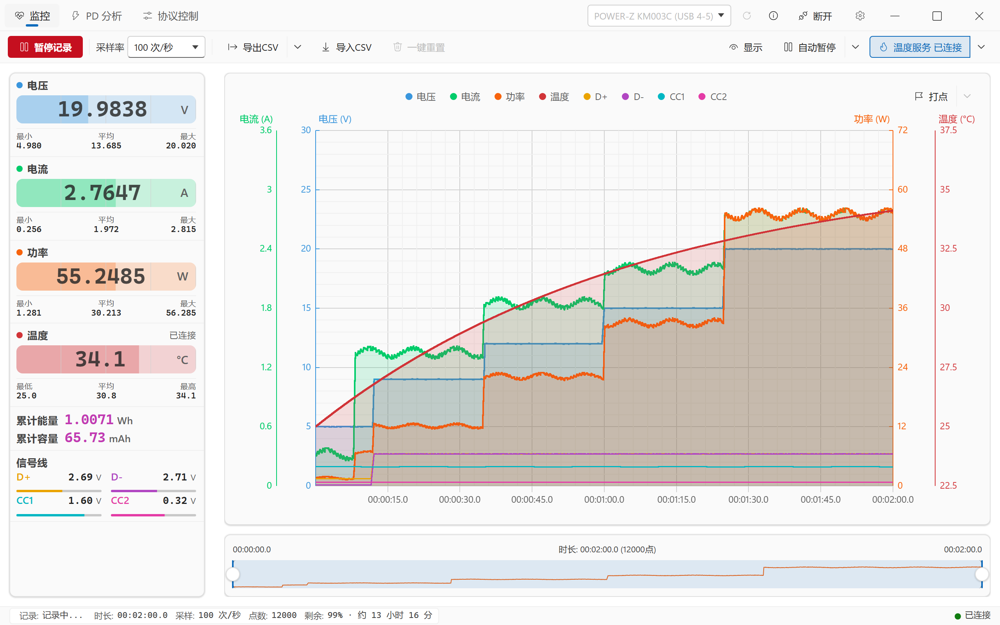
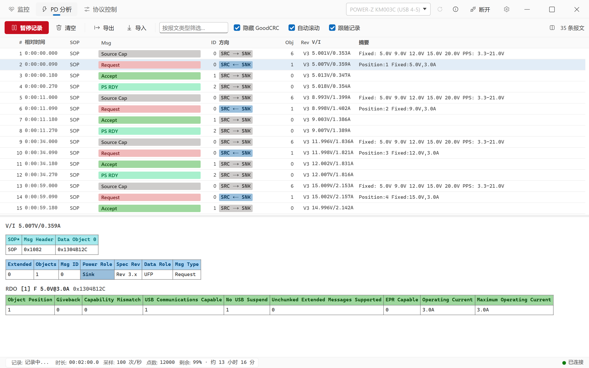
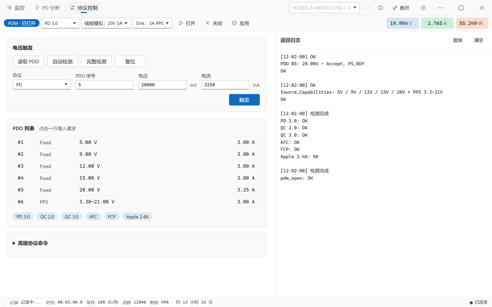
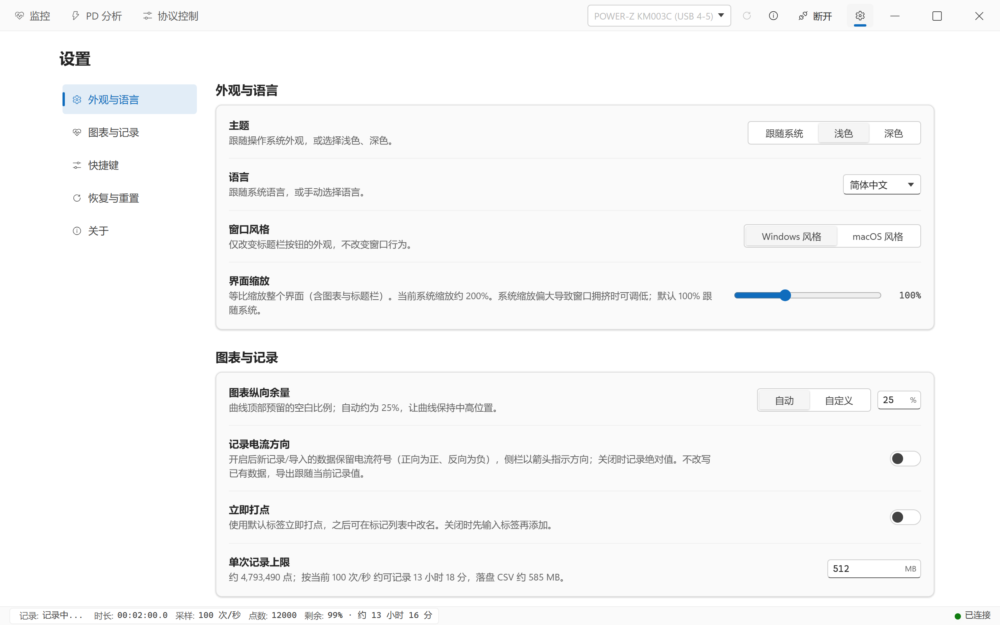

[English](en/USAGE.md) | **简体中文** | [繁體中文](zh-TW/USAGE.md) | [日本語](ja/USAGE.md)

← 返回 [README](../README.zh-CN.md)

# 使用指南

本指南对应 laPower **0.2.5**。下面的截图来自 Windows，使用模拟设备与数据；截图中开启的温度、信号线和采样率不代表首次启动的默认设置。深色主题的操作相同。

- [开始使用](#开始使用)
- [界面总览](#界面总览)
- [监控工作区](#监控工作区)
- [PD 分析工作区](#pd-分析工作区)
- [POWER-Z 协议控制](#power-z-协议控制)
- [设置页](#设置页)
- [文件格式](#文件格式)
- [常见问题](#常见问题)

## 开始使用

1. 将仪表的数据接口连接到电脑。在标题栏点击刷新图标，从设备下拉框选中仪表，再点击 `连接`。Linux 用户先配置 [udev 规则](DEVELOPMENT.md#udev-规则必需)。
2. 打开 `监控`，选择 `采样率`；首次默认是 `4 次/秒`。连接后大字读数会实时更新，但此时尚未记录。
3. 点击 `开始记录`。图表开始积累数据，底部点数增加，最小值、平均值、最大值及累计量随记录更新。切换到其他工作区不会暂停记录。
4. 如需温度，按 [温度服务](#温度服务) 中的步骤单独启用；仅连接仪表不会自动启用温度。
5. 点击 `暂停记录` 后可查看已有数据，或点击 `继续记录` 续接同一份记录。暂停期间实时读数仍可变化，图表和累计量不继续增加。
6. 点击 `导出CSV` 选择保存位置。需要温度或调整导出内容时，先打开它右侧的箭头。长期保存请显式导出，临时恢复文件不能代替导出文件。

## 界面总览

### 标题栏

左侧常驻 `监控`、`PD 分析`、`协议控制` 三个工作区入口。右侧依次是设备选择、刷新图标、设备信息图标、连接／断开按钮和设置齿轮。窗口按钮的位置随系统和窗口风格变化。

| 入口 | 用途 |
| --- | --- |
| `监控` | 查看实时读数、记录曲线、打点、导入和导出 CSV |
| `PD 分析` | 捕获与查看 USB-PD 报文、导入和导出 PD JSON |
| `协议控制` | POWER-Z 的 PDM 会话、协议检测和电压触发；入口始终显示，连接受支持的 KM003C/KM002C 后才启用控制操作 |
| 设置齿轮 | 外观与语言、图表与记录、快捷键、恢复与重置、关于 |

窄窗口下部分入口只显示图标，可悬停查看名称；文字显示不全时可在设置中调低 `界面缩放`。

### 设备连接与设备信息

设备信息按钮只显示信息图标，位于刷新和连接按钮之间。点击可查看型号、`VID`、`PID`、`SN` 及设备说明：优先显示已连接仪表，否则显示当前选中仪表；没有设备时显示空状态。查看信息不要求先连接，切换设备或刷新列表后会同步更新。

设备列表可能显示 USB 端口，例如 `WITRN K2 (USB 4-4)`；同一物理设备筛选后仍有多个 HID 接口时，还会追加接口信息。WITRN 的 USB 序列号可能相同，应结合端口区分同型号仪表。连接期间不能直接改选另一台仪表，请先点击 `断开`。

### 状态栏

底部显示记录状态、时长、采样率、已记录点数、剩余记录容量／预计时长及连接状态。点击左侧的记录状态也可开始或暂停主监控记录；开始记录需要已连接的仪表。这里的时长和点数反映记录数据，不代表仪表连接时长。

## 监控工作区



[查看深色主题](screenshots/zh-CN/dark-record.png)

### 命令栏

| 控件 | 操作与限制 |
| --- | --- |
| `开始记录` / `继续记录` / `暂停记录` | 无数据时开始；已有数据时续接；记录中暂停。断开仪表后保留已有数据，重新连接后可继续 |
| `采样率` | 设置实时采样间隔，见下表 |
| `导出CSV` 主按钮 | 按已保存的导出选项导出全部记录，图表选区不限制导出范围 |
| `导出CSV` 右侧箭头 | 打开 CSV 内容选项和联合导出入口 |
| `导入CSV` | 选择文件并导入；已有数据或正在记录时先确认替换，确认后暂停当前记录。导入完成后保持暂停，已有标记替换为文件中的标记 |
| `一键重置` | 记录中禁用；暂停后点击并确认，清空图表、统计、累计量和标记。PD 开启跟随记录时也清空 PD 报文 |
| `显示` | 设置曲线显隐、填充不透明度和统计范围 |
| `自动暂停` 主按钮 / 箭头 | 主按钮启用或停用功能；箭头设置触发条件 |
| `温度服务` 主按钮 / 箭头 | 主按钮连接或断开温度源；箭头配置来源、IP 和端口 |

分体按钮的主操作和箭头独立。打开配置不会启动记录、启用自动暂停或连接温度源。点击浮层外部可关闭，按 Escape 关闭后焦点返回打开浮层的按钮。

### 采样率

| 选项 | 采样间隔 |
| --- | --- |
| `1000 次/秒` | 1 ms；仅 POWER-Z KM003C/KM002C 可选 |
| `100 次/秒` | 10 ms |
| `10 次/秒` | 100 ms |
| `4 次/秒`（默认） | 250 ms |
| `2 次/秒` | 500 ms |
| `1 次/秒` | 1000 ms |
| `0.2 次/秒 (5秒1次)` | 5000 ms |
| `0.1 次/秒 (10秒1次)` | 10000 ms |

POWER-Z 高速模式不受支持或认证失败时，会退回 `100 次/秒` 并提示原因。较慢采样会将多帧读数汇总为一个点，短暂尖峰可能被平均；观察瞬态变化时选择设备支持的较高速率。导入文件使用文件中的时间和采样间隔，不改变下一次实时记录的采样率偏好。

### 读数卡片

左侧显示电压、电流、功率、温度、累计能量、累计容量和信号线读数。连接后大字数值用于实时预览；每张主卡下方的 `最小` / `平均` / `最大`（温度为 `最低` / `平均` / `最高`）来自记录数据。不要把暂停后的实时预览当成新的记录点。

累计能量（Wh）和容量（mAh）由软件对记录积分得到；暂停时间不计入，继续记录保留累计值，导入则按文件数据重新计算。较长的数据空档也会被排除。启用 `记录电流方向` 后，电流方向箭头反映正反方向；功率与累计量按幅值计算。

读数栏可拖动右侧分栏线调整宽度，窄窗口会限制实际宽度。读数放不下时，在栏内用滚轮或触控板上下滚动；此区域隐藏滚动条，不预留滚动条空白。

### 显示、图表与时间线

- 打开 `显示` 勾选曲线。电压、电流、功率和温度默认勾选，D+/D-、CC1/CC2 默认关闭。勾选温度曲线不会连接温度源。
- 四条主曲线各有填充百分比，范围 0–100%，默认 15%；0 仅关闭填充，不隐藏曲线。图例展示当前可见通道，不承担切换功能。
- 悬停主图可查看该时刻已显示且有有效数值的通道。主图滚轮以鼠标位置为中心缩放时间范围。
- 底部时间线的两端手柄调整范围，拖动中间选区可平移。记录时选区右端贴着最新数据会继续跟随；移到历史区间则停留在那里。
- `仅统计选中范围` 默认关闭。开启后，最小／平均／最大以及能量、容量只统计选区；大字实时读数仍是当前预览。它不裁剪数据，也不限制导出范围。缺失数值不参与统计。

长记录的渲染与采样不是同一频率。性能与积分细节见 [性能说明](PERFORMANCE.md) 和 [架构说明](ARCHITECTURE.md)。

### 打点标注

1. 点击主图右上角 `打点` 或按默认快捷键 `M`，输入标签后确认；默认标签形如 `标记 1`。
2. 记录中按按钮会标记随后到达的下一个点，暂停时标记最后一个点。鼠标停在主图上按 `M`，则标记光标下最近的点。位置在打开输入框前确定。
3. 右侧箭头打开标记列表；有标记时才可打开。点击标签可改名，改为空或点击删除图标可删除。

在 `设置 → 图表与记录` 开启 `立即打点` 后，按钮和快捷键直接使用默认标签，不再先询问。标签最长 40 个字符；不适合 CSV 的分隔符会被清理。标记随 CSV 的 `Marker` 列保存，导入带该列的文件会恢复标记；`一键重置` 会清空标记。

### 自动暂停

1. 点击 `自动暂停` 右侧箭头，选择 `电压 <`、`电流 <` 或 `功率 <`。
2. 填写 `阈值` 和 `持续时间`（秒），然后关闭浮层。
3. 点击 `自动暂停` 主按钮启用，高亮表示已启用；再开始或继续记录。

测量值不高于阈值且持续满足指定时间时暂停记录。界面条件显示 `<`，当前判断也包含等于阈值。持续时间为 0 时，首个满足条件的记录点即可触发。默认未启用、条件为 `无`、阈值和持续时间均为 0；仅修改条件不会启用功能，条件为 `无` 时不触发。

### 温度服务

温度采集、温度曲线显隐和 CSV 温度列是三项独立操作。

1. 点击 `温度服务` 右侧箭头，在 `来源` 中选择来源。
2. 使用仪表温度时选择 `仪表`，先连接仪表；不需要外部程序。使用 TCP 温度服务时选择 `外部`，填写 `IP` 和 `端口`，默认 `127.0.0.1:1573`。首次默认来源是外部，且未连接。
3. 关闭浮层，点击 `温度服务` 主按钮连接。等待有效数据后，温度卡显示当前值；温度随主监控记录写入数据。
4. 要在图表显示，确认 `显示` 中的温度已勾选；要写进 CSV，再勾选 `包含温度`。

连接期间来源、IP 和端口不可修改；先用主按钮断开，再修改。重启后需要手动重连。仪表来源随仪表断开，外部 TCP 连接独立；断线保留已有数据，缺失温度留空。服务端每行发送一个摄氏温度数字；示例与协议见 [外部温度服务](DEVELOPMENT.md#外部温度服务)。

### CSV 与 PD 联合导出

CSV 箭头里的三个选项会保存：`包含温度` 默认关闭，`包含设备信息` 和 `包含打点` 默认开启。勾选但没有数据时，温度和标记列仍保留为空列；设备来源未知时不会用当前连接的仪表补填。

同一浮层中的 `同时导出 CSV 和 PD 数据…` 需要监控和 PD 两侧都有数据。选择一次位置，生成 `名称.csv` 和 `名称.pd.json`，覆盖前会确认。两份文件导出全部数据，不受图表选区或 PD 筛选影响；选好位置后固定快照，后续记录不追加到该次导出。关闭 PD 跟随记录时，两份数据的时间范围可能不同，不会自动裁剪对齐。

## PD 分析工作区



[查看深色主题](screenshots/zh-CN/dark-pd.png)

### 先选择记录方式

`跟随记录` 默认开启。两种模式下，同一个记录按钮含义不同：

| 模式 | 记录按钮与数据行为 | 清空行为 |
| --- | --- | --- |
| 跟随记录开启 | `开始记录` / `暂停记录` 控制主监控和 PD；主监控暂停时不保留新报文。即使监控已有数据，PD 按钮在暂停后仍显示 `开始记录` | 任一侧清空都会清空监控图表和 PD 报文，确认框会说明联动 |
| 跟随记录关闭 | `暂停记录` / `继续记录` 只暂停／恢复列表刷新；已连接设备仍在后台缓冲报文，恢复时补入列表，不控制主监控记录 | 两侧分别清空 |

需要暂停采集整个跟随会话时，使用记录按钮；只想在列表中停留查看、同时继续缓冲时，先关闭跟随记录再暂停列表。切换工作区本身不暂停采集。

### 列表与详情

| 控件 | 用途 |
| --- | --- |
| `导入` / `导出` | 读取／保存 PD 捕获 JSON；导出全部捕获，不受列表筛选影响。导入替换当前 PD 捕获，已有内容时先确认 |
| `清空` | 确认后清空；注意上表中的联动关系 |
| 报文类型筛选框 | 按消息类型名称筛选 |
| `隐藏 GoodCRC` | 隐藏链路确认报文；默认开启，取消勾选可查看 GoodCRC |
| `自动滚动` | 新报文到达时跟随列表底部；默认开启 |
| 分栏图标 | 保存上下／左右布局偏好；左右布局仅在窗口宽度至少 1400px 时生效。拖动列表与详情间的分栏线可调比例 |

列表列为 `#`、`相对时间`、`SOP`、`Msg`、`ID`、`方向`、`Obj`、`Rev`、`V/I`、`摘要`。`V/I` 是报文附近的仪表采样，不保证精确同步。选择一行，在详情区查看原始数据、报文头及该消息适用的 PDO、RDO 等解码表；没有数据对象的消息不会显示 PDO 表。筛选和隐藏选项只影响查看。

捕获充电协商时，先开始记录，再重新插接充电器与被测设备，才能看到新的握手过程；只打开 PD 页面不会让已经完成的协商重新发生。

## POWER-Z 协议控制



[查看深色主题](screenshots/zh-CN/dark-trigger.png)

此入口始终可见。未连接设备或连接 WITRN 时显示提示，控制按钮禁用；连接支持协议控制的 POWER-Z KM003C/KM002C 后才可操作。

### 读取 PDO 并触发

1. 在顶部选择 PD 类型、线缆模拟和 Sink 参数，点击 `打开` 建立 PDM 会话。
2. 点击 `读取 PDO` 获取充电器档位，或用 `自动检测` / `完整检测` 检测支持的协议。
3. 点击 PDO 列表中的一行填入请求。按所选协议检查序号、电压（mV）、电流（mA），点击 `触发`；不是点击 PDO 行就立即触发。
4. 在返回日志中查看结果。更改顶部 PDM 参数后点击 `应用`；`复位` 用于退出当前协议并恢复默认 5 V，`关闭` 用于关闭 PDM 会话。

命令执行期间其他命令暂时禁用，可点击日志区的 `取消`；自动检测和完整检测可能分别需要约 90 秒、3 分钟。高级区域提供 PD/UFCS 命令及自定义命令；自定义命令可在未打开 PDM 时发送，其余协议操作需要 PDM。断开或设备采集连接重建后，应重新打开 PDM。协议控制页的大字读数与监控来自同一仪表连接。

## 设置页



[查看深色主题](screenshots/zh-CN/dark-settings.png)

点击标题栏右侧的齿轮进入；macOS 也可使用 ⌘, 或应用菜单的 Settings…。设置是一张可滚动页面，目录依次为 `外观与语言`、`图表与记录`、`快捷键`、`恢复与重置`、`关于`，关于在最下方。

宽屏目录固定在左侧，小于 980px 时改为顶部横向目录；点击定位，手动滚动同步高亮。可用 Tab 聚焦目录、Enter 跳转。系统开启减少动态效果时不使用平滑滚动。切换工作区后返回设置，保留本次会话的位置。设置通常修改即保存，无需寻找保存按钮。

### 外观与语言

| 设置 | 可选值与默认 |
| --- | --- |
| `主题` | `跟随系统`（默认）、`浅色`、`深色` |
| `语言` | `跟随系统`（默认）、简体中文、繁體中文、English、日本語 |
| `窗口风格` | Windows/Linux 可选 `Windows 风格`（默认）或 `macOS 风格`；macOS 使用原生窗口按钮，不显示此选项 |
| `界面缩放` | 50–200%，默认 100%；拖动结束后应用。窗口拥挤时可调低 |

语言切换立即生效，保留当前记录和数据；不支持的系统语言回退英文。`跟随系统` 后括号里的系统语言不随手动界面语言改变。系统语言检测与 Linux 启动示例见 [开发指南](DEVELOPMENT.md#语言选择)。

### 图表与记录

| 设置 | 含义与默认 |
| --- | --- |
| `图表纵向余量` | 默认 `自动`，约 25%；选择 `自定义` 后可输入 0–100% |
| `记录电流方向` | 默认关闭；开启后新记录与新导入保留电流符号，已有数据不改写。导出保留实际记录值 |
| `立即打点` | 默认关闭；开启后打点不先询问标签 |
| `单次记录上限` | 64–8192 MB，默认 512 MB；这是当前整份图表数据的容量预算，已有和导入的数据也占用额度，达到上限会自动暂停，并非自动分卷保存 |

### 快捷键

| 操作 | 默认按键 | 生效页面 |
| --- | --- | --- |
| 开始／暂停／继续记录 | `P` | 监控 |
| 打点 | `M` | 监控 |
| 导入 | `Ctrl+O` | 监控 CSV；PD JSON |
| 导出 | `Ctrl+S` | 监控 CSV；PD JSON |
| 同时导出 CSV 和 PD 数据 | `Ctrl+Shift+S` | 监控 |
| 清空 | 未绑定 | 监控、PD；仍需确认并遵循跟随联动 |

macOS 使用 Command 代替 Ctrl。点击当前按键按钮再按新组合键；Escape 取消录入，`解除` 解除绑定，`恢复默认` 恢复单项，`恢复全部快捷键` 恢复全部。冲突组合、纯修饰键及保留的关闭／退出组合不可使用。编辑文本、操作下拉菜单、浮层、对话框或录入新按键时，记录、导入、导出等快捷键暂停生效。

### 恢复与重置

`保留临时恢复文件` 默认开启，记录时约每秒保存一次到应用缓存，用于异常退出后的恢复。发现未完成记录时，会在此分组列出文件及 `恢复` / `删除` 操作；恢复后回到监控页，可继续记录或导出。恢复会替换当前监控数据，已有内容时先确认。

正常清空、导入或退出会在成功同步后清理临时文件；同步失败会保留文件并提示。临时文件不是长期归档，也不包含独立的 PD 捕获 JSON，请分别导出所需文件。

`重置所有设置` 用于恢复设置偏好和快捷键，确认后执行；与监控页清空当前数据的 `一键重置` 是不同操作。保存设置失败时以错误提示为准，不要把屏幕上已恢复的默认值当成已经持久保存。

### 关于

页面底部的应用信息卡展示图标、名称、说明、版本和许可证。`GitHub` 按钮使用 GitHub 标志，在系统浏览器打开项目首页；窗口较窄时按钮自动换行。

只有点击 `检查更新` 才会请求 GitHub 正式发布。检查期间按钮禁用；结果保留到本次会话结束，启动、打开设置和切换工作区均不自动检查。相同或更旧的发布版本显示已是最新，无正式发布另行提示；失败时可重试。发现新版后点击 `前往 GitHub 下载` 打开对应发布页，应用不自动下载或安装。

第三方组件卡显示主要组件的名称、版本、用途和许可证；展开全部运行组件可查看按名称排序的完整离线清单，覆盖四个桌面发布目标的直接与间接运行依赖。清单不包含本项目工作区包及纯开发、构建依赖。

## 文件格式

### CSV

监控页读取和写入 CSV。元信息位于表头前，包含点数、时长、采样间隔和日期；其后可能有软件、设备与采样规则来源行。下面的示例开启了温度和打点导出，使用单个记录点：

```csv
SUM,1
TotalTime,="00:00:00.250"
SampTime(ms),250
DateTime,2026-10-17 12:00:00
Software,laPower 0.2.5
Device,WITRN K2 (0716:5060)
Points,mean

Time(D.hh:mm:ss.ms),Voltage(V),Current(A),Power(W),Temp(°C),D+(V),D-(V),CC1(V),CC2(V),RelativeTime(s),Timestamp(ms),RecordingSegment,SampleInterval(ms),Marker,
="00:00:00.250",5,0.5,2.5,25,0.6,0.1,1.6,0.3,0.25,1792209600250,1,250,Start,
```

- `包含温度` 控制 `Temp(°C)`，`包含打点` 控制 `Marker`；`包含设备信息` 仅控制 `Device` 来源行。这些选项不改变采集和图表数据。
- `="HH:MM:SS.mmm"` 用于让电子表格按文本保留时间，超过一天会加天数。`RelativeTime(s)` 是精确相对秒，`Timestamp(ms)` 是绝对时间戳。
- `RecordingSegment` 区分暂停前后的记录段，`SampleInterval(ms)` 保留逐点采样间隔。文件也可能包含 `CurrentMagnitude(A)`，用于保留正反向相抵前的电流幅值，保证容量重新计算一致。
- 数字保留导出精度，缺失值留空；温度列开启不代表一定有有效温度。`Marker` 中的标签随导入恢复。
- 旧 CSV 缺少温度、信号线或新增尾列时仍可导入；识别依赖表头名称，不要求手动补列。来源信息缺失时保持未知，不用当前仪表填补。

### PD 捕获

PD 页使用 JSON，与监控 CSV 分开。当前导出格式标识为 `app: "laPower"`、`kind: "pd-capture"`、`version: 2`；旧的 version 1 捕获仍可导入。导入会校验格式并替换当前 PD 捕获；仅导入 CSV 不会带入 PD JSON，联合导出的两份文件也需分别从各自页面导入。

## 常见问题

### 设备未被识别或连接失败

确认使用仪表的数据接口与支持数据传输的线缆，点击刷新后选中仪表；关闭可能占用设备的其他上位机，再重试或重新插拔。Linux 需要同时配置 HID/Bulk 设备权限，见 [udev 规则](DEVELOPMENT.md#udev-规则必需)。支持的型号见 [设备列表](../README.zh-CN.md#-支持的设备)。

### 已连接但图表没有数据

连接只开启实时预览，请点击 `开始记录`。暂停后实时读数仍可变化，但记录点数不会增加；再点击 `继续记录`。设备报告不兼容或数据无效也可能没有有效读数。

### 温度一直是 `--`

按 [温度服务](#温度服务) 选择来源并用主按钮连接。默认来源是外部 TCP；想用仪表温度时需手动选仪表。图表温度勾选框和 CSV 温度选项都不会启动采集。等待数据时检查服务端、地址、端口或型号支持情况，部分仪表固件可能不提供有效温度。

### PD 页没有新报文

检查仪表连接和跟随记录状态；跟随开启时须先开始主监控记录。需要新一轮协商时重新插接被测连接。独立模式如果暂停了列表，点击 `继续记录` 才会显示后台缓冲的报文；也检查筛选条件。

### macOS 长时间记录

记录期间应用阻止自动睡眠，屏幕仍可熄灭；只连接或暂停时不阻止睡眠。macOS 14+ 配置了 WebView 后台节流禁用，macOS 12–13 长时间记录应保持窗口可见。合盖或手动睡眠仍可能中断 USB 采集。

旧项目名为 WITRN-RS；laPower 使用独立设置目录，旧 CSV 与兼容的 PD 捕获可直接导入。
