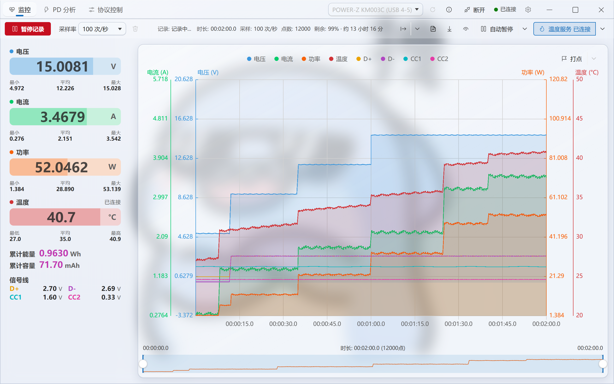
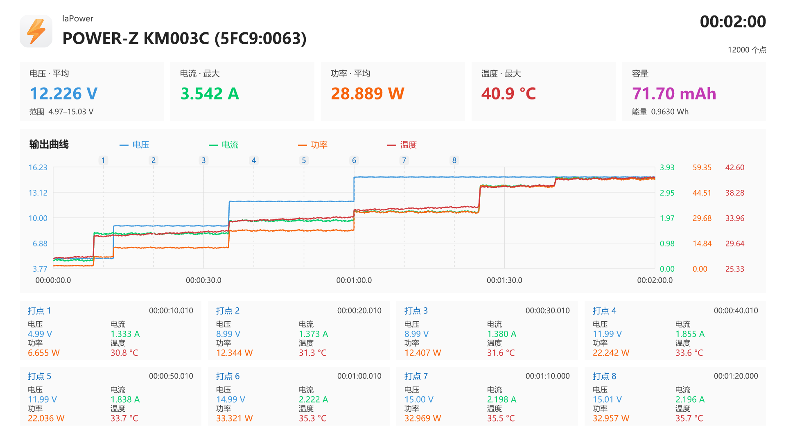
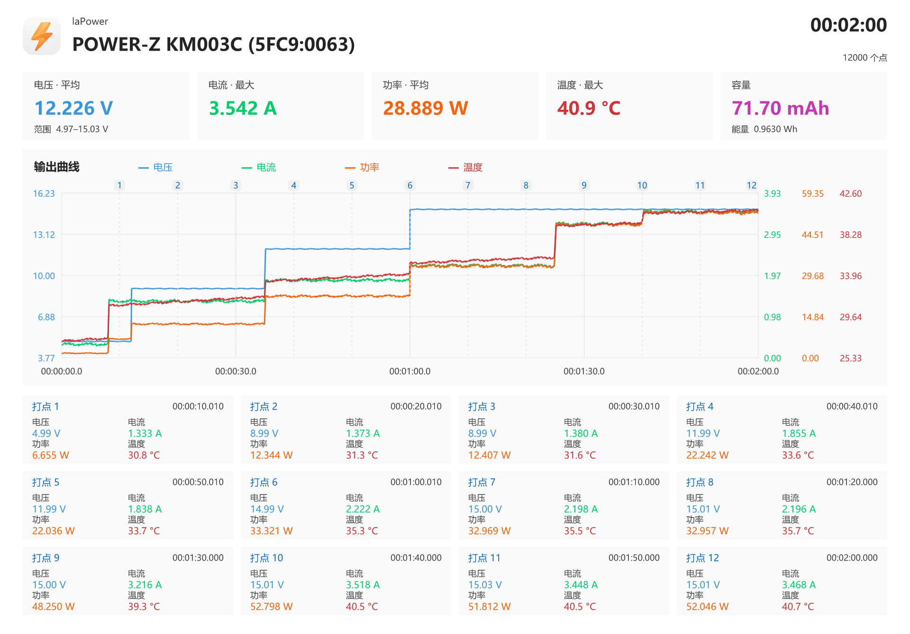
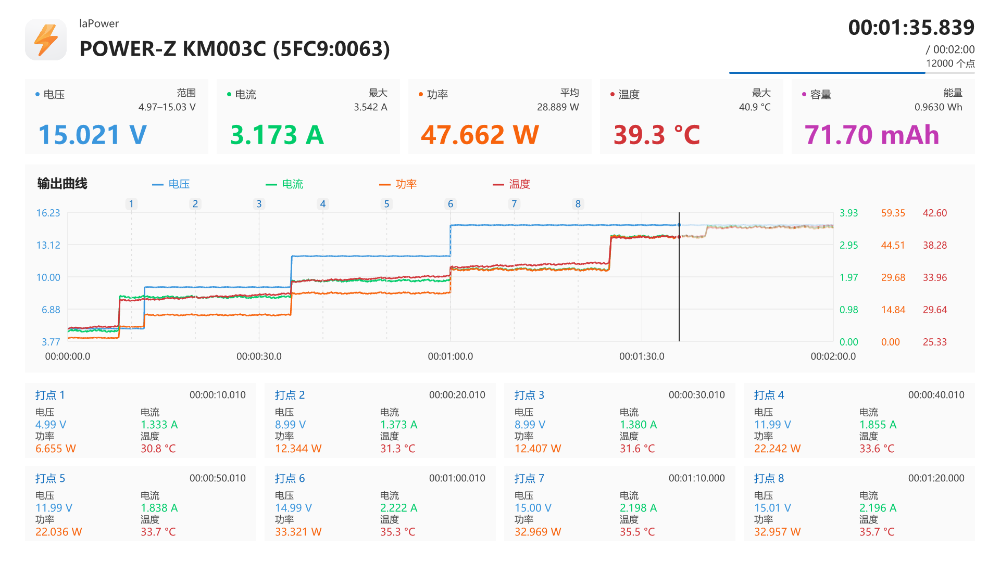
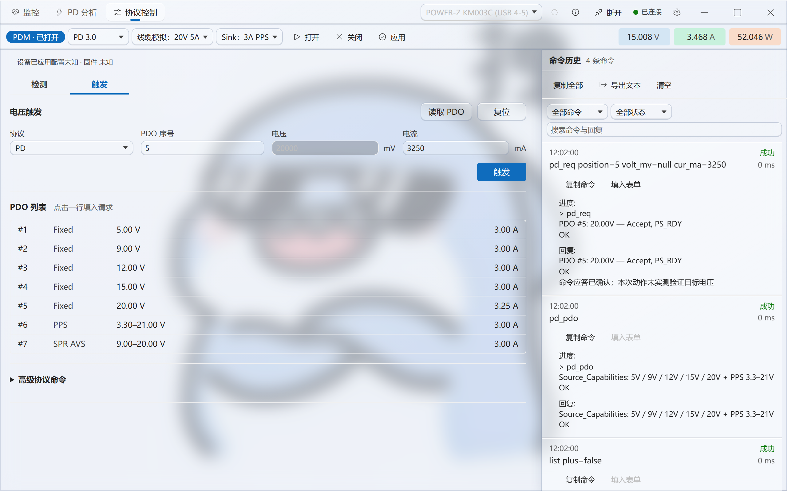
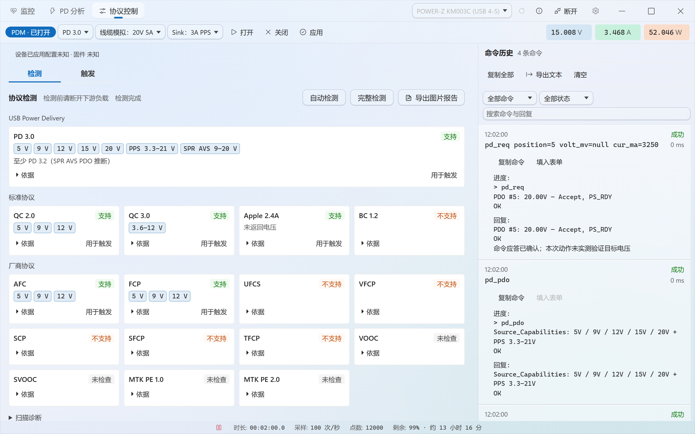
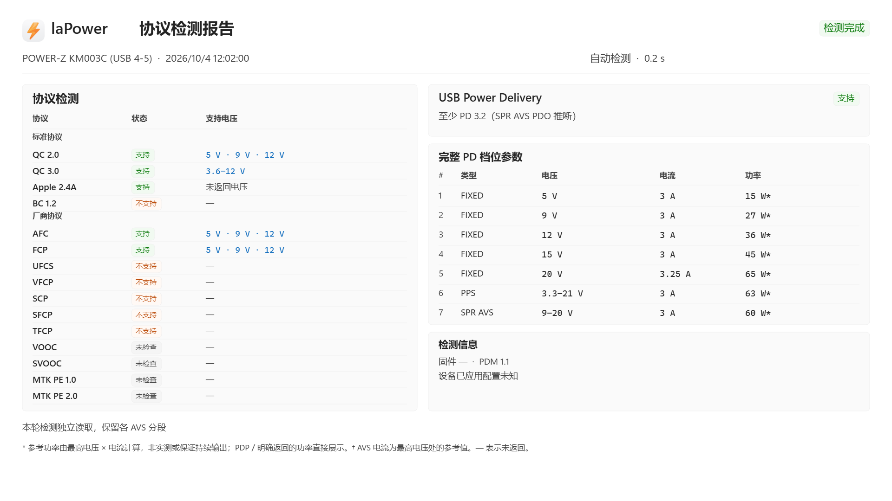

[English](en/USAGE.md) | **简体中文** | [繁體中文](zh-TW/USAGE.md) | [日本語](ja/USAGE.md)

← 返回 [README](../README.zh-CN.md)

# 使用指南

本指南对应 laPower **0.3.0**。截图源自 Windows 模拟环境，所开启的温度、信号线与采样率不代表首次启动默认值；深色主题操作一致。

- [开始使用](#开始使用)
- [界面总览](#界面总览)
- [监控工作区](#监控工作区)
- [PD 分析工作区](#pd-分析工作区)
- [POWER-Z 协议控制](#power-z-协议控制)
- [设置页](#设置页)
- [文件格式](#文件格式)
- [常见问题](#常见问题)

## 开始使用

1. 将仪表数据接口接入电脑，点击标题栏刷新图标后选中仪表并点击 `连接`。Linux 用户请先配置 [udev 规则](DEVELOPMENT.md#udev-规则必需)。
2. 打开 `监控`，选择 `采样率`（首次默认 `4 次/秒`）。连接后大字实时读数开始更新，但此时尚未开始记录。
3. 点击 `开始记录`（或快捷键 `P`），曲线、采样点数、最小/平均/最大统计与能量积分同步启动；切换工作区不会中断记录。
4. 如需温度数据，按[温度服务](#温度服务)步骤单独连接来源。
5. 点击 `暂停记录` 可查看当前记录，再点 `继续记录` 可续接同一记录（暂停期间实时预览仍更新，不计入图表与累计量）。
6. 长期保存请点击 `导出CSV` 显式导出，临时恢复文件不能替代正式导出；需要温度或联合导出时，先展开 `导出CSV` 右侧箭头。

## 界面总览

### 标题栏

左侧常驻 `监控`、`PD 分析`、`协议控制` 三个工作区入口；右侧依次为设备下拉框、刷新图标、设备信息图标、连接/断开按钮及设置齿轮。Windows / Linux 使用右侧 Windows 风格窗口按钮，macOS 使用左侧原生窗口按钮。

| 入口 | 用途 |
| --- | --- |
| `监控` | 查看实时读数、记录曲线、打点、导入/导出 CSV 与导出报告 |
| `PD 分析` | 捕获与分析 USB-PD 报文、导入/导出 PD JSON |
| `协议控制` | POWER-Z 的 PDM 会话、协议检测与电压触发（始终可见，连接支持的 KM003C/KM002C 后启用操作） |
| 设置齿轮 | 外观与语言、图表与记录、快捷键、恢复与重置、关于 |

窄窗口下部分按钮会精简为图标（可悬停查看名称），显示拥挤时可在设置中调低 `界面缩放`。

### 设备连接与设备信息

位于刷新与连接按钮之间的信息图标可随时查看型号、`VID`、`PID`、`SN` 及设备说明（优先显示已连接仪表，否则显示当前选中仪表，无需先连接）。

设备列表会尽量附带 USB 拓扑端口（如 `WITRN K2 (USB 4-4)`）及多余接口后缀；WITRN 仪表的 USB 序列号可能按生产批次重复，需结合端口区分同型号设备。连接状态下切换其他仪表前需先点击 `断开`。

### 状态栏

底部居中显示记录状态图标按钮、记录时长、采样率、已记录点数以及剩余记录容量/预计时长。连接仪表后，点击左侧记录图标按钮（暂停时显示播放图标，记录中显示暂停图标）即可快捷开始或暂停主监控记录。时长与点数仅反映当前记录数据，不代表仪表连接时长。

## 监控工作区



[查看深色主题](screenshots/zh-CN/dark-record.png)

### 命令栏

| 控件 | 操作与限制 |
| --- | --- |
| `开始记录` / `继续记录` / `暂停记录` | 无数据时开始，已有数据时续接，记录中暂停；断开重连后保留数据并可继续 |
| `采样率` | 设置实时采样间隔，见下表 |
| `导出CSV` 主按钮 | 按已保存选项导出全部记录（不受图表选区限制） |
| `导出CSV` 右侧箭头 | 配置 CSV 导出内容并调用 CSV/PD 联合导出 |
| `导出报告` | 将整段记录导出为 PNG 图片（16:9 或长图）或短视频；至少两个记录点后可用，详见[导出报告](#导出报告) |
| `导入CSV` | 导入 CSV 文件；若已有数据或正在记录则先确认替换并暂停当前记录，导入后保持暂停并替换标记 |
| `一键重置` | 仅暂停时可用，确认后清空图表、统计、累计量与标记（PD 开启`跟随记录`时同步清空 PD 报文） |
| `显示` | 调整曲线显隐、曲线阴影、填充不透明度、颜色、线宽、纵向偏移与统计范围 |
| `自动暂停` 主按钮 / 箭头 | 主按钮开关自动暂停；箭头设置触发条件、阈值与持续时间 |
| `温度服务` 主按钮 / 箭头 | 主按钮连接或断开温度源；箭头配置来源（仪表/外部 TCP）、IP 与端口 |

分体按钮的主操作与箭头互不干涉，打开设置浮层不会触发启停或连接。点击浮层外部或按 Escape 可关闭（按 Escape 后焦点返回触发按钮）。

### 采样率

| 选项 | 采样间隔 |
| --- | --- |
| `1000 次/秒` | 1 ms；仅 POWER-Z KM003C/KM002C 可选 |
| `100 次/秒` | 10 ms |
| `10 次/秒` | 100 ms |
| `4 次/秒`（默认） | 250 ms |
| `2 次/秒` | 500 ms |
| `1 次/秒` | 1000 ms |
| `0.2 次/秒 (5秒1次)` | 5000 ms |
| `0.1 次/秒 (10秒1次)` | 10000 ms |

POWER-Z 高速模式不受支持或认证失败时将自动回退 `100 次/秒` 并提示原因。较低采样率会对窗口内多帧求平均，可能平滑短暂尖峰；分析瞬态波形建议启用较高速率。导入 CSV 采用文件自带时间与间隔，不改变实时记录采样率设置。

### 读数卡片

左侧面板展示电压、电流、功率、温度、累计能量、累计容量与信号线实时读数；主卡下方的 `最小` / `平均` / `最大`（温度为 `最低` / `平均` / `最高`）仅统计已记录样本，暂停时实时预览变化不计入统计。

累计能量（Wh）与容量（mAh）由软件对采样点积分，自动排除暂停时段及异常时间空档，并在续接或导入后保持/重算。开启 `记录电流方向` 后侧栏显示电流方向箭头，功率与累计量按幅值计算。拖动栏右缘分隔线可调宽；内容溢出时支持滚轮/触控板滚动且不占用额外滚动条空间。

### 显示、图表与时间线

- 打开 `显示` 选择通道：默认勾选电压、电流、功率和温度（勾选温度不会自动连接温度源），D+ / D−、CC1 / CC2 默认关闭。
- 顶部的 `曲线阴影` 总开关默认开启并保存选择，关闭后保留各主通道原有填充透明度（范围 0–100%，默认 15%；0 仅关闭填充），再次开启时恢复原值；录制、暂停或缩放均不自动更改阴影。图例仅指示当前可见通道。
- 默认从零起算并按全局等分步长量化所有 Y 轴（存在负值时向负侧延伸），确保四条 Y 轴刻度整齐共线；可在 `显示` 调整通道颜色、填充不透明度、线条粗细（自动/手动）与 `上下错开`（归零恢复默认位置），仅影响视觉投影而不改写原始采样与积分结果。
- 悬停主图可查看对应时刻所有有效显示通道的真实值。在主图或底部时间线总览上滚动滚轮可横向缩放（缩放历史区间时不跳回实时跟随；跟随最新点时仅改变显示时长并保持跟随），放大后可在主图区域按住左右拖动平移；拖拽时间线两端手柄可调整统计/浏览窗口。滚轮与拖动交互期间暂不重算纵轴，录制中的新峰值在手势结束后纳入量程。
- `仅统计选中范围` 默认关闭，开启后最小/平均/最大统计与能量/容量积分仅针对当前时间窗计算（实时大字读数仍为当前值），不会裁剪原始数据或限制导出范围。

长记录渲染调度与积分规则详见 [性能基准与边界](PERFORMANCE.md) 与 [技术架构](ARCHITECTURE.md)。

### 打点标注

1. 点击主图右上角 `打点` 或按默认快捷键 `M` 输入标签（默认如 `标记 1`）。记录中点击标记下一到达点，暂停时标记末点；光标悬停主图按 `M` 时标记指针最近样本。
2. 右侧箭头在已有标记时可用，点击标签可重命名，留空或点击删除图标可移除。

在 `设置 → 图表与记录` 开启 `立即打点` 后将跳过输入直接按默认名称标注。标签最长 40 字符（自动清理 CSV 非法分隔符），随 CSV 的 `Marker` 列导出并可导入恢复，`一键重置` 会同步清空标记。

### 自动暂停

1. 展开 `自动暂停` 箭头选择 `电压 <`、`电流 <` 或 `功率 <`，填入 `阈值` 与 `持续时间`（秒）后关闭浮层。
2. 点击 `自动暂停` 主按钮启用（高亮表示生效），再开始或继续记录。

当测量值不高于阈值（判断包含等于）并持续达设定秒数时自动暂停；持续时间为 0 时首个满足条件的样本即触发。默认关闭、条件为 `无` 且阈值为 0；仅修改条件不会启用该功能。

### 温度服务

温度采集、图表温度曲线与 CSV 温度列三者相互独立：

1. 展开 `温度服务` 箭头选择 `来源`：`仪表` 直接读取设备报文温度（需先连表，无需外部程序）；`外部` 通过 TCP 连接外部温度源（默认 `127.0.0.1:1573`）。
2. 关闭浮层后点击 `温度服务` 主按钮连接；收到有效读数后显示于温度卡并随主监控记录保存。
3. 需在图表显示或写入 CSV 时，分别在 `显示` 勾选温度与在 `导出CSV` 勾选 `包含温度`。

连接期间不可更改来源、IP 与端口（需先断开）；软件重启需手动重连。`仪表` 温度随仪表断开自动复位，而 `外部` TCP 连接独立运行；断线后历史记录保留，缺失温度留空。外部 TCP 协议及示例服务器见 [外部温度服务](DEVELOPMENT.md#外部温度服务)。

### CSV 选项与联合导出

`导出CSV` 箭头中的选项会持久化：`包含温度` 默认关闭，`包含设备信息` 和 `包含打点` 默认开启。勾选但无数据时保留空列；未知设备来源不会用当前连接设备代填。

`同时导出 CSV 和 PD 数据…` 需监控与 PD 两侧均有数据：选定路径后一次性导出完整数据的 `名称.csv` 与 `名称.pd.json`（快照在选定路径时即冻结，不受选区或筛选影响，覆盖前确认）。若关闭了 PD `跟随记录`，两份文件的时间跨度可能不同且不会自动裁剪对齐。

### 导出报告



[深色主题](screenshots/zh-CN/dark-report-image.png)



[深色主题](screenshots/zh-CN/dark-report-long.png)



[深色主题](screenshots/zh-CN/dark-report-video.png)

点击监控命令栏 `导出报告`，可将整段冻结记录输出为无损 PNG 图片或短视频（记住类型、720p–4K 分辨率、主题与内容选项）。`报告内容` 中包含电压、电流、功率、温度、`打点` 与 `打点详细信息`：后两项独立控制，可仅显示曲线标记、仅展示底部打点详情，或同时开关。

- **图片报告（PNG）**：静态版式展示完整曲线、总时长、点数、时间加权平均电压/功率、峰值电流、最高温度及累计容量/能量（缺测显式保留）。`16:9` 横版最多保留前 8 个打点（超出时提示）；`长图` 保留全部打点并按需增高（超限报错提示降分辨率或关闭详情，绝不静默丢弃）。
- **视频报告**：支持 MP4/MOV、H.264/H.265、24/30/60 fps、1–60 秒时长，将整段记录快放至目标时长并随时间更新五张参数卡主读数（右上角保留整段统计摘要，最多含前 8 个打点）。

点击 `生成图片` / `生成视频` 后冻结快照并在后台单槽运行，关闭对话框不中断任务（重开可恢复进度），仅成功后写入目标位置，取消或失败会清理暂存文件。

#### 视频画质与编码模式

导出对话框提供 `编码模式`（默认 `自动`）与 `画质`（默认 `高清`），切换组合后会自动探测可用性并显示目标码率：

| 画质 | H.264（1080p / 30 fps） | H.265（1080p / 30 fps） |
| --- | --- | --- |
| 标准 | 10 Mbps | 6.5 Mbps |
| 高清（默认） | 20 Mbps | 13 Mbps |
| 极清 | 30 Mbps | 19.5 Mbps |

码率按像素数与帧率线性缩放（H.264 最低 4 Mbps、H.265 最低 3 Mbps，上限 240 Mbps）。`自动` 优先使用硬件编码并在失败时回退软件编码并说明原因；`硬件编码` 仅使用真实硬件编码器（Windows 支持 GPU 纹理与 CPU 帧转硬件两级路径）；`软件编码` 直接使用内置软件编码器（Linux 仅支持自动或软件模式的 H.264；macOS 软件 HEVC 需系统实际支持）。无需额外安装 ffmpeg。

## PD 分析工作区


[查看深色主题](screenshots/zh-CN/dark-pd.png)

### 选择记录模式

`跟随记录` 默认开启，同一记录按钮在不同模式下语义不同：

| 模式 | 记录按钮与数据行为 | 清空行为 |
| --- | --- | --- |
| 跟随记录开启 | `开始记录` / `暂停记录` 联动主监控与 PD；主监控暂停时不保留新报文（监控已有数据时，PD 暂停后按钮仍显示 `开始记录`） | 任一侧清空均同步清空监控与 PD |
| 跟随记录关闭 | `暂停记录` / `继续记录` 仅暂停/恢复列表刷新，后台继续缓冲连接报文，不影响主监控 | 两侧独立清空 |

若需在保持后台缓冲的同时固定列表查看，请先关闭 `跟随记录` 再暂停列表。切换工作区不会暂停采集。

### 列表与详情

| 控件 | 用途 |
| --- | --- |
| `导入` / `导出` | 读写 PD 捕获 JSON（导出全部捕获不受筛选影响；导入前确认替换） |
| `清空` | 确认后清空（受跟随模式联动影响） |
| 报文类型筛选框 | 按消息类型名称筛选视图 |
| `隐藏 GoodCRC` | 隐藏链路层确认帧（默认开启） |
| `自动滚动` | 新报文到达时自动滚至底部（默认开启） |
| 分栏图标 | 切换并保存上下/左右布局（左右布局仅在窗口宽度 ≥ 1400 px 时生效），拖动分隔线可调比例 |

列表展示 `#`、`相对时间`、`SOP`、`Msg`、`ID`、`方向`、`Obj`、`Rev`、`V/I`（报文附近的仪表采样）及 `摘要`；选中任意行可在详情区查看原始字节、报文头及对应 PDO / RDO 解码树。捕获充电器握手协商时，请先开始记录再插拔被测连接。

## POWER-Z 协议控制



[查看深色主题](screenshots/zh-CN/dark-trigger.png)

此入口始终可见；未连接设备或连接 WITRN 时显示提示并禁用操作，连接支持的 POWER-Z KM003C / KM002C 后启用。工作区默认打开 `触发` 页签，顶部的 `PD 类型`、`线缆模拟`、`Sink` 设置与实时 V/I/P 读数在 `检测` 与 `触发` 间共用（与监控共用同一仪表连接）。

### 读取 PDO 并触发

1. 在顶部选择 `PD 类型`、`线缆模拟` 和 `Sink` 参数，点击 `打开` 建立 PDM 会话（顶部状态区分当前界面选择与设备已确认应用配置，并展示可识别的固件版本；断开或重建连接后需重新打开 PDM）。
2. 点击 `读取 PDO` 获取充电器档位，或运行 `自动检测` / `完整检测`。
3. 点击 PDO 列表行将参数填入请求表单，核对序号、电压（mV）与电流（mA）后点击 `触发`（仅点击列表行不会发送请求）：
   - 已知固定 PD PDO 电压为只读并省略 `volt`；UFCS 保留原始 `NUM` 物理编号；PPS / AVS 与未知编号保留手动输入。
4. 在返回日志查看确认状态；`应用` 用于更新 PDM 参数，`复位` 退出当前协议并恢复默认 5 V，`关闭` 结束 PDM 会话。

**命令历史与高级命令：**

- 命令执行期间其他操作锁定，顶栏显示 `取消` 与活动状态；同一时间仅可执行一条命令。
- 右侧常驻命令历史按命令分组记录时间、参数、耗时、状态、完整过程及回复（支持按命令/状态/文本筛选、复制、导出文本与参数回填，复制和回填不重放命令）。历史仅保留于当前会话，上限 64 KB（超限时优先淘汰最旧已完成条目，单条超长按完整行裁剪并给出提示），重复出现的状态/连接回复按接收顺序保留。
- 高级区域提供 PD/UFCS 与自定义命令：自定义命令可在未打开 PDM 时发送（执行后会自动重新确认协议状态并使旧选定配置失效），`pd data` 支持连续 hex、`0x` 前缀及常见分隔符，非法字符将报错拒收。

### 协议检测



[深色主题](screenshots/zh-CN/dark-detection.png)



[深色主题](screenshots/zh-CN/dark-protocol-report.png)

> **注意：** 检测会切换协议并包含 5 V 实测验证，请务必在**断开下游负载**后执行。

- **检测模式与结果矩阵**：`自动检测`（约 4 分钟预算）执行常规扫描并对未出明确结果的常规协议逐项补探；`完整检测`（约 7 分钟预算）优先发送 `entry list+` 探测 VOOC/SVOOC、MTK PE 等扩展协议（缺少结束标记时回退常规扫描），旧 PDM 不支持扩展结果时标为“未检查”。结果按 PD、标准协议、厂商协议分组，明确区分“支持”“不支持”“未检查”“未确认”；VOOC/SVOOC 与 MTK PE 1.0/2.0 分列（不互相推断，也不凭 PD 功率推断私有认证）。点击“依据”可查看来源与原始回复；对支持且有触发实现的协议点击 `用于触发` 仅跳转并填表，不会自动触发。
- **独立 PD 读取与版本判定**：检测忽略列表扫描附带的 PD 状态，在其余协议完成后独立执行 `reset → entry pd → pd pdo` 判定 PD 支持与完整档位（取消则跳过）。PD 版本依次优先采用：`Get_Revision` 完整响应 → 完整扫描明确报告的 PD 3.0/3.1/3.2 → PDO 能力证明的最低版本（PPS ≥ PD 3.0、EPR ≥ PD 3.1、SPR AVS ≥ PD 3.2；普通固定 PDO 无法推断）。版本展示同时校验独立读取的 PDO，低版本 `Get_Revision` 响应不可覆盖 SPR AVS 的 PD 3.2 下限，冲突时会明确提示。
- **5 V 实测验证与复位**：单项 5 V 补探在命令确认至少 500 ms 后取连续 5 个新鲜样本的中位数，按 `max(200 mV, 3%)` 容差判定（最长等待 12 秒，超时或偏差记为未确认）。正常结束或取消后都会在 15 秒内尝试复位并实测确认恢复 5 V，未确认时给出明确提示。
- **导出图片报告**：检测完成后可点击 **导出图片报告** 保存 16:9 PNG（1920×1080 / 2560×1440 / 3840×2160，浅色/深色主题独立记忆）。打开弹窗即冻结本轮报告，包含全部协议状态、PD 版本与完整 PDO（保留 SPR AVS 分段，`*` 标示最高电压参考功率，`†` 标示最高电压 AVS 参考电流，缺失显示 `—`；部分完成或取消也可导出并标明警示）。

## 设置页


[查看深色主题](screenshots/zh-CN/dark-settings.png)

点击标题栏齿轮（macOS 可按 `⌘,` 或菜单 `Settings…`）打开单页设置。宽屏目录固定于左侧，宽度小于 980 px 时切至顶部横向目录；设置项修改即自动持久化，无需手动保存。

### 外观与语言

| 设置 | 可选值与默认 |
| --- | --- |
| `主题` | `跟随系统`（默认）、`浅色`、`深色` |
| `语言` | `跟随系统`（默认）、简体中文、繁體中文、English、日本語 |
| `自定义背景图片` | 选择本地 PNG、JPG 或 WebP 图片（≤ 25 MB）并持久化，点击 `清除背景` 还原默认（无内置壁纸） |
| `背景图片透明度` | 0–100%，默认 0% |
| `界面缩放` | 50–200%，默认 100%，松手生效；窗口拥挤时可调低 |

语言切换立即生效且保留所有记录与连接数据；`跟随系统` 括号中显示的检测语言及 Linux 启动环境变量规则详见 [语言选择](DEVELOPMENT.md#语言选择)。

### 图表与记录

| 设置 | 含义与默认 |
| --- | --- |
| `图表纵向余量` | 默认 `自动`（按整段已显示通道峰值定标）；`自定义` 可设 0–100% |
| `缩放时自动调整线条粗细` | 默认开启；随缩放级别自动调节曲线线宽 |
| `记录电流方向` | 默认关闭；开启后新记录与新导入保留电流正负号，导出保留实录值 |
| `立即打点` | 默认关闭；开启后打点跳过标签输入弹窗直接使用默认标签 |
| `单次记录上限` | 64–8192 MB，默认 512 MB；涵盖当前全部图表数据（含已有及导入），达限自动暂停 |

### 快捷键

| 操作 | 默认按键 | 生效页面 |
| --- | --- | --- |
| 开始/暂停/继续记录 | `P` | 监控 |
| 打点 | `M` | 监控 |
| 导入 | `Ctrl+O` | 监控 CSV；PD JSON |
| 导出 | `Ctrl+S` | 监控 CSV；PD JSON |
| 同时导出 CSV 和 PD 数据 | `Ctrl+Shift+S` | 监控 |
| 清空 | 未绑定 | 监控、PD（仍需确认并遵循跟随联动） |

macOS 自动映射为 `Command`。点击按键按钮后按新组合可重绑（Escape 取消），支持单键解除/恢复或全部恢复；输入文本、操作菜单/弹窗或录制快捷键期间全局快捷键暂停生效。

### 恢复与重置

`保留临时恢复文件` 默认开启，录制时每秒缓存一次供异常退出恢复；未完成记录将在本组列出并提供 `恢复` / `删除`（恢复会确认并替换当前监控数据，但不含独立 PD JSON）。正常清空、导入或退出会在同步成功后清理临时文件。

`重置所有设置` 仅恢复偏好与快捷键，与监控页清空数据的 `一键重置` 相互独立。

### 关于

底部展示应用信息、`Copyright (C) 2026 KHWLGH`（自有贡献）及协议库 LGPL-3.0-or-later 声明（`usbpd-parser` 与 `witrn-hid` 保留 `Copyright (c) 2025 JohnScotttt`），并提供 `开源许可证`（离线全文阅读弹窗，支持复制与记住位置）、`GitHub` 与 `检查更新`（仅手动点击时请求 GitHub 正式发布，不自动下载安装）。第三方组件卡列出主要依赖与可展开的 `全部运行组件` 离线清单及许可阅读入口。源码完整声明见 [`COPYRIGHT`](../COPYRIGHT)、[`LICENSE`](../LICENSE) 与 [`LICENSE.LGPL-3.0`](../LICENSE.LGPL-3.0)。

## 文件格式

### CSV

监控页读写 CSV。表头前包含点数、时长、采样间隔、日期以及可选的软件/设备/采样规则来源行（以下示例开启了温度与打点）：

```csv
SUM,1
TotalTime,="00:00:00.250"
SampTime(ms),250
DateTime,2026-10-17 12:00:00
Software,laPower 0.3.0
Device,WITRN K2 (0716:5060)
Points,mean

Time(D.hh:mm:ss.ms),Voltage(V),Current(A),Power(W),Temp(°C),D+(V),D-(V),CC1(V),CC2(V),RelativeTime(s),Timestamp(ms),RecordingSegment,SampleInterval(ms),Marker,
="00:00:00.250",5,0.5,2.5,25,0.6,0.1,1.6,0.3,0.25,1792209600250,1,250,Start,
```

- `="HH:MM:SS.mmm"` 确保电子表格保留文本格式（超 24 小时带天数前缀）；`RelativeTime(s)` 为相对秒，`Timestamp(ms)` 为绝对时间戳。
- `RecordingSegment` 区分暂停前后的录制段，`SampleInterval(ms)` 记录逐点间隔；可选 `CurrentMagnitude(A)` 保留正反向相抵前的电流幅值以保证容量重算一致。
- 导入按表头名匹配，兼容缺少温度、信号线或额外尾列的旧 CSV；缺失来源保持未知。

### PD 捕获

PD 捕获使用独立 JSON 格式（当前 `app: "laPower"`、`kind: "pd-capture"`、`version: 2`，兼容读取 version 1）。导入会校验格式并替换当前 PD 列表；联合导出的 `.csv` 与 `.pd.json` 需分别在对应页面导入。

## 常见问题

### 设备未被识别或连接失败

确认接入仪表的数据端口并使用具备数据传输能力的线缆，关闭占用设备的其他上位机后点击刷新重试或重插。Linux 需先配置 [udev 规则](DEVELOPMENT.md#udev-规则必需)；支持列表见 [支持的设备](../README.zh-CN.md#-支持的设备)。

### 已连接但图表没有数据

连接仅开启实时数值预览，需点击 `开始记录` 才写入图表；暂停后需点击 `继续记录`。若持续无有效数值，请确认设备固件报告格式兼容。

### 温度一直是 `--`

请按[温度服务](#温度服务)选择来源并点击主按钮连接（默认来源为外部 TCP，用仪表温度须切为 `仪表`）。仅勾选图表显示或 CSV 温度列不会启动温度采集；部分固件可能不输出有效温度。

### PD 页没有新报文

检查设备连接与 `跟随记录` 状态（跟随开启时须先启动主监控记录），重新插拔充电器以触发新握手；独立模式下若暂停了列表刷新，需点击 `继续记录` 显示后台缓冲报文，并检查筛选条件。

### macOS 长时间记录

录制期间应用会阻止系统自动睡眠（允许熄屏）；仅连接或暂停时不阻止睡眠。macOS 14+ 已禁用 WebView 后台节流，macOS 12–13 长时录制请保持窗口可见；合盖或手动睡眠仍会中断 USB 采集。

> 旧项目名为 WITRN-RS；laPower 采用独立配置目录，旧版 CSV 与兼容 PD 捕获文件均可直接导入。
