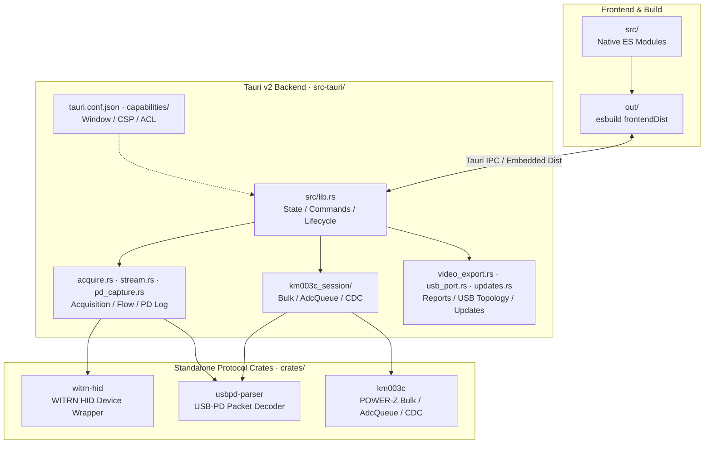
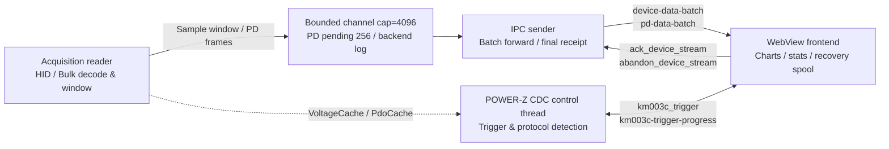
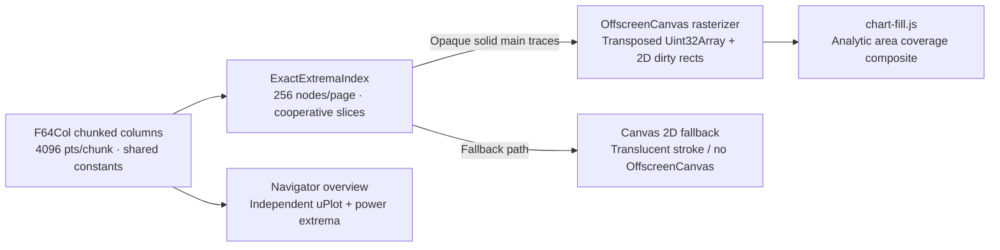
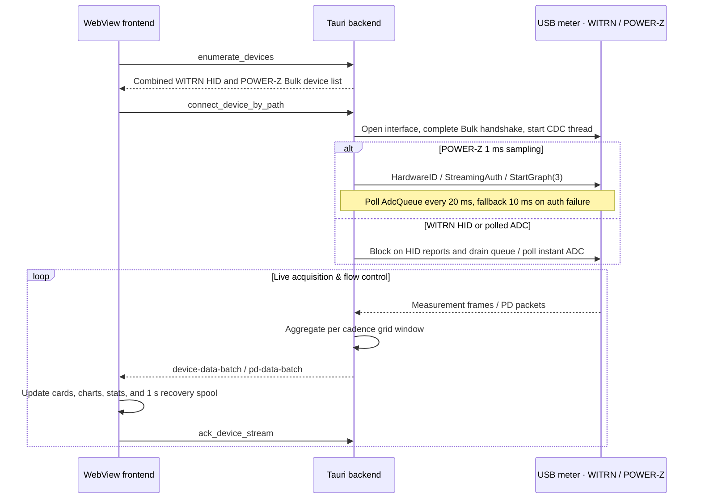

**English** | [简体中文](../ARCHITECTURE.md)

← Back to [README](../../README.md)

# Architecture

This document describes laPower's internal architecture. See the [User guide](USAGE.md) for operation and [Development and build](DEVELOPMENT.md) for building.

- [Repository layout](#repository-layout)
- [Backend](#backend)
- [Protocol crates](#protocol-crates)
- [Frontend](#frontend)
- [Data flow](#data-flow)
- [HID report layout](#hid-report-layout)
- [Tests](#tests)
- [Security boundaries](#security-boundaries)

## Repository layout

The Cargo workspace contains four crates plus a plain ES Module frontend directory; release builds generate `out/` via esbuild.

| Path | Purpose |
| --- | --- |
| `src-tauri/src/lib.rs` | App state, Tauri command registry, and lifecycle |
| `src-tauri/src/acquire.rs` | Acquisition loop, cadence grid windowing, and timestamp back-projection |
| `src-tauri/src/stream.rs` | Stream sessions, bounded channels, backpressure, and final receipts |
| `src-tauri/src/pd_capture.rs` | USB-PD capture log (`seq` / `generation` / lazy decoding) |
| `src-tauri/src/km003c_session/` | POWER-Z Bulk/AdcQueue and CDC control session |
| `src-tauri/src/video_export.rs` | Image/video report export and platform rendering/encoding backends |
| `src-tauri/src/usb_port.rs` | Platform-specific USB topology port resolution |
| `src-tauri/src/updates.rs` | Manual GitHub release check and validated browser links |
| `src-tauri/capabilities/` | Tauri ACL capability declarations |
| `src-tauri/tauri.conf.json` | Window, CSP, and bundling configuration |
| `crates/usbpd-parser/` | USB-PD message decoding |
| `crates/km003c/` | POWER-Z Bulk, AdcQueue, CDC, and protocol detection |
| `crates/witrn-hid/` | WITRN HID device wrapper |
| `src/` | Frontend sources (native ES modules) |
| `out/` | Generated `frontendDist` (untracked) |
| `tools/showcase/` | Virtual devices and screenshot tooling (not shipped) |
| `test/` | Frontend unit tests (`node --test`) |
| `bench/` | Algorithm, storage, memory, and rendering benchmarks |
| `temperature-example/` | External TCP temperature server examples in Python |
| `docs/` | Documentation |

Root `Cargo.toml` centralizes `version`, `edition = 2021`, `rust-version = 1.85`, and shared dependencies (`serde`, `serde_json`, `hidapi 2.6`, `chrono 0.4`).

## Backend

### `src-tauri/src/lib.rs`

Hosts application state and device/module command registration under a **lock only where necessary** rule:

- `sample_rate: Arc<AtomicU64>` avoids taking a mutex on every acquisition iteration.
- Remaining shared state uses `Arc<Mutex<...>>`.

### Thread model

Each device connection owns an acquisition reader and an IPC sender; POWER-Z adds a dedicated CDC control thread:

- **Acquisition reader**: WITRN blocks on HID reports and drains host-queued reports nonblockingly; POWER-Z reads Vendor Bulk / AdcQueue (polled ADC uses `vbus_instant_v()` and `ibus_instant_a()` and computes `voltage × current`). Frames are averaged per cadence grid window (mean voltage, current, power, D+/D−, retaining per-frame current magnitude means; newest timestamp, CC, and temperature) into a 4096-item bounded channel. PD events use a 256-entry pending buffer when full while remaining in the backend log. Acquisition stops with an error at 8192 unacknowledged samples.
- **IPC sender**: blocks when idle and starts its batching deadline on the first arriving item, emitting `device-data-batch` (up to 64 points or `clamp(4 × interval, 8 ms, 50 ms)`) and `pd-data-batch`. The frontend confirms via `ack_device_stream`; shutdown drains queued items before sending the final receipt and disconnect event.
- **macOS background keep-alive and timestamp back-projection**: main windows set `backgroundThrottling: "disabled"` (macOS 14+); active readers hold an `NSProcessInfo` `LatencyCritical` activity (`src-tauri/src/app_nap.rs`) to opt out of App Nap, switching seamlessly to an idle-sleep-preventing activity during nonzero recording segments. Late-wakeup WITRN bursts are drained by `HidSource` and spread back by `acquire::stamp_drained` at ≤ 10 ms intervals; segment and rate transitions run `HidSource::barrier` and `seal_boundary`.
- **Ordered shutdown and terminal retirement**: `BackgroundTask::stop()` always stops **producers before consumers**; `shutdown` is `#[tauri::command(async)]` to avoid main-thread emit deadlocks and destroys the window instead of calling `close()` (preventing exit loops). Once a stream fails terminally and stops its producer, the frontend calls `abandon_device_stream` to retire the joined session without faking `consumed` ACKs, keeping disconnect, reconnect, and quit reachable.

### Tauri commands

| Command | Purpose |
| --- | --- |
| `enumerate_devices` | Combine WITRN HID and POWER-Z Vendor Bulk enumeration |
| `connect_device_by_path` | Connect WITRN HID or POWER-Z Bulk by enumerated path |
| `disconnect_device` | Disconnect and stop connection workers |
| `get_current_device_info` | Return connected-device metadata |
| `set_sample_rate` | Set sampling interval (1–60000 ms, clamped to device limits) |
| `set_pd_capture_enabled` | Toggle PD packet capture |
| `pd_log_clear` / `pd_log_after` / `pd_log_import` / `pd_log_import_page` / `decode_pd_at` | Clear PD log, recover paged gaps (≤ 512/page), stream controlled import, and O(1) decode lookup |
| `drain_device_stream` / `ack_device_stream` / `set_recording_segment` / `abandon_device_stream` | Stop/drain stream, ACK consumed seqs, set recording segments, and retire terminal sessions |
| `connect_temp_service` / `disconnect_temp_service` | External TCP temperature connection lifecycle |
| `check_for_updates` / `open_project_page` | Manual GitHub Releases query (10 s timeout) and validated repository URL launch |
| `shutdown` | Stop all workers and destroy the main window |
| `km003c_trigger` / `km003c_cancel_trigger` | Execute or cancel POWER-Z protocol control and detection |
| `choose_custom_background` / `load_custom_background` / `clear_custom_background` | Select, load, and clear local custom background image |
| `list_system_fonts` | Enumerate installed system fonts, localized/face metadata, and CJK/Latin coverage |
| `csv_export_pick` / `pd_export_pick` / `text_export_pick` / `png_export_pick` / `paired_export_pick` / `csv_import_pick` / `pd_import_pick` | Pick files and issue controlled backend read/write handles (CSV/PD/text log/protocol PNG) |
| `video_export_capability` / `video_export_pick` / `video_export_start` / `video_export_status` / `video_export_current` / `video_export_cancel` | Probe image/video encoding, issue single-use destination ticket, and manage single-slot background report export |

### `src-tauri/src/pd_capture.rs`

Append-only `Vec` where **`seq` is the message index**. Raw frames and conversation-aware decode trees are stored at capture time for O(1) generation-checked `decode_pd_at` lookups (the frontend caches up to 8 fetched trees; legacy imports retain embedded `meta`). Clearing or import replacement bumps `generation`, invalidating pending recovery/detail work; disconnect separators stay in order without consuming `seq`. Hard cap: `PD_LOG_HARD_CAP = 1_000_000`; frontend soft warning at `PD_SOFT_CAP = 500_000`.

### `src-tauri/src/temperature_reader.rs`

Reads fixed 1024-byte chunks into a 256-byte incremental line buffer (including CRLF), discarding oversized lines through the next newline and retaining partial lines across 250 ms idle read timeouts; EOF and read errors trigger disconnection events.

### `src-tauri/src/usb_port.rs`

Resolves physical USB topology ports (e.g., `4-4`) to distinguish identical meters sharing batch serial numbers: Windows (`CM_Get_DevNode_PropertyW` + `DEVPKEY_Device_LocationPaths`), Linux (unprivileged sysfs walk over `/sys/class/hidraw/<name>/device` `devpath`), and macOS (`get_location_id`).

### `src/protocol-report*.js`

Draws protocol detection reports onto a 1920×1080 logical Canvas styled from bundled CSS tokens without toggling the live UI theme. Deep-copies the run snapshot on dialog open (`DetectionReport.pdos` holds independently read PDOs with SPR AVS bands; `TriggerPdo.max_power_mw` separates reported PDP from Vmax×I reference power) and saves via `png_export_pick` staging/commit. Settings persist separately in `protocolReportExport`.

### `src-tauri/src/video_export.rs`

Unifies PNG image and short video exports under Monitor's **Export report** button, sharing frozen snapshots, a single `lapower-video` background slot, backend-owned native destination tickets (`video_export_pick` writes a hidden same-directory staging file and renames atomically on success), 500 ms status polling, and a ≤ 2 s `shutdown` cancellation wait:

- **Frontend freezing and projection**: `src/video-export.js` freezes column snapshots while pure `src/video-projection.js` projects up to 256 buckets × 10 points (2560 max overview points), per-frame values, and up to 8 markers (long images retain every marker and expand height within host pixel safety limits). `src/video-export-options.js` and `src/video-palette.js` supply whitelists, frame counts, and theme palettes.
- **Rendering and encoding**: `model.rs` validates payloads; `scene.rs` renders the 1920×1080 logical layout through `Painter` to `windows.rs` (Direct2D/DirectWrite/WIC) or `skia.rs` (tiny-skia + system fonts on macOS/Linux). PNG saves losslessly without probing video encoders.
- **Bitrates and codec paths**: `VideoOptions::bitrate()` scales linearly with pixels and fps (10/20/30 Mbps for 1080p30 H.264, 65% for HEVC; 4/3 Mbps floor, 240 Mbps ceiling; free-space check reserves 125% + 64 MiB). `acceleration` (auto/hardware/software) and `quality` (standard/high/ultra) share cached one-frame host probes: Windows tries `gpu.rs` (DXGI + `ID3D11VideoProcessor` hardware NV12), WIC + CPU NV12 hardware transforms, then software (`mov.rs` rewrites MOV headers in place); macOS uses `apple.rs` VideoToolbox with bundled OpenH264 software H.264 fallback; Linux uses bundled `software.rs` OpenH264 for H.264 only (`mp4.rs` writes MP4/MOV natively).

## Protocol crates

Three workspace crates (`publish = false`, zero Tauri dependency) share `workspace.package.version` under LGPL-3.0-or-later (`usbpd-parser` and `witrn-hid` originate from retired `WITRN-API-RS`, last import `30c4bdb`; see [`COPYRIGHT`](../../COPYRIGHT)).

### `crates/usbpd-parser`

Modular USB-PD decoder (`header`, `data_msg`, `ext_msg`, `pdo`, `rdo`, `vdo`, `crc`, `context`, `render`) covering control/data/extended messages, Hard/Cable Reset, and Structured VDM 2.1 into bit-ranged trees; `vendor-ids` (13,542 USB-IF IDs) and `serde` are enabled by default.

### `crates/witrn-hid`

`device.rs` wraps HID access and `general.rs` decodes `GeneralSample` (`voltage`, `current`, `power = voltage × current`, `dp`/`dn`, `cc1`/`cc2`, `temperature: Option<f32>`, and meter accumulators `ah`/`wh`).

### `crates/km003c`

POWER-Z Interface 0 Vendor Bulk + CDC control: `protocol::auth` (AES-128-ECB), `protocol::queue` (20-byte AdcQueue), `transport::bulk`, `trigger`, and bounded/cancellable `detection` (240/420 s standard/full budgets, immediate 15 s reset and 5 V check on completion or cancellation).

- `TriggerSession::run_with_detection` emits `generation`/`req_id`-bound snapshots via `km003c-trigger-progress`; capabilities distinguish PD from UFCS (`NUM`), and `VoltageCache` records acquisition samples for median-of-5 5 V validation within `max(200 mV, 3%)` after 500 ms settling (12 s max).
- PD ignores scan-embedded flags/PDOs and runs `reset → entry pd → pd pdo` independently; PD revision prefers complete non-extended `Get_Revision`, then explicit scan PD 3.0/3.1/3.2, then PDO capability floors (PPS ≥ 3.0, EPR ≥ 3.1, SPR AVS ≥ 3.2).

> Displayed Wh and mAh **ignore meter accumulators**, integrating magnitude-aware frontend samples while skipping gaps > `max(2 s, 8 × nominal interval)` to exclude pauses, support range stats, and allow unified reset.

## Frontend

`src/` holds plain ES Modules targeting `out/` (`no devUrl`, rebuild and relink after source changes; `withGlobalTauri: true`, types in `src/global.d.ts`, `// @ts-check` enabled). Build copies `src-tauri/icons/128x128@2x.png` to `out/assets/app-icon.png`; About reads `src/third-party-components.json` and loads `src/legal-notices.json` on demand.

| Group | Modules | Responsibility |
| --- | --- | --- |
| Assembly & core | `app.js`, `shell.js`, `state.js`, `utils.js`, `dropdown.js`, `event-listeners.js`, `boot-timing.js` | Startup wiring, Tab routing, shared state/types, and cold-start markers |
| Localization | `i18n.js`, `i18n-messages.js` | Four-language dictionaries, locale resolution, and live language updates |
| Charts | `chart.js`, `chart-axes.js`, `chart-buckets.js`, `chart-extrema.js`, `chart-fill.js`, `chart-pacing.js`, `chart-plugins.js`, `chart-raster.js`, `chart-window.js`, `performance-diagnostics.js`, `theme.js` | uPlot scheduling, axis quantization/drawing, pixel buckets & `OffscreenCanvas` rasterizer, extrema index, analytic fill, interaction plugins, pacing, windows, and Canvas theme |
| Data & storage | `data.js`, `data-display.js`, `data-range-ui.js`, `measurement.js`, `provenance.js`, `device-stream.js`, `recording-spool.js`, `recording-recovery.js`, `recording-limit.js`, `file-io.js`, `cooperative.js` | Acquisition, reading display & range UI, pure integration, provenance, stream ACKs, crash spooling, limits, chunked file I/O, and cooperative slices |
| Exports & reports | `csv.js`, `csv-codec.js`, `csv-export.js`, `csv-export-worker.js`, `csv-import-core.js`, `csv-import-worker.js`, `export-options.js`, `export-session.js`, `export-ui.js`, `paired-export.js`, `range-stats*.js`, `video-export*.js`, `video-palette.js`, `video-projection.js`, `protocol-report*.js` | CSV/PD/joint export, chunked/stats Workers, report snapshot/projection, and protocol detection PNG export |
| Markers & shortcuts | `markers.js`, `marker-ui.js`, `shortcuts-core.js`, `shortcuts.js`, `shortcut-hints.js` | Pure dataset marker management and global keybindings |
| PD & protocol control | `pd-model.js`, `pd-export*.js`, `views/pd.js`, `views/pd-list.js`, `views/pd-transfer.js`, `km003c-model.js`, `views/trigger.js`, `views/trigger-detection.js`, `views/trigger-history.js` | PD summaries/filtering/list/transfer, KM003C models, and trigger/detection/history UI |
| Devices & temp | `device.js`, `temperature.js` | Connection lifecycle, info flyout, and TCP temperature state |
| Settings, UI & About | `settings.js`, `views/settings-view.js`, `custom-background.js`, `fonts.js`, `ui-scale.js`, `theme-boot.js`, `views/about-view.js` | Persisted settings, custom wallpapers, custom system fonts, 50–200% scale, first-frame theme/fonts, licenses, and update checks |
| UI primitives | `ui/` | `dialog`, `toast`, `menu`, `flyout`, `tabbar`, `controlbar`, `display-stepper`, `windowcontrols` |
| Styles & vendor | `styles/`, `vendor/` | `tokens` → `base` → `components` → `app` → `views` → `compact` → `glass`; vendored uPlot & Store shim |

Pure modules (`measurement.js`, `pd-model.js`, `chart-window.js`, `markers.js`, `km003c-model.js`) avoid DOM and Tauri APIs for direct Node unit testing. Window means retain signed net current alongside per-frame current magnitudes (`CurrentMagnitude(A)`) so signed current charts preserve polarity while power and mAh integrate magnitudes consistently.

### Protocol-control frontend projection

- PD revision rendering cross-checks `pd_version_inference` against independently read `voltages`, retaining lower conflicting `Get_Revision` payloads with an explicit warning.
- The control worker keeps up to 256 KiB UTF-8 transcript per command (line-evicted) and reconciles via final `transcript`; frontend history caps at 64,000 chars, reusing DOM nodes by command ID without text deduplication.

### Chart rendering

- **Chunked column store**: `F64Col` uses 4096-point chunks; identical full constant chunks reuse the latest constant chunk (`Object.is` preserves signed zero and missing values), while tails own mutable buffers and historical edits copy-on-write per chunk.
- **Extrema index & time-column M4 projection**: `ExactExtremaIndex` (256-node pages storing 8-channel extrema indices plus `Float32` envelopes at `level >= 2`) reuses completed prefixes so shortening or panning skips full scans; main and overview charts project exact M4 geometry per X-axis pixel column over visible channels only (eliminating power-of-two halving and mixed-rate distortion), stepping 32 columns at a time (~4 ms initial attempt, ~1.5 ms cooperative continuation).
- **Canvas 2D / `OffscreenCanvas` pipeline**: dense main-chart views with opaque solid strokes and `OffscreenCanvas` rasterize ordered per-channel extrema columns at pixel centers into a transposed `Uint32Array` bitmap, clearing only prior dirty bounds, uploading 2D dirty rectangles via `putImageData` / `drawImage`, applying a 3-point affine projection check, and compositing analytic area coverage (`chart-fill.js` with sparse row-event clearing) in the same pass. Translucent or non-`OffscreenCanvas` paths fall back to standard Canvas 2D; the navigator keeps independent uPlot strokes and its single-channel power extrema index.
- **Pacing & shading**: draws classify `live`, `interaction`, and `maintenance` (throttling automatic 1 ms live updates to 50–100 ms); curve shading follows persisted `chartFillEnabled` and per-channel opacity only, without automatic slow-frame suppression.

### Reusing background work

Range statistics serialize on one reusable Worker (transferring and returning ≤ 4096-row scratch chunks without moving source columns); PD filtering/recovery coalesce and cancel DOM commits while hidden; image/video reports share `video-projection.js`'s ~1.5 ms cooperative kernel over frozen snapshots.

## Data flow

1. Frontend calls `enumerate_devices` to combine WITRN HID and POWER-Z Bulk devices.
2. `connect_device_by_path` connects the selected interface (completing POWER-Z Bulk handshake and starting its CDC thread).
3. At 1 ms, KM003C runs HardwareID, StreamingAuth, and StartGraph(3), polling AdcQueue every 20 ms (falling back to 10 ms on auth failure); polled ADC reads `vbus_instant_v()` / `ibus_instant_a()`.
4. Windowed batches emit via `device-data-batch` and `pd-data-batch` to update cards, charts, statistics, and 1 s recovery files.

## HID report layout

WITRN reports are fixed **64 bytes** (little-endian), with byte 0 as report type (`0xFF` = measurement):

| Offset | Type | Field | Validation |
| --- | --- | --- | --- |
| 0 | `u8` | Report type, must be `0xFF` | Reject otherwise |
| 14–17 | `f32` | Capacity Ah, meter accumulator | Reject non-finite |
| 18–21 | `f32` | Energy Wh, meter accumulator | Reject non-finite |
| 26–29 | `u32` | Runtime, seconds | — |
| 30–33 | `f32` | D+ voltage | — |
| 34–37 | `f32` | D− voltage | — |
| 42–45 | `f32` | Temperature °C | Outside −40–150 becomes missing |
| 46–49 | `f32` | Bus voltage V | Reject outside 0–60 |
| 50–53 | `f32` | Bus current A | Reject outside −20–20 |
| 55 | `u8` | CC1 voltage (divide by 10) | — |
| 56 | `u8` | CC2 voltage (divide by 10) | — |

Power is computed as `voltage × current`; ±20 A accommodates overshoot, out-of-range temperature degrades to missing rather than dropping frames, and checksum verification is not implemented (verify byte layouts with real hardware before adding models).

## Tests

### Frontend — `test/`

`npm test` (`node --test`) verifies pure logic, data pipelines, protocol/file contracts, CSP, release sync, and critical regressions (see `npm test` output for exact counts and [Testing and regression boundaries](DEVELOPMENT.md#testing-and-regression-boundaries) for test policy):

| Area | Test modules (`test/*.test.js`) |
| --- | --- |
| Chart rendering & frame scheduling | `chart-binding`, `chart-buckets`, `chart-columns`, `chart-cooperative`, `chart-cursor`, `chart-extrema`, `chart-feedback`, `chart-fill`, `chart-pacing`, `chart-window`, `frame-scheduler` |
| Streaming, recording & metrics | `device-stream`, `ingest`, `markers`, `measurement`, `provenance`, `range-stats`, `recording`, `recording-spool`, `temp-disconnect` |
| Import, export & reports | `csv-codec`, `csv-import`, `export-workflows`, `pd-capture-file`, `video-export` |
| PD & protocol control | `km003c-model`, `pd-model` |
| UI, i18n & settings | `i18n`, `macos-menu`, `marker-ui`, `settings-persistence`, `shortcuts` |
| Security, benchmarks, build & release | `bench-gate`, `clean`, `release`, `security-csp`, `tauri-config`, `third-party-components`, `version-sync` |

### Rust workspace

CI runs `cargo test --workspace`, `cargo fmt --check --all`, workspace Clippy, and non-default protocol feature matrices (see [CI gates](DEVELOPMENT.md#ci-gates)):

| Location | Coverage |
| --- | --- |
| `crates/usbpd-parser` | Protocol fields, rendering, and full session replay |
| `crates/witrn-hid` | Interface filtering and measurement frame decoding |
| `crates/km003c` | Protocol, Bulk, CDC, and trigger/detection state machines |
| `src-tauri` | Acquisition, batching, queue timebase, file handles, and recovery spooling |

Physical HID/Bulk meters and external TCP temperature servers require manual verification. `tools/showcase/server.mjs` injects a virtual bridge for local previews only without entering `src/` or shipped builds (see [Development showcase](DEVELOPMENT.md#development-showcase)).

## Security boundaries

- **CSP**: `img-src` allows `'self'`, `data:` (for locally validated custom backgrounds), `asset:`, `https://asset.localhost`, and `blob:`; `connect-src` allows `'self'` and IPC; `script-src`/`style-src` are `'self'` without `'unsafe-inline'` (Tauri injects script hashes and style nonces at compile time).
- **Minimal dialog and filesystem permissions**: `capabilities/default.json` grants only `dialog:allow-open`, `dialog:allow-save`, `store:default`, and needed `core:window:allow-*` / `decorum:allow-show-snap-overlay` permissions for the custom title bar (no frontend `fs:*` capabilities). Confirmations use `<dialog>`, and CSV/PD/text/report reads and writes use Rust file handles or single-use backend tickets (4 MiB chunk cap, no arbitrary path opens).
- **Local assets and network**: frontend runtime dependencies are vendored in `src/vendor/` with no CDN requests; outbound network access is limited to user-configured TCP temperature servers and manual update checks/links targeting `KHWLGH/laPower` on GitHub.
