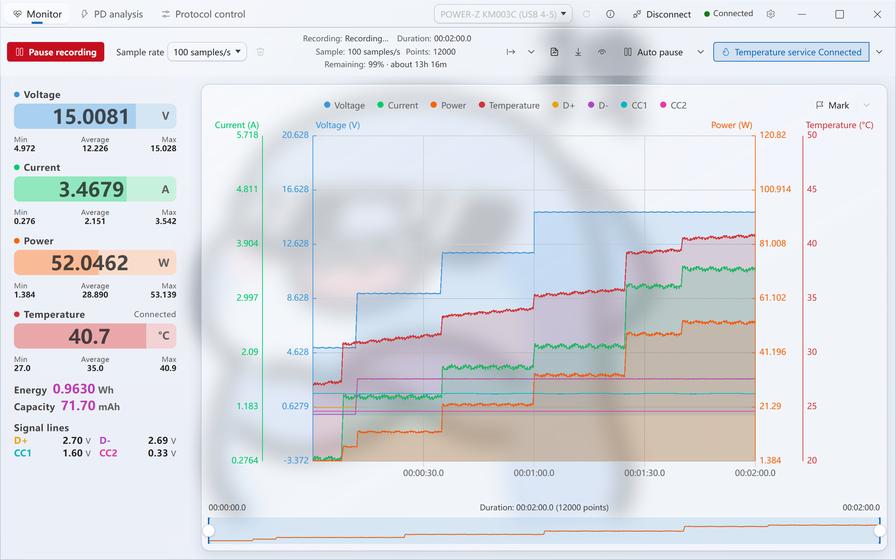
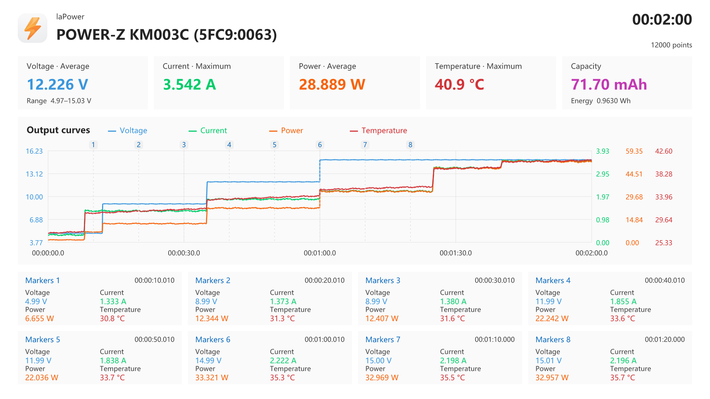
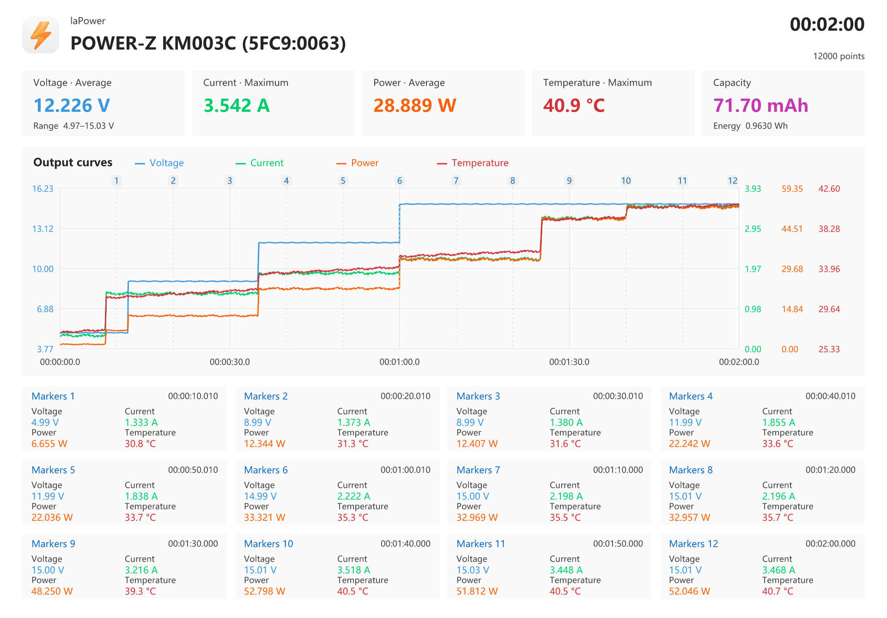
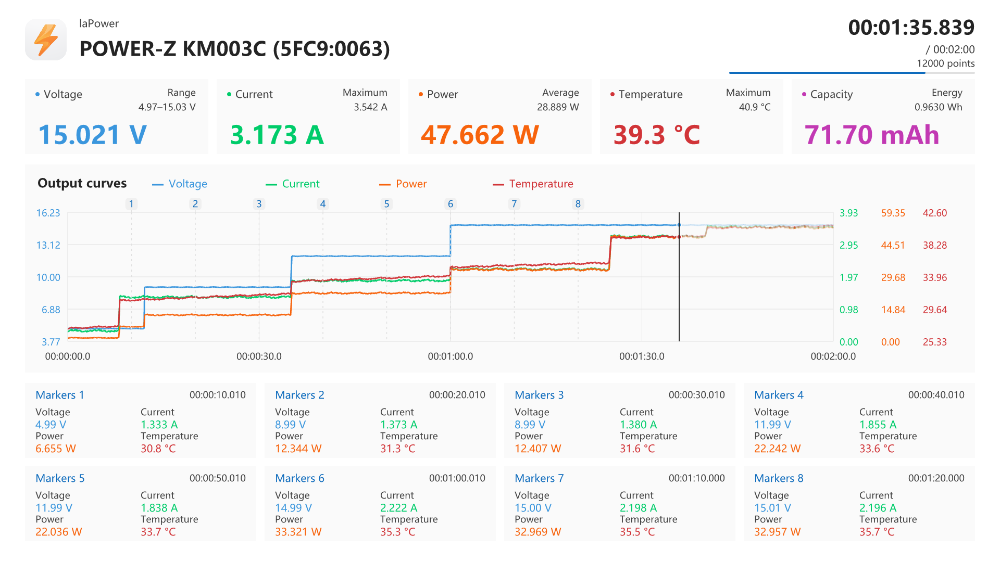
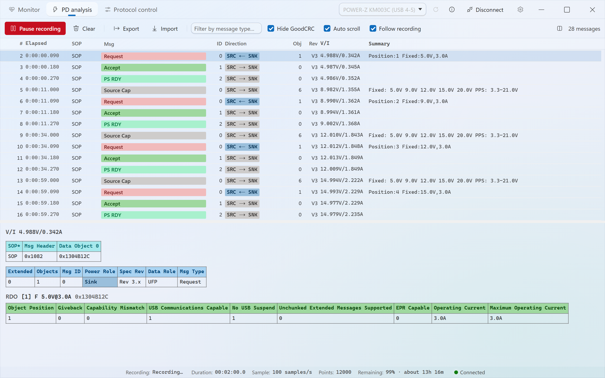
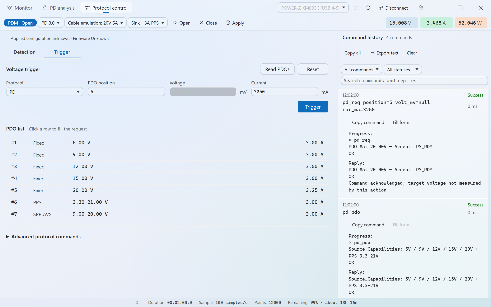
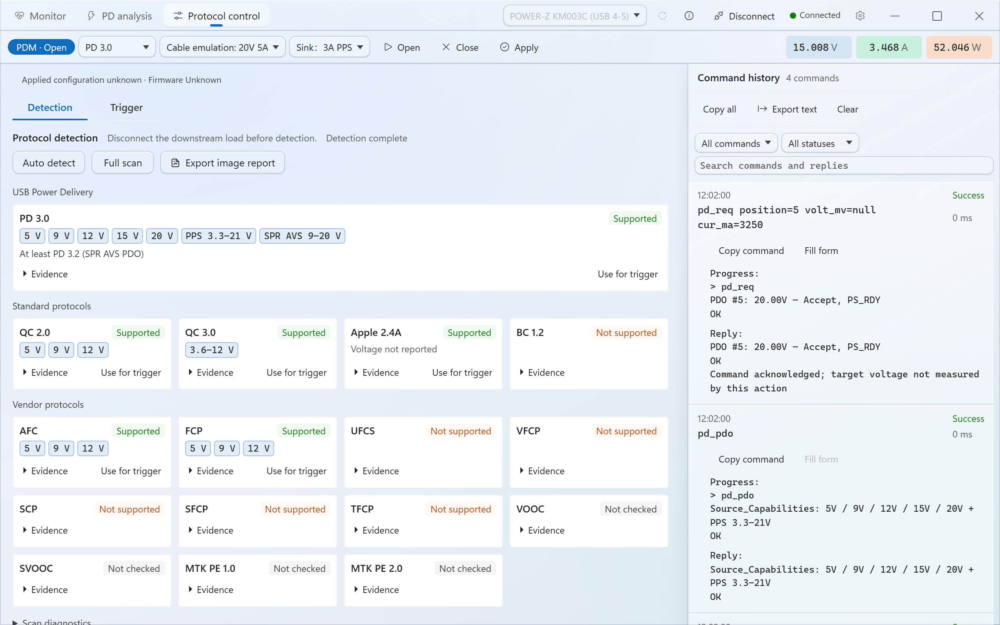
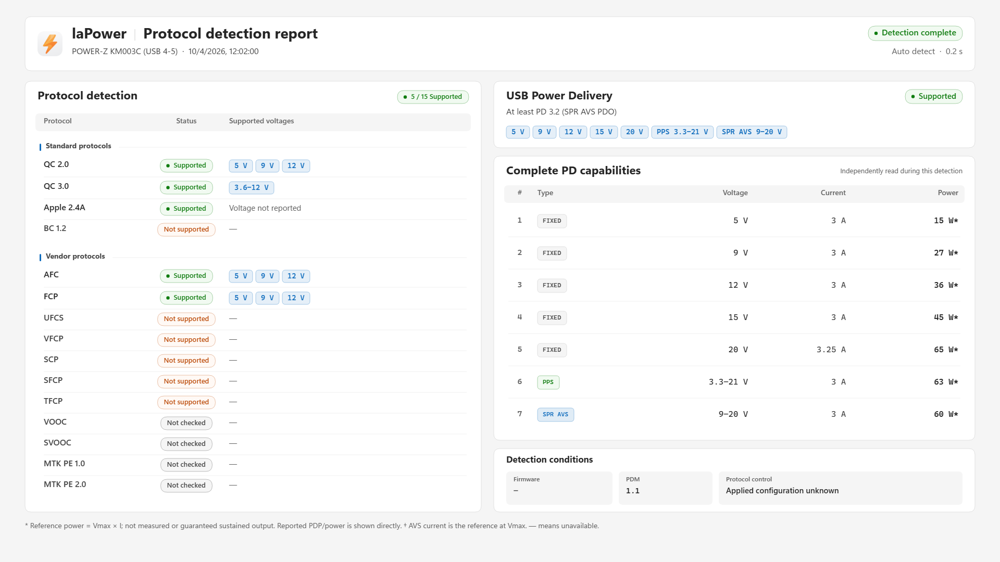
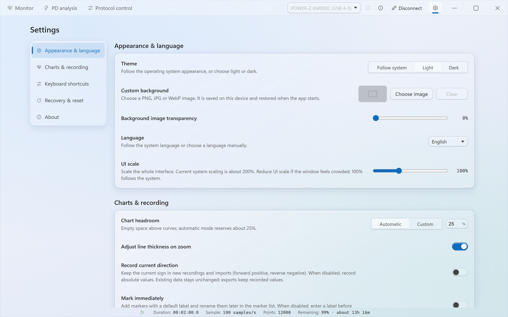

**English** | [简体中文](../USAGE.md) | [繁體中文](../zh-TW/USAGE.md) | [日本語](../ja/USAGE.md)

← Back to [README](../../README.md)

# User guide

This guide covers laPower **0.3.0**. Screenshots come from a simulated Windows setup; enabled temperature, signal channels, and sample rates do not reflect first-run defaults. Dark mode uses identical controls.

- [Getting started](#getting-started)
- [Interface overview](#interface-overview)
- [Monitor workspace](#monitor-workspace)
- [PD analysis workspace](#pd-analysis-workspace)
- [POWER-Z protocol control](#power-z-protocol-control)
- [Settings](#settings)
- [File formats](#file-formats)
- [Troubleshooting](#troubleshooting)

## Getting started

1. Connect the meter's data port to your computer, click the title-bar refresh icon, select the device, and click `Connect`. On Linux, configure [udev rules](DEVELOPMENT.md#udev-rules-required) first.
2. Open `Monitor` and choose a `Sample rate` (default `4 samples/s`). Connecting updates the large live readings without starting a recording.
3. Click `Start recording` (or press `P`). Charts, point count, min/avg/max statistics, and energy/capacity integration start immediately and continue across workspace switches.
4. For temperature readings, connect a source separately under [Temperature service](#temperature-service).
5. Click `Pause recording` to inspect data or `Continue recording` to append to the same session (live previews still update while paused without adding recorded points).
6. Use `Export CSV` for long-term storage (temporary recovery files do not replace exports); open the arrow beside `Export CSV` to configure columns or run a joint CSV/PD export.

## Interface overview

### Title bar

On the left are `Monitor`, `PD analysis`, and `Protocol control`; on the right are device selection, refresh, device info, connect/disconnect, and the Settings gear. Windows/Linux use Windows-style window controls on the right; macOS uses native controls on the left.

| Entry | Purpose |
| --- | --- |
| `Monitor` | Live readings, chart recording, markers, CSV import/export, and report export |
| `PD analysis` | USB-PD capture, field-tree inspection, and PD JSON import/export |
| `Protocol control` | POWER-Z PDM sessions, protocol detection, and voltage requests (always visible; actions enable on supported KM003C/KM002C connections) |
| Settings gear | Appearance & language, Charts & recording, Keyboard shortcuts, Recovery & reset, and About |

Narrow windows collapse labels to icons (hover to read names); lower `UI scale` in Settings if controls feel crowded.

### Device connection and information

The info icon between Refresh and Connect opens model, `VID`, `PID`, `SN`, and device notes (preferring the connected device, otherwise the selected device, without requiring a connection).

Device entries append the USB topology port when available (e.g., `WITRN K2 (USB 4-4)`) and any extra interface suffix. Because WITRN serial numbers can be shared across production batches, use the USB port to distinguish identical units. Disconnect before switching to another meter.

### Status bar

Centered along the bottom are the recording toggle button, duration, sample rate, recorded point count, and remaining capacity/estimated time. Once a meter is connected, clicking the left icon button (showing play while paused and pause while recording) toggles Monitor recording. Duration and point count reflect recorded data rather than connection uptime.

## Monitor workspace



[View dark mode](../screenshots/en/dark-record.png)

### Command bar

| Control | Action and limits |
| --- | --- |
| `Start recording` / `Continue recording` / `Pause recording` | Start empty, append to existing data, or pause; existing data stays intact across disconnects |
| `Sample rate` | Set the live sample interval (see table below) |
| Main `Export CSV` button | Export the entire recording with saved options (unaffected by chart selection) |
| Arrow beside `Export CSV` | Configure CSV content options and joint CSV/PD export |
| `Export report` | Export the recording as a PNG image (16:9 or long) or short video; available after two recorded samples. See [Export report](#export-report) |
| `Import CSV` | Load a CSV file; prompts to replace and pauses recording if data exists or recording is active, restoring markers from the file |
| `Reset` | Available when paused; confirms before clearing the chart, statistics, totals, and markers (and PD messages when Follow recording is on) |
| `Display` | Configure channel visibility, curve shading, fill opacity, colors, line width, Y offset, and statistics scope |
| `Auto pause` and arrow | Main button enables/disables auto pause; arrow configures trigger rule, threshold, and hold duration |
| `Temperature service` and arrow | Main button connects/disconnects the temperature source; arrow selects Device/External TCP, IP, and port |

Split-button main actions and arrows work independently; opening a flyout does not start recording or connect sources. Click outside or press Escape to close a flyout (Escape returns focus to the button).

### Sample rate

| Option | Interval |
| --- | --- |
| `1000 samples/s` | 1 ms; POWER-Z KM003C/KM002C only |
| `100 samples/s` | 10 ms |
| `10 samples/s` | 100 ms |
| `4 samples/s` (default) | 250 ms |
| `2 samples/s` | 500 ms |
| `1 sample/s` | 1000 ms |
| `0.2 samples/s (1 every 5s)` | 5000 ms |
| `0.1 samples/s (1 every 10s)` | 10000 ms |

If POWER-Z 1000 samples/s is unsupported or authentication fails, the app falls back to `100 samples/s` and explains why. Slower rates average all frames in each interval, smoothing short spikes; pick a higher rate to inspect transients. CSV import uses the file's timestamps without altering your preferred live rate.

### Readings and statistics

The left panel shows voltage, current, power, temperature, energy, capacity, and signal lines. Beneath each main card, `Min` / `Average` / `Max` reflect recorded samples only (live preview changes during pauses are excluded).

Energy (Wh) and capacity (mAh) are integrated from samples, excluding pauses and excessively large time gaps, and are preserved on resume or recalculated on import. Enabling `Record current direction` displays a direction arrow while computing power and totals from magnitudes. Drag the panel divider to resize; overflow scrolls inside the panel without reserving scrollbar space.

### Display, chart and timeline

- Open `Display` to toggle curves. Voltage, current, power, and temperature are enabled by default (enabling the temperature curve does not connect its source); D+/D− and CC1/CC2 default off.
- `Curve shading` at the top defaults on and persists; disabling it preserves each main channel's fill opacity (0–100%, default 15%; `0` removes fill only) and restores them when re-enabled. Recording, pausing, and zooming never change shading automatically. The legend reflects currently visible channels.
- Y axes start at zero (extending negative when needed) with quantized shared grid steps and aligned round ticks across all four axes. `Display` adjusts per-channel color, fill opacity, line width (auto/manual), and `Y offset` (`0` resets) as visual projections without modifying stored samples or integrals.
- Hover the main plot for exact valid channel readings at that timestamp. Scroll over the main plot or timeline navigator to zoom horizontally (zooming a historical window stays in history; zooming while following live data preserves live follow), drag the main plot horizontally to pan when zoomed in, and drag the timeline handles to resize/pan the selected window. Vertical axes do not refit while scrolling/dragging; new peaks apply once the gesture ends.
- `Selected range only` (off by default) restricts min/avg/max and energy/capacity statistics to the timeline window without removing data or limiting exports.

See [Performance benchmarks and limits](PERFORMANCE.md) and [Architecture](ARCHITECTURE.md) for rendering and integration internals.

### Markers

1. Click `Mark` above the chart or press `M` to enter a label (e.g. `Mark 1`). Clicking while recording marks the next incoming sample; while paused, the last sample; pressing `M` over the plot marks the nearest point under the pointer.
2. The arrow beside `Mark` opens the marker list once markers exist; click a label to rename it or clear/delete it.

Enable `Mark immediately` under `Settings → Charts & recording` to skip the prompt. Labels are capped at 40 characters (CSV separators cleaned), stored in the CSV `Marker` column, restored on import, and cleared on `Reset`.

### Auto pause

1. Open the `Auto pause` arrow, choose `Voltage <`, `Current <`, or `Power <`, enter `Threshold` and `Hold duration` (seconds), and close the flyout.
2. Click the main `Auto pause` button (highlighted when active), then start or continue recording.

Recording pauses when readings stay at or below the threshold (equality is included) for the hold duration; a `0` duration triggers on the first matching sample. Defaults are disabled, `None`, and `0`; changing fields alone does not enable it.

### Temperature service

Temperature acquisition, curve visibility, and the CSV temperature column are independent controls:

1. Open the `Temperature service` arrow and pick `Source`: `Device` reads the meter sensor (connect the meter first, no external tool needed); `External` connects to a TCP server (default `127.0.0.1:1573`).
2. Close the flyout and click the main `Temperature service` button to connect; valid readings populate the card and record with Monitor.
3. Toggle temperature visibility in `Display` and `Include temperature` in CSV options separately as needed.

Source, IP, and port lock while connected (disconnect first); restart requires manual reconnection. `Device` temperature resets when the meter disconnects, whereas `External` TCP runs independently; historical readings remain after disconnection with missing values left blank. See [External temperature service](DEVELOPMENT.md#external-temperature-service) for the protocol and Python examples.

### CSV options and joint export

Three CSV flags persist: `Include temperature` (default off), `Include device information` (default on), and `Include markers` (default on). Selected empty columns remain blank; unknown device provenance is never backfilled from the current meter.

`Export CSV and PD data…` requires data in both Monitor and PD. Selecting one destination freezes both snapshots and writes `name.csv` and `name.pd.json` with all data (unaffected by chart selection or PD filters; confirms before overwriting). If `Follow recording` is off, time spans can differ and are not auto-trimmed.

### Export report



[Dark theme](../screenshots/en/dark-report-image.png)



[Dark theme](../screenshots/en/dark-report-long.png)



[Dark theme](../screenshots/en/dark-report-video.png)

Click **Export report** in the Monitor command bar to save the entire frozen recording as a lossless PNG image or short video (persisting type, 720p–4K resolution, theme, and content choices). **Report content** independently toggles voltage, current, power, temperature, **Markers**, and **Marker details** (markers on the chart vs. detail rows below).

- **PNG image report**: static layout displaying full curves, duration, point count, time-weighted average voltage/power, peak current, maximum temperature, and capacity/energy (missing values explicit). **16:9** retains up to the first 8 markers (warning if more exist); **Long image** retains all markers and expands height (reporting an explicit error if dimensions exceed safe limits rather than silently dropping markers).
- **Video report**: supports MP4/MOV, H.264/H.265, 24/30/60 fps, and 1–60 s duration, fast-forwarding the whole recording while updating the five reading cards along the timeline (card upper-right summaries cover the full recording; up to 8 markers).

Clicking **Generate image** or **Generate video** freezes data and runs in a single background slot (closing the dialog keeps encoding alive and reopening reattaches progress); only successful completion writes the final file, while cancellation or failure removes staging files.

#### Video quality and encoding mode

The export dialog provides `Encoding mode` (default `Automatic`) and `Quality` (default `High`). Changing either re-probes host support and shows the target bitrate:

| Quality | H.264 (1080p / 30 fps) | H.265 (1080p / 30 fps) |
| --- | --- | --- |
| Standard | 10 Mbps | 6.5 Mbps |
| High (default) | 20 Mbps | 13 Mbps |
| Ultra | 30 Mbps | 19.5 Mbps |

Bitrates scale linearly with pixel count and frame rate (4 Mbps H.264 / 3 Mbps H.265 floor; 240 Mbps ceiling). `Automatic` prefers hardware encoding and falls back to software with a notice; `Hardware encoding` requires a real hardware encoder (Windows tries GPU textures, then CPU frames submitted to hardware); `Software encoding` skips hardware probing (Linux supports automatic/software H.264 only; macOS software HEVC requires host support). No ffmpeg installation is needed.

## PD analysis workspace



[View dark mode](../screenshots/en/dark-pd.png)

### Choose the recording mode

`Follow recording` is enabled by default, changing the recording button's scope:

| Mode | Recording button and capture | Clearing |
| --- | --- | --- |
| Follow recording on | `Start recording` / `Pause recording` controls both Monitor and PD; PD ignores new frames while Monitor is paused (shows `Start recording` when paused even if Monitor has data) | Clearing either clears both Monitor and PD |
| Follow recording off | `Pause recording` / `Continue recording` only pauses/resumes list display while connected buffering continues without affecting Monitor | Each view clears independently |

To pause list updates while buffering in the background, disable `Follow recording` before pausing the list. Switching workspaces does not pause capture.

### List and details

| Control | Purpose |
| --- | --- |
| `Import` / `Export` | Load/save PD capture JSON (exports full capture regardless of filters; confirms before replacing) |
| `Clear` | Clear after confirmation (follows link behavior above) |
| Message-type filter | Filter visible rows by message type name |
| `Hide GoodCRC` | Hide link-layer acknowledgements (on by default) |
| `Auto scroll` | Scroll to new messages automatically (on by default) |
| Layout icon | Persist stacked/side-by-side layout (side-by-side requires ≥ 1400 px width); drag divider to resize |

Columns show `#`, `Elapsed`, `SOP`, `Msg`, `ID`, `Direction`, `Obj`, `Rev`, `V/I` (nearby meter sample), and `Summary`. Select any row to inspect raw bytes, header fields, and decoded PDO/RDO trees. To capture a new charger handshake, start recording before reconnecting the tested link.

## POWER-Z protocol control



[View dark mode](../screenshots/en/dark-trigger.png)

Always visible in the title bar, this tab enables controls only when a supported POWER-Z KM003C/KM002C is connected. It opens on `Trigger`; top `PD type`, `Cable emulation`, `Sink` settings, and live V/I/P readings (shared with Monitor) apply to both `Detection` and `Trigger`.

### Read PDOs and request a voltage

1. Choose `PD type`, `Cable emulation`, and `Sink`, then click `Open` to start PDM (top status separates UI selection from confirmed device settings and displays detected firmware versions; reopen PDM after disconnection or stream rebuilds).
2. Click `Read PDOs` to fetch charger capabilities, or run `Auto detect` / `Full scan`.
3. Click a PDO row to populate the request form, verify position, voltage (mV), and current (mA), and click `Trigger` (selecting a row does not transmit):
   - Known fixed PD PDOs keep voltage read-only and omit `volt`; UFCS preserves `NUM` positions; PPS/AVS and unknown positions allow manual entry.
4. Check the log for confirmation; use `Apply` after editing PDM parameters, `Reset` to return to 5 V, and `Close` to end PDM.

**Command history and advanced commands:**

- While a command runs, other commands lock and `Cancel` appears; only one command runs at a time.
- The docked right-hand history groups entries by command with timestamps, parameters, duration, status, live progress, and replies (filterable, copyable, exportable, and refillable without replaying). History is session-only up to 64 KB (evicting oldest completed entries first and trimming oversized lines explicitly), preserving repeated states in arrival order.
- Advanced commands provide PD/UFCS and custom commands (custom commands can run without PDM and re-verify protocol state afterward; `pd data` accepts hex bytes with standard separators and rejects invalid characters).

### Protocol detection



[Dark theme](../screenshots/en/dark-detection.png)



[Dark theme](../screenshots/en/dark-protocol-report.png)

> **Warning:** Detection switches protocols and runs 5 V load checks—disconnect any downstream load first.

- **Scan modes and result matrix**: `Auto detect` (~4 min budget) runs standard scanning plus individual probes for inconclusive standard protocols; `Full scan` (~7 min budget) tries `entry list+` first for VOOC/SVOOC and MTK PE (falling back to standard scan if needed; older PDM marks unsupported extensions “Not checked”). Results separate Supported, Not supported, Not checked, and Unconfirmed across PD, Standard, and Vendor groups, keeping VOOC/SVOOC and MTK PE 1.0/2.0 distinct without cross-inference or wattage guesses. Expand “Evidence” for raw replies; `Use for trigger` only switches to `Trigger` and fills the form.
- **Independent PD discovery and version rules**: Detection ignores scan-embedded PD status and runs `reset → entry pd → pd pdo` after all other probes (unless cancelled). PD revision prefers a complete `Get_Revision` response, then an explicit meter-scan PD 3.0/3.1/3.2 label, then the minimum implied by PDOs (PPS ≥ 3.0, EPR ≥ 3.1, SPR AVS ≥ 3.2; ordinary fixed PDOs cannot distinguish versions). A lower `Get_Revision` cannot override SPR AVS's PD 3.2 floor and triggers an explicit conflict notice.
- **5 V verification and reset**: Single-protocol 5 V probes take the median of five fresh samples ≥ 500 ms after acknowledgement within `max(200 mV, 3%)` (up to 12 s). Completion and cancellation immediately attempt reset and 5 V verification within 15 s, warning if recovery is unconfirmed.
- **Export image report**: Click **Export image report** to save a 16:9 PNG (1920×1080 / 2560×1440 / 3840×2160; light/dark theme saved independently from monitoring reports). Opening the dialog freezes the scan snapshot, showing all protocol states, PD version, and complete PDOs with SPR AVS bands (`*` marks Vmax × I reference power, `†` marks AVS current at max voltage, `—` marks missing values; partial/cancelled runs remain exportable with warnings).

## Settings



[View dark mode](../screenshots/en/dark-settings.png)

Open via the title-bar gear (`⌘,` or Settings… on macOS). Wide windows pin navigation to the left; windows under 980 px place it horizontally on top. Changes save immediately without a Save button.

### Appearance & language

| Setting | Choices and defaults |
| --- | --- |
| `Theme` | `Follow system` (default), `Light`, `Dark` |
| `Language` | `Follow system` (default), 简体中文, 繁體中文, English, 日本語 |
| `Interface font` / `Monospace & numeric font` | Independently pick installed system fonts for UI text vs. monospace readings, timestamps, chart ticks, and tables (localized to language-specific CJK/Latin controls in Chinese and Japanese; changing one leaves system defaults intact, with the default font name shown, live preview, and `Reset fonts`) |
| `Custom background` | Select a local PNG, JPG, or WebP image (≤ 25 MB) to persist as backdrop, or `Clear` to reset (no bundled wallpaper) |
| `Background image opacity` | 0–100%, default 100% (0% hidden, 100% full) |
| `Background image blur` | 0–40 px, default 14 px (0 px sharp) |
| `UI scale` | 50–200%, default 100%, applied on release; lower if controls feel crowded |

Language switches take effect immediately without losing recordings or connections; see [Language selection](DEVELOPMENT.md#language-selection) for locale rules and Linux launch examples.

### Charts & recording

| Setting | Meaning and default |
| --- | --- |
| `Chart headroom` | `Automatic` scales to peaks across visible channels; `Custom` accepts 0–100% |
| `Adjust line thickness on zoom` | On by default; automatically scales line width with zoom level |
| `Record current direction` | Off by default; preserves signed current for new recordings/imports while integrating magnitudes |
| `Mark immediately` | Off by default; skips the label prompt when adding markers |
| `Start recording with system time` | Off by default; displays chart X-axis, timeline bounds, tooltips, and marker times as system clock time from recording start (duration and CSV format stay unchanged) |
| `Recording limit` | 64–8192 MB, default 512 MB; covers all current chart data (including existing/imported) and pauses when reached |

### Keyboard shortcuts

| Action | Default | Workspace |
| --- | --- | --- |
| Start/pause/continue recording | `P` | Monitor |
| Mark | `M` | Monitor |
| Import | `Ctrl+O` | Monitor CSV; PD JSON |
| Export | `Ctrl+S` | Monitor CSV; PD JSON |
| Joint CSV/PD export | `Ctrl+Shift+S` | Monitor |
| Clear | Unassigned | Monitor, PD (confirmation and follow linkage apply) |

macOS maps `Ctrl` to `Command`. Click any binding to rebind (Escape cancels), unassign, or reset individual/all shortcuts; shortcuts pause while typing or inside menus, flyouts, and dialogs.

### Recovery & reset

`Keep temporary recovery files` (on by default) writes once per second to app cache while recording. Unfinished sessions appear here with `Recover` / `Delete` (recovering replaces Monitor data after confirmation and excludes separate PD JSON). Clean clear, import, or exit removes temporary files after synchronization.

`Reset all settings` restores preferences and shortcuts only, unlike Monitor's data-clearing `Reset`.

### About

Shows application info, `Copyright (C) 2026 KHWLGH` (own contributions), LGPL-3.0-or-later protocol crate notices (`usbpd-parser` and `witrn-hid` retain `Copyright (c) 2025 JohnScotttt`), `Open-source licenses` (offline viewer with text copying and position memory), `GitHub`, and `Check for updates` (requests stable GitHub releases only on click; never downloads or installs automatically). The third-party card lists major dependencies and expands `All runtime components` offline with per-component license links. Full source scope lives in [`COPYRIGHT`](../../COPYRIGHT), [`LICENSE`](../../LICENSE), and [`LICENSE.LGPL-3.0`](../../LICENSE.LGPL-3.0).

## File formats

### CSV

Monitor reads and writes CSV with summary metadata rows before column headers, optionally followed by software/device/sampling provenance (this single-point example enables temperature and markers):

```csv
SUM,1
TotalTime,00:00:00.250
SampTime(ms),250
DateTime,2026-10-17 12:00:00
Software,laPower 0.3.0
Device,WITRN K2 (0716:5060)
Points,mean

SystemTime,SoftwareTime(s),Voltage(V),Current(A),Power(W),Temp(°C),D+(V),D-(V),CC1(V),CC2(V),RecordingSegment,SampleInterval(ms),Marker,
2026-10-17 12:00:00.250,0.25,5,0.5,2.5,25,0.6,0.1,1.6,0.3,1,250,Start,
```

- `SystemTime` records local wall-clock timestamps (`YYYY-MM-DD HH:MM:SS.mmm`) and `SoftwareTime(s)` records exact relative software seconds (standard plain CSV without `="..."` wrappers).
- `RecordingSegment` separates pause segments, `SampleInterval(ms)` records per-point intervals, and optional `CurrentMagnitude(A)` preserves unsigned magnitudes for consistent capacity recalculation.
- Imports match columns by header name, remaining backward compatible with legacy CSV layouts (`Time(D.hh:mm:ss.ms)`, `RelativeTime(s)`, `Timestamp(ms)`) as well as files without temperature, signals, or trailing columns; missing provenance remains unknown.

### PD capture

PD uses separate JSON (`app: "laPower"`, `kind: "pd-capture"`, `version: 2`, accepting version 1). Imports validate and replace the current PD log; jointly exported `.csv` and `.pd.json` files must be imported separately in their respective workspaces.

## Troubleshooting

### Device missing or connection fails

Use the meter's data port and a data-capable cable, close other meter utilities, refresh, and reconnect. Linux requires [udev rules](DEVELOPMENT.md#udev-rules-required); see [Supported devices](../../README.md#-supported-devices).

### Connected but the chart is empty

Connecting starts live previews only—click `Start recording` (or `Continue recording` when paused). Incompatible firmware report layouts can also produce no valid samples.

### Temperature stays at `--`

Select a source and connect via [Temperature service](#temperature-service) (default is External TCP; pick `Device` for meter temperature). Chart/CSV toggles do not start acquisition; some meter firmware does not output valid temperature.

### No new PD messages

Verify device connection and `Follow recording` (linked capture requires active Monitor recording), and replug the tested USB link to trigger a fresh handshake. In independent mode, click `Continue recording` if paused and check active filters.

### Long recordings on macOS

Active recording prevents idle system sleep while allowing display sleep; connecting alone or pausing does not. macOS 14+ disables WebView background throttling; keep the window visible on macOS 12–13. Closing the lid or manual sleep can still interrupt USB acquisition.

> Formerly WITRN-RS; laPower uses separate settings directories, and existing CSV and compatible PD captures remain directly importable.
