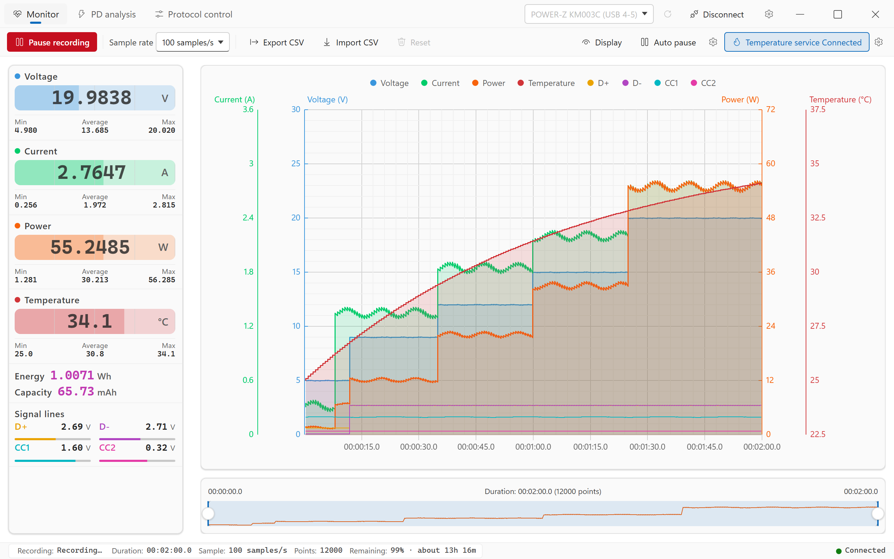
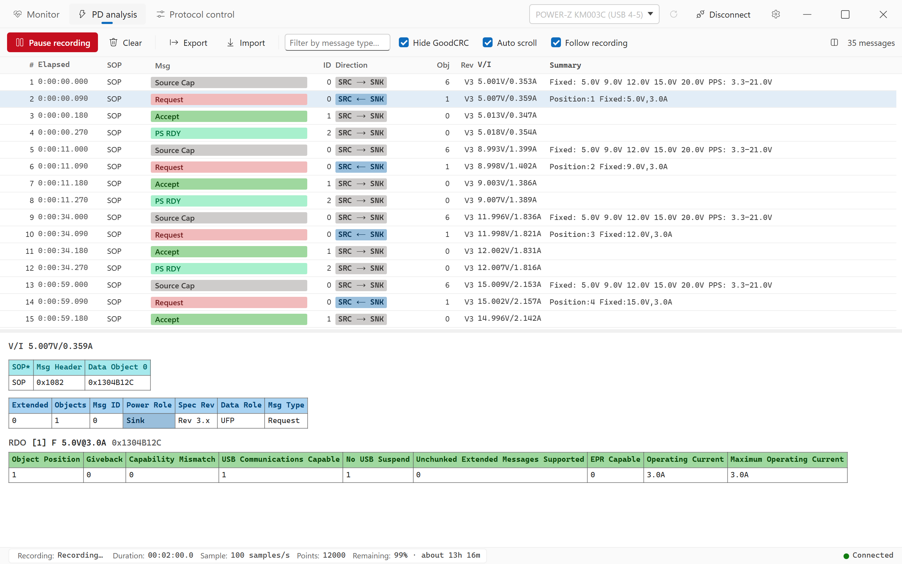
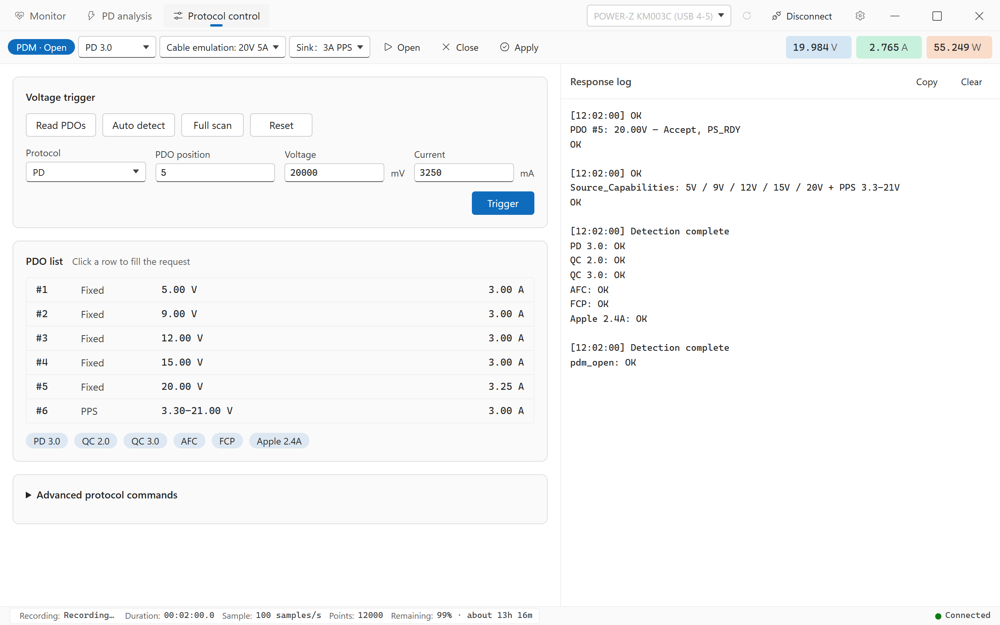
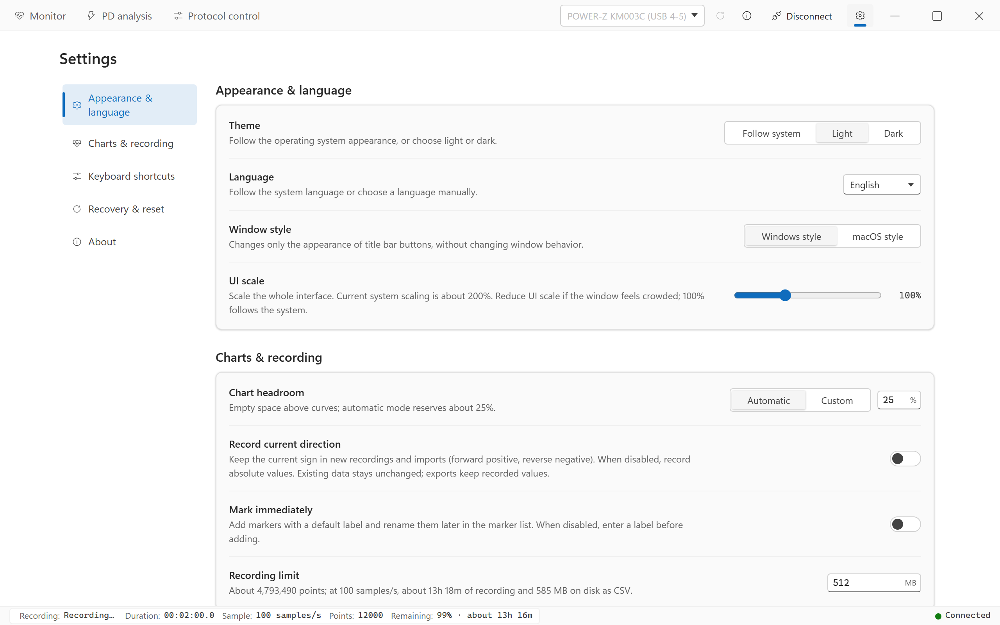

**English** | [简体中文](../USAGE.md) | [繁體中文](../zh-TW/USAGE.md) | [日本語](../ja/USAGE.md)

← Back to [README](../../README.md)

# User guide

This guide covers laPower **0.2.5**. Screenshots were taken on Windows with simulated devices and data; their enabled temperature, signal channels and sample rate are not first-run defaults. Dark mode uses the same controls.

- [Getting started](#getting-started)
- [Interface overview](#interface-overview)
- [Monitor workspace](#monitor-workspace)
- [PD analysis workspace](#pd-analysis-workspace)
- [POWER-Z protocol control](#power-z-protocol-control)
- [Settings](#settings)
- [File formats](#file-formats)
- [Troubleshooting](#troubleshooting)

## Getting started

1. Connect the meter's data port to your computer. Click the title-bar refresh icon, select the meter, then click `Connect`. On Linux, first configure the [udev rules](DEVELOPMENT.md#udev-rules-required).
2. Open `Monitor` and choose a `Sample rate`; the default is `4 samples/s`. Connecting updates the large live readings, but does not start recording.
3. Click `Start recording`. The chart and recorded point count grow, with recorded statistics and accumulated energy/capacity. Changing workspaces does not pause recording.
4. To include temperature, enable it separately using [Temperature service](#temperature-service). Connecting the meter alone does not enable temperature acquisition.
5. Click `Pause recording` to inspect data, or `Continue recording` to append to the same recording. Live readings can still change while paused; the chart and accumulated totals do not grow.
6. Click `Export CSV` and select a destination. Use its arrow first to include temperature or change the export contents. Export files for long-term storage; recovery files do not replace exports.

## Interface overview

### Title bar

`Monitor`, `PD analysis` and `Protocol control` are always available on the left. On the right are device selection, refresh, information, connect/disconnect and the Settings gear. The position of window controls depends on the operating system and window style.

| Entry | Purpose |
| --- | --- |
| `Monitor` | Live readings, chart recording, markers and CSV import/export |
| `PD analysis` | USB-PD capture, message inspection and PD JSON import/export |
| `Protocol control` | POWER-Z PDM sessions, protocol detection and voltage requests. The tab stays visible; control actions require a supported KM003C/KM002C connection |
| Settings gear | Appearance & language, Charts & recording, Keyboard shortcuts, Recovery & reset, and About |

Narrow windows can show icons without text; hover to identify them. Reduce `UI scale` in Settings if controls feel crowded.

### Device connection and information

The information-only icon sits between Refresh and Connect. It opens the model, `VID`, `PID`, `SN` and device description, prioritizing the connected meter, then the selected meter, or an empty state. It works before connecting and updates when the selection or device list changes.

Device names may include a USB port, such as `WITRN K2 (USB 4-4)`, and an interface suffix when several HID interfaces remain for the same physical device. WITRN serial numbers can be shared; use ports to distinguish identical models. Disconnect before selecting another meter.

### Status bar

The bottom bar shows recording state, duration, sample rate, recorded points, remaining recording capacity/estimated time, and connection state. Click its recording state to start or pause Monitor recording; starting requires a connected meter. Duration and points describe the recording, not the time the meter has been connected.

## Monitor workspace



[View dark mode](../screenshots/en/dark-record.png)

### Command bar

| Control | Action and limits |
| --- | --- |
| `Start recording` / `Continue recording` / `Pause recording` | Start an empty recording, append to existing data, or pause. Disconnection preserves recorded data; reconnect to continue |
| `Sample rate` | Set the live sample interval; see below |
| Main `Export CSV` button | Export the entire recording using saved options; the chart selection does not limit the export |
| Arrow beside `Export CSV` | Open CSV content options and joint export |
| `Import CSV` | Load a file; confirm replacement if data exists or recording is active. Confirmation pauses the current recording. Import stays paused and replaces existing markers with markers from the file |
| `Reset` | Disabled while recording. Once paused, confirm to clear the chart, statistics, totals and markers. Also clears PD messages when Follow recording is enabled |
| `Display` | Choose visible channels, fill opacity and statistics scope |
| `Auto pause` and its arrow | Main button enables/disables; arrow configures the trigger |
| `Temperature service` and its arrow | Main button connects/disconnects; arrow configures source, IP and port |

Main and arrow actions are independent. Opening configuration does not start recording, enable auto pause or connect temperature. Click outside to close a flyout; Escape closes it and returns focus to its trigger.

### Sample rate

| Option | Interval |
| --- | --- |
| `1000 samples/s` | 1 ms; POWER-Z KM003C/KM002C only |
| `100 samples/s` | 10 ms |
| `10 samples/s` | 100 ms |
| `4 samples/s` (default) | 250 ms |
| `2 samples/s` | 500 ms |
| `1 sample/s` | 1000 ms |
| `0.2 samples/s (1 every 5s)` | 5000 ms |
| `0.1 samples/s (1 every 10s)` | 10000 ms |

If POWER-Z high-rate sampling is unavailable or authentication fails, the app falls back to `100 samples/s` and explains why. Slower rates combine multiple frames into a point and can average out short spikes; use a faster supported rate to inspect transients. Import uses the file's timestamps and intervals without changing the preferred live recording rate.

### Readings and statistics

The left panel contains voltage, current, power, temperature, energy, capacity and signal lines. Large values are live previews after connection. The `Min` / `Average` / `Max` statistics beneath the main readings use recorded samples. A changing live preview during a pause is not a new recorded point.

Energy (Wh) and capacity (mAh) are integrated from recorded data. Pauses are excluded; continuing retains totals, and importing recalculates them from the file. Long data gaps are also excluded. `Record current direction` enables the current direction arrow; power and accumulated totals use magnitudes.

Drag the panel's right divider to resize it; narrow windows limit the resulting width. If readings do not fit vertically, scroll inside the panel. Its scrollbar is hidden without reserving blank space.

### Display, chart and timeline

- Open `Display` to choose curves. Voltage, current, power and temperature are selected by default; D+/D- and CC1/CC2 are off. Selecting the temperature curve does not connect its source.
- Each main channel has a fill opacity from 0–100%, default 15%. Zero removes fill, not the curve. The legend identifies visible channels; it does not toggle them.
- Hover for enabled channels with valid values at that time. The mouse wheel zooms the main chart around the pointer.
- Drag the bottom timeline's end handles to resize the range or its middle to pan. A range touching the newest point follows new data; a historical range stays in place.
- `Selected range only` is off by default. Enabling it limits min/average/max and energy/capacity to the selected range; the large live readings still show current previews. It neither removes data nor limits exports. Missing values are excluded from statistics.

Rendering does not run at the same rate as acquisition. See [Performance notes](PERFORMANCE.md) and [Architecture](ARCHITECTURE.md) for rendering and integration details.

### Markers

1. Click `Mark` above the chart or press the default `M` shortcut, enter a label and confirm. Defaults look like `Mark 1`.
2. While recording, the button marks the next arriving point; while paused, it marks the last point. Pressing `M` over the main chart marks the nearest point under the pointer. The position is chosen before the label dialog opens.
3. Its arrow opens the marker list, available once markers exist. Click a label to rename it; an empty name or the delete icon removes it.

Enable `Mark immediately` under `Settings → Charts & recording` to skip the label dialog. Labels have a 40-character limit and CSV separators are cleaned. The CSV `Marker` column stores markers, and importing it restores them; `Reset` clears them.

### Auto pause

1. Open the arrow beside `Auto pause` and select `Voltage <`, `Current <` or `Power <`.
2. Enter `Threshold` and `Hold duration` in seconds, then close the flyout.
3. Click the main `Auto pause` button to enable it, indicated by highlighting, then start or continue recording.

Recording pauses when the measurement stays at or below the threshold for the hold duration. Although the condition label shows `<`, equality also satisfies the current check. A duration of 0 triggers on the first qualifying recorded sample. Defaults are disabled, `None`, threshold 0 and duration 0. Changing configuration does not enable the feature; `None` never triggers it.

### Temperature service

Temperature acquisition, curve visibility and the CSV temperature column are separate controls.

1. Open the arrow beside `Temperature service` and choose a `Source`.
2. For meter temperature choose `Device` and connect the meter first; no external program is needed. For TCP choose `External` and enter `IP` and `Port`, default `127.0.0.1:1573`. First-run defaults are External and disconnected.
3. Close the flyout and click the main `Temperature service` button to connect. Valid data appears in the temperature card and is stored with Monitor recording.
4. Select temperature in `Display` to show its curve, and separately enable `Include temperature` to include it in CSV.

Source, IP and port cannot change while connected; disconnect with the main button first. Restarting requires manual reconnection. Meter temperature ends with the meter connection; external TCP is independent. Historical data stays after disconnection, and missing values are blank. The TCP server sends one Celsius number per line; see [External temperature service](DEVELOPMENT.md#external-temperature-service) for the protocol and examples.

### CSV options and joint export

The three CSV options are saved: `Include temperature` is off by default; `Include device information` and `Include markers` are on. Selected temperature/marker columns remain with blank cells when data is missing. Unknown device provenance is not filled from the currently connected meter.

`Export CSV and PD data…` in the same flyout requires Monitor and PD data. One destination selection creates `name.csv` and `name.pd.json`, with overwrite confirmation. Both exports use all data regardless of chart selection or PD filters. Their snapshots are fixed after destination selection; later samples are not appended to that export. When Follow recording is off, time ranges can differ and are not cropped or aligned automatically.

## PD analysis workspace



[View dark mode](../screenshots/en/dark-pd.png)

### Choose the recording mode

`Follow recording` is on by default. The recording button behaves differently in each mode:

| Mode | Recording button and capture | Clearing |
| --- | --- | --- |
| Follow recording on | `Start recording` / `Pause recording` controls Monitor and PD. New PD messages are not retained while Monitor is paused. The paused PD button says `Start recording` even when Monitor already has data | Clearing either view clears both Monitor and PD, as stated in the confirmation |
| Follow recording off | `Pause recording` / `Continue recording` pauses/resumes list refresh only. A connected device continues buffering messages, which appear on resume; Monitor recording is unaffected | Each view clears independently |

To pause a linked capture, use its recording button. To inspect a stationary list while continuing to buffer, turn off Follow recording and pause the list. Switching workspaces does not itself pause capture.

### List and details

| Control | Purpose |
| --- | --- |
| `Import` / `Export` | Load/save PD JSON. Export includes the whole capture regardless of filters. Import replaces the current PD capture, with confirmation when data exists |
| `Clear` | Confirm to clear; observe the linkage above |
| Message-type filter | Filter by message type name |
| `Hide GoodCRC` | Hide link acknowledgments; on by default. Uncheck to see GoodCRC |
| `Auto scroll` | Follow new messages to the bottom; on by default |
| Layout icon | Save stacked/side-by-side preference; side-by-side applies only at a window width of at least 1400px. Drag the list/detail divider to adjust their proportions |

Columns are `#`, `Elapsed`, `SOP`, `Msg`, `ID`, `Direction`, `Obj`, `Rev`, `V/I` and `Summary`. `V/I` is a nearby meter reading, not a guaranteed synchronized measurement. Select a row to see raw data, header fields and the applicable PDO/RDO or other decoded tables. Messages without data objects do not have PDO tables. Filters and hiding affect the view only.

Start recording before reconnecting the charger/tested connection to capture a new handshake. Merely opening PD analysis does not repeat a negotiation that already finished.

## POWER-Z protocol control



[View dark mode](../screenshots/en/dark-trigger.png)

This tab is always visible. Without a connection, or with WITRN, it displays guidance and disables control actions. Connect a POWER-Z KM003C/KM002C supporting protocol control to enable them.

### Read PDOs and request a voltage

1. Choose the PD type, cable emulation and Sink parameters at the top, then click `Open` to open PDM.
2. Click `Read PDOs` for charger capabilities, or `Auto detect` / `Full scan` to detect supported protocols.
3. Click a PDO row to fill the request. Check the position, voltage in mV and current in mA for the selected protocol, then click `Trigger`. Selecting a PDO row alone does not send the request.
4. Inspect the response log. Click `Apply` after changing PDM parameters. `Reset` exits the current protocol and restores default 5 V; `Close` closes the PDM session.

Other commands are disabled while a command runs; `Cancel` appears in the log area. Auto detection/full scanning can take about 90 seconds/3 minutes respectively. The advanced area has PD/UFCS and custom commands. Custom commands can run without PDM; other protocol operations require it. Reopen PDM after disconnection or rebuilding the meter acquisition connection. Live readings share the Monitor device connection.

## Settings



[View dark mode](../screenshots/en/dark-settings.png)

Open the title-bar gear; on macOS use ⌘, or the application's Settings… menu. This is one scrolling page in the order `Appearance & language`, `Charts & recording`, `Keyboard shortcuts`, `Recovery & reset`, `About`. About is at the bottom.

The directory stays on the left in wide windows and moves to a horizontal top bar below 980px. Click to jump, or use Tab and Enter; scrolling updates the highlight. Reduced-motion settings disable smooth jumps. Leaving and returning restores your position for this session. Settings normally save when changed, without a separate Save button.

### Appearance & language

| Setting | Choices and defaults |
| --- | --- |
| `Theme` | `Follow system` (default), `Light`, `Dark` |
| `Language` | `Follow system` (default), 简体中文, 繁體中文, English, 日本語 |
| `Window style` | Windows/Linux: `Windows style` (default) or `macOS style`. macOS uses native window buttons and hides this option |
| `UI scale` | 50–200%, default 100%; applied when the slider is released. Reduce it if the window is crowded |

Language changes apply immediately and retain recording/data. Unsupported system languages fall back to English. The detected language shown beside Follow system does not change with manual UI language selection. See [Development](DEVELOPMENT.md#language-selection) for detection and Linux launch examples.

### Charts & recording

| Setting | Meaning and default |
| --- | --- |
| `Chart headroom` | `Automatic` by default, about 25%; `Custom` allows 0–100% |
| `Record current direction` | Off by default. New recordings/imports preserve the current sign when enabled. Existing data is unchanged; export keeps recorded values |
| `Mark immediately` | Off by default. Enable to add markers without first entering a label |
| `Recording limit` | 64–8192 MB, default 512 MB. The budget covers all data in the current chart, including existing/imported data. Reaching it pauses recording; it does not automatically create multiple files |

### Keyboard shortcuts

| Action | Default | Workspace |
| --- | --- | --- |
| Start/pause/continue recording | `P` | Monitor |
| Mark | `M` | Monitor |
| Import | `Ctrl+O` | Monitor CSV; PD JSON |
| Export | `Ctrl+S` | Monitor CSV; PD JSON |
| Joint CSV/PD export | `Ctrl+Shift+S` | Monitor |
| Clear | Unassigned | Monitor and PD; confirmation and follow linkage still apply |

On macOS use Command instead of Ctrl. Click a binding button and press the new combination; Escape cancels. `Unassign` removes a binding, `Default` restores one, and `Restore shortcuts` restores all. Conflicts, modifier-only input and reserved close/quit bindings are rejected. Recording, import, export and similar shortcuts are inactive while editing text, using dropdowns/flyouts/dialogs or recording a new binding.

### Recovery & reset

`Keep temporary recovery files` is on by default. It saves to the app cache about once per second while recording for crash recovery. Unfinished recordings appear here with `Recover` / `Delete`. Recovery returns to Monitor, where you can continue or export. It replaces current Monitor data after confirmation when data exists.

Normal clear, import or exit removes temporary files after successful synchronization; failed synchronization keeps them and reports an error. These files are not long-term archives and do not contain a separate PD JSON capture; export the required files individually.

`Reset all settings` restores preferences and shortcuts after confirmation. This is a different action from Monitor's data-clearing `Reset`. If saving settings fails, follow the error message; visible default values do not confirm persistence.

### About

The bottom application card shows the icon, name, description, version and license. The GitHub-logo `GitHub` button opens the project homepage in the system browser; actions wrap in narrower layouts.

Only `Check for updates` requests stable GitHub releases. Its button is disabled during the check and results stay for the session. Startup, opening Settings and switching workspaces do not check automatically. Equal/older published versions report up to date, with a separate status for no stable release. Failures allow retrying. A newer release provides `Download on GitHub` to open its release page; there is no automatic download or installation.

The third-party card shows major component names, versions, purposes and licenses. Expand All runtime components for the alphabetically sorted offline list of direct/indirect runtime dependencies across four desktop release targets. Workspace packages and development/build-only dependencies are excluded.

## File formats

### CSV

Monitor reads/writes CSV. Before the column header are point count, duration, sample interval and date, optionally followed by software/device/sampling provenance. This single-point example enables temperature and markers:

```csv
SUM,1
TotalTime,="00:00:00.250"
SampTime(ms),250
DateTime,2026-10-17 12:00:00
Software,laPower 0.2.5
Device,WITRN K2 (0716:5060)
Points,mean

Time(D.hh:mm:ss.ms),Voltage(V),Current(A),Power(W),Temp(°C),D+(V),D-(V),CC1(V),CC2(V),RelativeTime(s),Timestamp(ms),RecordingSegment,SampleInterval(ms),Marker,
="00:00:00.250",5,0.5,2.5,25,0.6,0.1,1.6,0.3,0.25,1792209600250,1,250,Start,
```

- `Include temperature` controls `Temp(°C)`, `Include markers` controls `Marker`, and `Include device information` controls only the `Device` provenance line. They do not change acquisition or chart data.
- `="HH:MM:SS.mmm"` preserves display time as spreadsheet text, with a day prefix beyond 24 hours. `RelativeTime(s)` is precise relative seconds; `Timestamp(ms)` is an absolute timestamp.
- `RecordingSegment` distinguishes recording segments around pauses; `SampleInterval(ms)` stores per-point intervals. Optional `CurrentMagnitude(A)` preserves current magnitude before opposite directions cancel, allowing consistent capacity recalculation.
- Numeric precision is retained and missing values are blank. Enabling the temperature column does not guarantee valid temperature. Labels in `Marker` are restored on import.
- Older CSV files without temperature, signal lines or added trailing columns remain importable. Columns are identified by header name; do not manually add empty columns. Missing provenance stays unknown rather than using the current meter.

### PD capture

PD uses JSON separately from Monitor CSV. Current exports identify `app: "laPower"`, `kind: "pd-capture"`, `version: 2`; version 1 captures are still accepted. Import validates the format and replaces the current PD capture. Importing CSV does not load PD JSON; import joint-exported files separately in their respective workspaces.

## Troubleshooting

### Device missing or connection fails

Use the meter's data port and a data-capable cable, refresh, then select it. Close other meter software that might hold the device, retry or reconnect the USB cable. Linux needs HID/Bulk permissions; see [udev rules](DEVELOPMENT.md#udev-rules-required). See [Supported devices](../../README.md#-supported-devices).

### Connected but the chart is empty

Connecting enables live preview only; click `Start recording`. While paused, live values can change without increasing recorded points; click `Continue recording`. Incompatible or invalid meter reports can also prevent valid readings.

### Temperature stays at `--`

Select and connect a source using [Temperature service](#temperature-service). The default is external TCP; choose Device explicitly for meter temperature. Curve visibility and CSV options do not enable acquisition. Check the server/address/port or device support while waiting for data; some meter firmware may not provide valid temperature.

### No new PD messages

Check connection and follow mode; linked capture requires Monitor recording. Reconnect the tested link for a new negotiation. In independent mode, click `Continue recording` if the list is paused to show buffered messages. Also check filters.

### Long recordings on macOS

Recording prevents automatic sleep, while the screen can turn off. Connecting alone or pausing does not prevent sleep. macOS 14+ is configured to disable WebView background throttling; keep the window visible for long recordings on macOS 12–13. Closing the lid or manually sleeping can still interrupt USB acquisition.

The old project name was WITRN-RS. laPower uses a separate settings directory; existing CSV and compatible PD captures can be imported directly.
