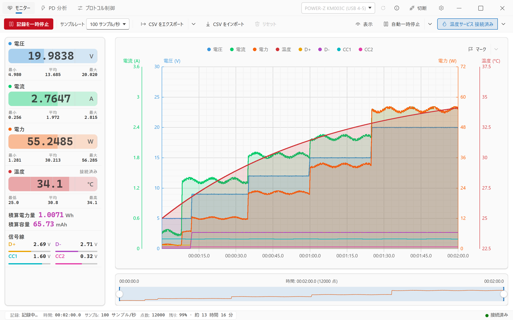
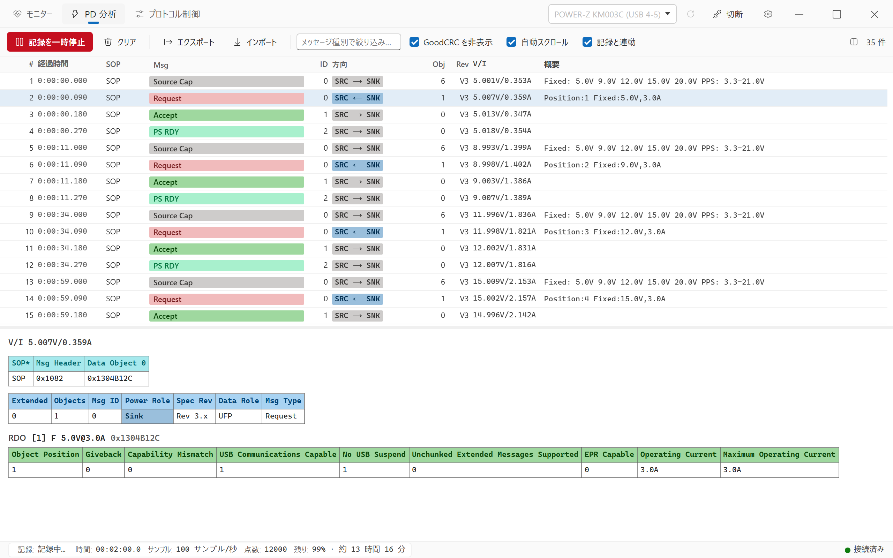
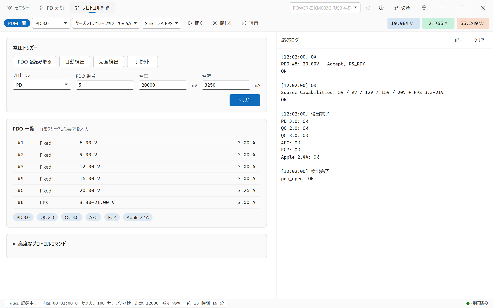
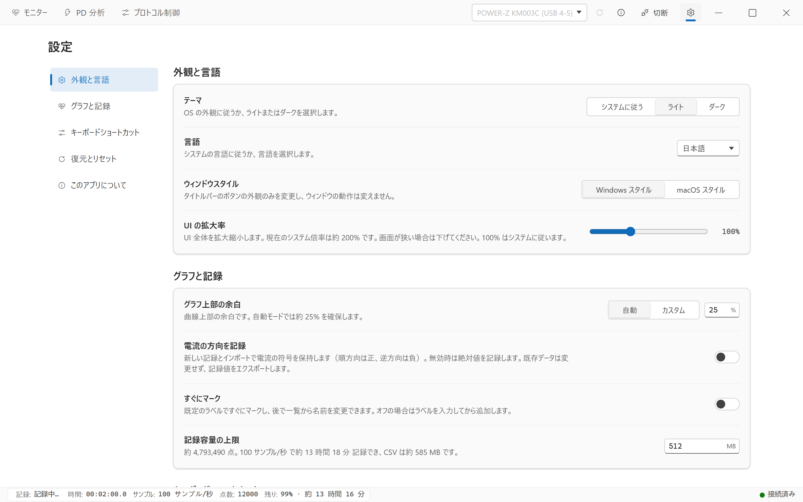

[English](../en/USAGE.md) | [简体中文](../USAGE.md) | [繁體中文](../zh-TW/USAGE.md) | **日本語**

← [README](../../README.ja.md) に戻る

# 使用ガイド

laPower **0.2.5** の操作を説明します。スクリーンショットは Windows 上で模擬デバイスとデータを使って撮影しています。画像で有効な温度・信号線やサンプルレートは初回起動時の既定値とは異なります。ダークテーマでも操作は同じです。

- [使い始める](#使い始める)
- [画面の概要](#画面の概要)
- [モニターワークスペース](#モニターワークスペース)
- [PD 分析ワークスペース](#pd-分析ワークスペース)
- [POWER-Z プロトコル制御](#power-z-プロトコル制御)
- [設定](#設定)
- [ファイル形式](#ファイル形式)
- [よくある問題](#よくある問題)

## 使い始める

1. 計器のデータ端子をパソコンに接続します。タイトルバーの更新アイコンを押し、一覧で計器を選んで `接続` をクリックします。Linux では先に [udev ルール](DEVELOPMENT.md#udev-ルール必須)を設定してください。
2. `モニター` を開き、`サンプルレート` を選びます。既定は `4 サンプル/秒` です。接続すると大きな数値が更新されますが、まだ記録は始まりません。
3. `記録開始` をクリックします。グラフと記録点数が増え、統計値・積算値も更新されます。他のワークスペースへ移動しても記録は続きます。
4. 温度が必要なら、[温度サービス](#温度サービス)の手順で別途有効にします。計器の接続だけでは温度取得は有効になりません。
5. `記録を一時停止` でデータを確認し、`記録を続行` で同じ記録に追加します。一時停止中も現在値は変化しますが、グラフと積算値は増えません。
6. `CSV をエクスポート` を押して保存先を選びます。温度や出力内容を変更する場合は、先に右の矢印を開きます。長期保存にはエクスポートが必要で、一時復元ファイルでは代用できません。

## 画面の概要

### タイトルバー

左には `モニター`、`PD 分析`、`プロトコル制御` が常に表示されます。右にはデバイス選択、更新、情報アイコン、接続／切断、設定の歯車があります。ウィンドウボタンの位置は OS とウィンドウスタイルによって異なります。

| 入口 | 用途 |
| --- | --- |
| `モニター` | 現在値、グラフ記録、マーカー、CSV の読み書き |
| `PD 分析` | USB-PD キャプチャ、メッセージ確認、PD JSON の読み書き |
| `プロトコル制御` | POWER-Z の PDM、プロトコル検出、電圧要求。タブは常に表示され、操作には対応 KM003C/KM002C の接続が必要 |
| 設定の歯車 | 外観と言語、グラフと記録、ショートカット、復元とリセット、このアプリについて |

狭いウィンドウでは文字が省略され、アイコンだけになる場合があります。ホバーで名前を確認できます。窮屈な場合は設定の `UI の拡大率` を下げてください。

### デバイス接続と情報

更新と接続の間にある情報アイコンは、文字や矢印を表示しないボタンです。モデル、`VID`、`PID`、`SN`、説明を開きます。接続中の計器を優先し、未接続なら選択中の計器、対象がなければ空の状態を表示します。接続前も使用でき、選択や一覧更新に追従します。

一覧には `WITRN K2 (USB 4-4)` のように USB ポートが付く場合があります。同一計器の複数 HID インターフェイスが残る場合はその情報も付きます。WITRN のシリアル番号は重複する場合があるため、同型機はポートも確認してください。接続中は別の計器を選べません。先に `切断` を押します。

### ステータスバー

下部には記録状態、時間、サンプルレート、記録点数、残り容量／推定時間、接続状態を表示します。左の記録状態をクリックしてもモニターの記録を開始・一時停止できます。開始には計器接続が必要です。時間と点数は記録データの情報で、計器の接続時間ではありません。

## モニターワークスペース



[ダークテーマを見る](../screenshots/ja/dark-record.png)

### コマンドバー

| 操作 | 動作と制限 |
| --- | --- |
| `記録開始` / `記録を続行` / `記録を一時停止` | 空なら開始、既存データがあれば追加、記録中なら一時停止。切断しても記録データを保持し、再接続後に続行可能 |
| `サンプルレート` | 現在の取得間隔を設定。下表を参照 |
| `CSV をエクスポート` 本体 | 保存済みオプションで全記録を出力。グラフの選択範囲には限定しない |
| `CSV をエクスポート` の矢印 | CSV の内容と CSV/PD 同時エクスポートを設定 |
| `CSV をインポート` | ファイルを選択。既存データがある場合や記録中は置換を確認し、確定すると現在の記録を一時停止。読み込み後も停止状態で、マーカーは読み込んだものに置換 |
| `リセット` | 記録中は無効。一時停止後に確認してグラフ、統計、積算値、マーカーを消去。PD 連動時は PD メッセージも消去 |
| `表示` | 曲線の表示、塗りの不透明度、統計範囲を設定 |
| `自動一時停止` 本体 / 矢印 | 本体で有効・無効、矢印で条件を設定 |
| `温度サービス` 本体 / 矢印 | 本体で接続・切断、矢印で取得元、IP、ポートを設定 |

本体と矢印は独立しています。設定を開くだけでは記録開始、自動一時停止の有効化、温度接続は行いません。フライアウトの外側をクリックして閉じるか、Escape で閉じてボタンへフォーカスを戻します。

### サンプルレート

| 選択肢 | 間隔 |
| --- | --- |
| `1000 サンプル/秒` | 1 ms。POWER-Z KM003C/KM002C のみ |
| `100 サンプル/秒` | 10 ms |
| `10 サンプル/秒` | 100 ms |
| `4 サンプル/秒`（既定） | 250 ms |
| `2 サンプル/秒` | 500 ms |
| `1 サンプル/秒` | 1000 ms |
| `0.2 サンプル/秒（5 秒に 1 回）` | 5000 ms |
| `0.1 サンプル/秒（10 秒に 1 回）` | 10000 ms |

POWER-Z の高速取得に非対応、または認証失敗の場合は `100 サンプル/秒` に戻り、理由を表示します。低速取得では複数フレームを 1 点にまとめ、短いピークが平均化される場合があります。瞬間的な変化には対応する高速側を選んでください。インポートはファイルの時刻と間隔を使い、次の実測用レート設定は変更しません。

### 測定値と統計

左には電圧、電流、電力、温度、積算電力量、積算容量、信号線を表示します。接続後の大きな数値は現在値のプレビューです。下の `最小` / `平均` / `最大`（温度は `最低` / `平均` / `最高`）は記録サンプルの統計です。停止中に現在値が変化しても、記録点は増えません。

電力量（Wh）と容量（mAh）は記録をソフトウェアで積分します。停止時間と長い欠損は含めず、続行では値を保持し、インポートではファイルから再計算します。`電流の方向を記録` を有効にすると方向矢印が表示されます。電力と積算値は大きさに基づいて計算します。

右の仕切りをドラッグして測定値パネルの幅を変更できますが、狭いウィンドウでは制限されます。縦に収まらない場合はパネル内でホイールやトラックパッドを使ってスクロールします。この領域のスクロールバーは非表示で、そのための空白も確保しません。

### 表示・グラフ・タイムライン

- `表示` で曲線を選びます。電圧、電流、電力、温度は既定でオン、D+/D- と CC1/CC2 はオフです。温度の選択だけでは取得元へ接続しません。
- 主 4 曲線の塗りは 0–100%、既定 15% です。0 は塗りだけを消し、曲線は残ります。凡例は表示中のチャンネルを示し、クリックによる切り替えはありません。
- 主グラフのホバーで、表示中かつ有効な値のあるチャンネルを確認します。ホイールでポインター位置を中心に時間範囲を拡大・縮小します。
- 下のタイムラインは両端ハンドルで範囲を調整し、中央をドラッグして移動します。記録中に右端が最新点に接していれば追従し、過去へ移動するとその範囲に留まります。
- `選択範囲のみ` は既定でオフです。オンでは最小・平均・最大、電力量、容量を選択範囲だけで計算します。大きな現在値は引き続きプレビューです。データの削除や出力範囲の制限はせず、欠損値は統計から除外します。

描画と取得の頻度は同一ではありません。詳しくは [Performance notes](../en/PERFORMANCE.md) と [Architecture](../en/ARCHITECTURE.md)（英語）を参照してください。

### マーカー

1. 主グラフ右上の `マーク` または既定キー `M` でラベルを入力し、確定します。既定の名前は `マーカー 1` のようになります。
2. 記録中のボタンは次に届く点、停止中は最後の点に付けます。主グラフ上で `M` を押すと、ポインターに最も近い点を選びます。位置は入力画面を開く前に決まります。
3. マーカーがあると右の矢印から一覧を開けます。ラベルをクリックして改名し、空欄か削除アイコンで削除します。

`設定 → グラフと記録` の `すぐにマーク` を有効にすると、入力を省略して既定のラベルを使います。最大 40 文字で、CSV に不向きな区切り文字は除去します。CSV の `Marker` 列に保存し、読み込むとファイルのマーカーを復元します。`リセット` はマーカーも消去します。

### 自動一時停止

1. `自動一時停止` の矢印を開き、`電圧 <`、`電流 <`、`電力 <` を選びます。
2. `しきい値` と `継続時間`（秒）を入力し、閉じます。
3. 本体の `自動一時停止` を押して有効にし、強調表示を確認してから記録を開始・続行します。

値がしきい値以下の状態を指定時間維持すると停止します。表示は `<` ですが、現在の判定には等しい値も含みます。継続時間 0 なら最初の条件成立サンプルで停止できます。既定は無効、`なし`、しきい値 0、時間 0 です。設定変更だけでは有効にならず、`なし` では発動しません。

### 温度サービス

温度取得、温度曲線の表示、CSV の温度列は別の操作です。

1. `温度サービス` の矢印を開き、`取得元` を選びます。
2. 計器温度は `デバイス` を選び、先に計器を接続します。外部プログラムは不要です。TCP は `外部` を選び、`IP` と `ポート` を入力します。既定は `127.0.0.1:1573`、外部、未接続です。
3. 閉じて本体の `温度サービス` で接続します。有効な値が届くとカードに表示し、モニターの記録とともに保存します。
4. 曲線は `表示` で温度を選び、CSV には別途 `温度を含める` を有効にします。

接続中は取得元、IP、ポートを変更できません。先に本体で切断します。再起動後は手動接続が必要です。計器温度は計器切断で終了し、外部 TCP は独立します。履歴は残り、欠損温度は空欄になります。TCP サーバーは摂氏の数字を 1 行ずつ送信します。[外部温度サービス](DEVELOPMENT.md#外部温度サービス)にプロトコルと例があります。

### CSV オプションと同時エクスポート

CSV の矢印にある 3 設定は保存されます。`温度を含める` は既定でオフ、`デバイス情報を含める` と `マーカーを含める` はオンです。温度・マーカーがなくても選択した列は空欄で残ります。計器の出所が不明な場合、現在の接続計器で補完しません。

同じ画面の `CSV と PD データを同時にエクスポート…` にはモニターと PD 両方のデータが必要です。保存先を 1 回選び、`名前.csv` と `名前.pd.json` を作成し、上書き前に確認します。グラフの選択範囲や PD フィルターによらず全データを出力します。保存先決定後に内容を固定し、その後のサンプルは今回の出力に追加しません。記録連動がオフだと時間範囲が異なる場合があり、自動調整はしません。

## PD 分析ワークスペース



[ダークテーマを見る](../screenshots/ja/dark-pd.png)

### 記録モードを選ぶ

`記録と連動` は既定でオンです。同じ記録ボタンでも、モードで動作が異なります。

| モード | ボタンと取得動作 | 消去 |
| --- | --- | --- |
| 連動オン | `記録開始` / `記録を一時停止` でモニターと PD を制御。モニター停止中の新着 PD は保持しない。モニターに既存データがあっても、PD 停止時は `記録開始` と表示 | どちらを消去してもモニターと PD 両方を消去。確認画面に連動を表示 |
| 連動オフ | `記録を一時停止` / `記録を続行` は一覧更新だけを停止・再開。接続機器からのメッセージは背景で蓄積し、再開時に反映。モニター記録には影響しない | 各画面を別々に消去 |

連動した取得全体を止める場合は記録ボタンを使います。一覧を止めて読みながら蓄積を続ける場合は、連動をオフにして一覧を一時停止します。画面の切り替えだけでは取得は止まりません。

### 一覧と詳細

| 操作 | 用途 |
| --- | --- |
| `インポート` / `エクスポート` | PD JSON の読み書き。フィルターによらず全キャプチャを出力。インポートは現在の PD を置換し、既存データがあれば確認 |
| `クリア` | 確認後に消去。上表の連動に注意 |
| メッセージ種別フィルター | 種別名で絞り込み |
| `GoodCRC を非表示` | リンク確認フレームを非表示。既定でオン、GoodCRC を見る場合は解除 |
| `自動スクロール` | 新着時に一覧の末尾へ追従。既定でオン |
| レイアウトアイコン | 上下／左右の設定を保存。左右は幅 1400px 以上でのみ有効。一覧と詳細の仕切りをドラッグして比率を変更 |

列は `#`、`経過時間`、`SOP`、`Msg`、`ID`、`方向`、`Obj`、`Rev`、`V/I`、`概要` です。`V/I` は付近の計器サンプルで、厳密な同期値ではありません。行を選ぶと生データ、ヘッダー、該当する PDO/RDO などのデコード表を表示します。データオブジェクトのないメッセージに PDO 表はありません。絞り込みと非表示は表示だけに適用します。

充電交渉を調べる場合は、記録を開始してから充電器・測定対象の接続を抜き差しし、新しい交渉を発生させます。PD 画面を開くだけでは、完了した交渉は再実行されません。

## POWER-Z プロトコル制御



[ダークテーマを見る](../screenshots/ja/dark-trigger.png)

入口は常に表示されます。未接続時や WITRN 接続時は案内を表示し、操作を無効にします。対応する POWER-Z KM003C/KM002C を接続すると使用できます。

### PDO の読み取りとトリガー

1. 上部で PD タイプ、ケーブルエミュレーション、Sink を選び、`開く` で PDM を開きます。
2. `PDO を読み取る` で充電器の能力を取得するか、`自動検出` / `完全検出` で対応プロトコルを検出します。
3. PDO 行をクリックして要求欄に入力します。プロトコルに応じて番号、電圧（mV）、電流（mA）を確認し、`トリガー` を押します。行を選ぶだけでは要求を送りません。
4. 応答ログで結果を確認します。上部 PDM 設定を変更したら `適用` を押します。`リセット` は現在のプロトコルを終了して既定 5 V に戻し、`閉じる` は PDM を閉じます。

実行中は他のコマンドが無効になり、ログ欄に `キャンセル` が表示されます。自動検出・完全検出にはそれぞれ約 90 秒・3 分かかる場合があります。高度な設定には PD/UFCS とカスタムコマンドがあります。カスタムコマンドは PDM なしで送れますが、他のプロトコル操作には PDM が必要です。切断や計器の取得接続を再構築した後は PDM を開き直します。現在値はモニターと同じ計器接続から取得します。

## 設定



[ダークテーマを見る](../screenshots/ja/dark-settings.png)

タイトルバー右側の歯車を開きます。macOS は ⌘, またはアプリの Settings… メニューでも開けます。単一のスクロールページに `外観と言語`、`グラフと記録`、`キーボードショートカット`、`復元とリセット`、`このアプリについて` の順で並び、このアプリについては一番下です。

広い画面では左に目次を固定し、980px 未満では上部の横並びにします。クリックまたは Tab と Enter で移動でき、スクロールで強調項目が更新されます。動きを減らす OS 設定では滑らかな移動を無効にします。他画面から戻ると同じセッション内の位置を復元します。通常、設定は変更時に保存し、別の保存ボタンはありません。

### 外観と言語

| 設定 | 選択肢と既定値 |
| --- | --- |
| `テーマ` | `システムに従う`（既定）、`ライト`、`ダーク` |
| `言語` | `システムに従う`（既定）、简体中文、繁體中文、English、日本語 |
| `ウィンドウスタイル` | Windows/Linux は `Windows スタイル`（既定）または `macOS スタイル`。macOS はネイティブボタンを使い、この項目は非表示 |
| `UI の拡大率` | 50–200%、既定 100%。スライダーを離すと適用。窮屈な場合は下げる |

言語は即座に反映され、記録とデータは維持します。未対応のシステム言語は英語になります。自動選択に付く検出言語は、UI 言語の手動変更では変わりません。[開発ガイド](DEVELOPMENT.md#言語の選択)に検出規則と Linux 起動例があります。

### グラフと記録

| 設定 | 意味と既定値 |
| --- | --- |
| `グラフ上部の余白` | 既定は `自動`、約 25%。`カスタム` は 0–100% |
| `電流の方向を記録` | 既定は無効。有効にすると新しい記録とインポートで符号を保持。既存データは変えず、出力は記録値を使用 |
| `すぐにマーク` | 既定は無効。有効にするとラベル入力を省略 |
| `記録容量の上限` | 64–8192 MB、既定 512 MB。現在のグラフ全体が対象で、既存・読み込み済みデータも含む。上限で一時停止し、自動で複数ファイルに分割保存はしない |

### キーボードショートカット

| 操作 | 既定 | 画面 |
| --- | --- | --- |
| 記録の開始・一時停止・続行 | `P` | モニター |
| マーク | `M` | モニター |
| インポート | `Ctrl+O` | モニター CSV、PD JSON |
| エクスポート | `Ctrl+S` | モニター CSV、PD JSON |
| CSV/PD 同時出力 | `Ctrl+Shift+S` | モニター |
| 消去 | 未割り当て | モニター、PD。確認と記録連動は適用 |

macOS は Ctrl の代わりに Command を使います。現在のキーをクリックして新しい組み合わせを押します。Escape で中止、`解除` で解除、`既定値` で 1 項目、`すべて既定に戻す` で全項目を戻します。重複、修飾キーのみ、予約済みの終了用キーは使えません。テキスト入力中、メニュー・フライアウト・ダイアログ使用中、キー登録中は、記録・インポート・エクスポートなどのショートカットは動作しません。

### 復元とリセット

`一時復元ファイルを保持` は既定で有効です。記録中は約 1 秒ごとにキャッシュへ保存し、異常終了からの復元に使います。未完了記録がこのグループに並び、`復元` / `削除` で操作できます。復元後はモニターで続行や出力ができます。現在のモニターデータを置換し、既存データがあれば先に確認します。

正常な消去・インポート・終了では同期成功後に一時ファイルを削除します。失敗時は保持して通知します。長期保存用ではなく、独立した PD JSON も含まないため、必要なファイルをそれぞれ出力してください。

`すべての設定をリセット` は確認後に設定とショートカットを既定に戻す操作で、モニターのデータ消去 `リセット` とは別です。保存エラー時は画面に既定値が出ていても保存成功を意味しません。

### このアプリについて

最下部のカードにアイコン、名前、説明、バージョン、ライセンスを表示します。GitHub ロゴ付き `GitHub` ボタンは標準ブラウザーでプロジェクトを開き、狭い配置ではボタンを折り返します。

`更新を確認` を押した場合だけ GitHub の正式リリースを確認します。確認中はボタンを無効にし、結果はセッション終了まで保持します。起動、設定表示、画面切り替えでは自動確認しません。公開版が同じか古い場合は最新、正式版なしは別の状態で表示し、失敗は再試行できます。新版の `GitHub でダウンロード` は該当リリースを開き、自動取得・インストールはしません。

サードパーティーのカードには主なコンポーネントの名前、バージョン、用途、ライセンスを表示します。全実行時コンポーネントを展開すると、4 つのデスクトップ配布対象の直接・間接の依存関係を名前順でオフライン確認できます。本プロジェクトの workspace と開発・ビルド専用依存関係は除外します。

## ファイル形式

### CSV

モニターで CSV を読み書きします。列見出しの前に点数、時間、取得間隔、日付があり、ソフトウェア・機器・取得ルールが続く場合があります。この 1 点の例は温度とマーカーを有効にしています。

```csv
SUM,1
TotalTime,="00:00:00.250"
SampTime(ms),250
DateTime,2026-10-17 12:00:00
Software,laPower 0.2.5
Device,WITRN K2 (0716:5060)
Points,mean

Time(D.hh:mm:ss.ms),Voltage(V),Current(A),Power(W),Temp(°C),D+(V),D-(V),CC1(V),CC2(V),RelativeTime(s),Timestamp(ms),RecordingSegment,SampleInterval(ms),Marker,
="00:00:00.250",5,0.5,2.5,25,0.6,0.1,1.6,0.3,0.25,1792209600250,1,250,Start,
```

- `温度を含める` は `Temp(°C)`、`マーカーを含める` は `Marker`、`デバイス情報を含める` は `Device` 行だけを制御します。取得やグラフデータは変更しません。
- `="HH:MM:SS.mmm"` は表計算で時刻を文字列として保持し、24 時間を超えると日数を付けます。`RelativeTime(s)` は正確な相対秒、`Timestamp(ms)` は絶対時刻です。
- `RecordingSegment` は停止前後の区間を区別し、`SampleInterval(ms)` は各点の取得間隔です。任意の `CurrentMagnitude(A)` は正反方向が相殺される前の大きさを保持し、容量の再計算を一致させます。
- 数値精度を保持し、欠損は空欄です。温度列を選んでも有効な温度があるとは限りません。`Marker` のラベルは読み込み時に復元します。
- 温度・信号線・追加の末尾列がない旧 CSV も読み込めます。見出し名で識別するため、手動で空列を足す必要はありません。出所不明はそのまま保持し、接続中の計器で埋めません。

### PD キャプチャ

PD はモニター CSV と別の JSON です。現在の出力は `app: "laPower"`、`kind: "pd-capture"`、`version: 2` で、旧 version 1 も読み込めます。インポートでは検証して現在の PD を置換します。CSV だけでは PD JSON は読み込まれません。同時出力した 2 ファイルも、それぞれ対応画面で読み込んでください。

## よくある問題

### 計器が見つからない・接続に失敗する

計器のデータ端子とデータ対応ケーブルを使用し、一覧を更新して選択します。他の計器ソフトを閉じ、再試行や抜き差しをしてください。Linux は HID/Bulk の権限設定が必要です。[udev ルール](DEVELOPMENT.md#udev-ルール必須)と[対応デバイス](../../README.ja.md#-対応デバイス)を参照してください。

### 接続済みでもグラフが空

接続だけでは現在値のプレビューです。`記録開始` を押してください。停止中は現在値が変わっても点数は増えず、`記録を続行` が必要です。計器の非対応・無効なレポートでも有効値を得られない場合があります。

### 温度が `--` のまま

[温度サービス](#温度サービス)で取得元を選び、本体ボタンで接続します。既定は外部 TCP なので、計器温度にはデバイスを明示的に選んでください。曲線や CSV の選択だけでは取得しません。サーバー、IP、ポート、モデルを確認してください。ファームウェアによって有効な温度がない場合もあります。

### PD メッセージが増えない

接続と連動設定を確認します。連動オンではモニターの記録開始が必要です。新しい交渉には測定対象の接続をやり直します。独立モードで一覧が停止中なら `記録を続行` で蓄積メッセージを表示し、フィルターも確認してください。

### macOS の長時間記録

記録中は自動スリープを防ぎ、画面消灯は許可します。接続だけ、または一時停止中は防ぎません。macOS 14+ では WebView の背景抑制を無効にする設定ですが、macOS 12–13 では長時間記録中のウィンドウを表示したままにしてください。ふたを閉じる・手動スリープは USB 取得を中断する場合があります。

旧プロジェクト名は WITRN-RS です。laPower は別の設定ディレクトリを使い、既存 CSV と互換 PD キャプチャは直接読み込めます。
