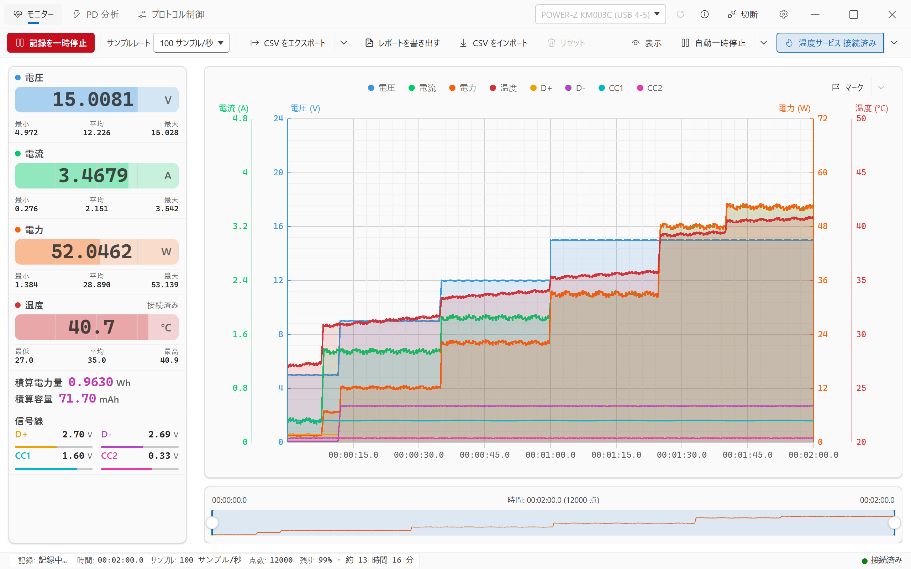
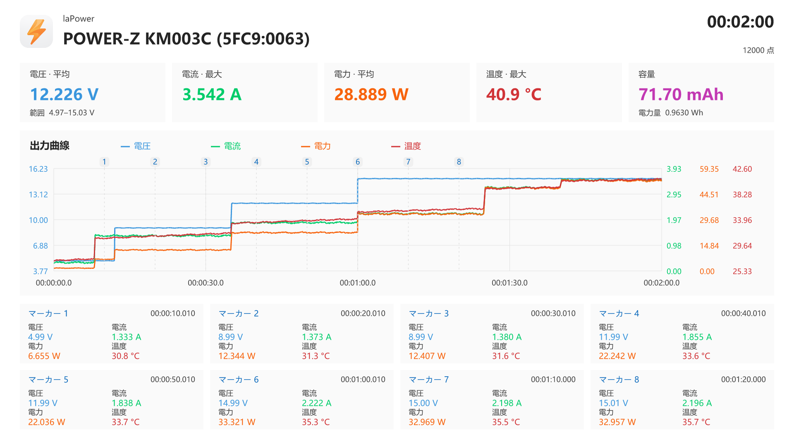
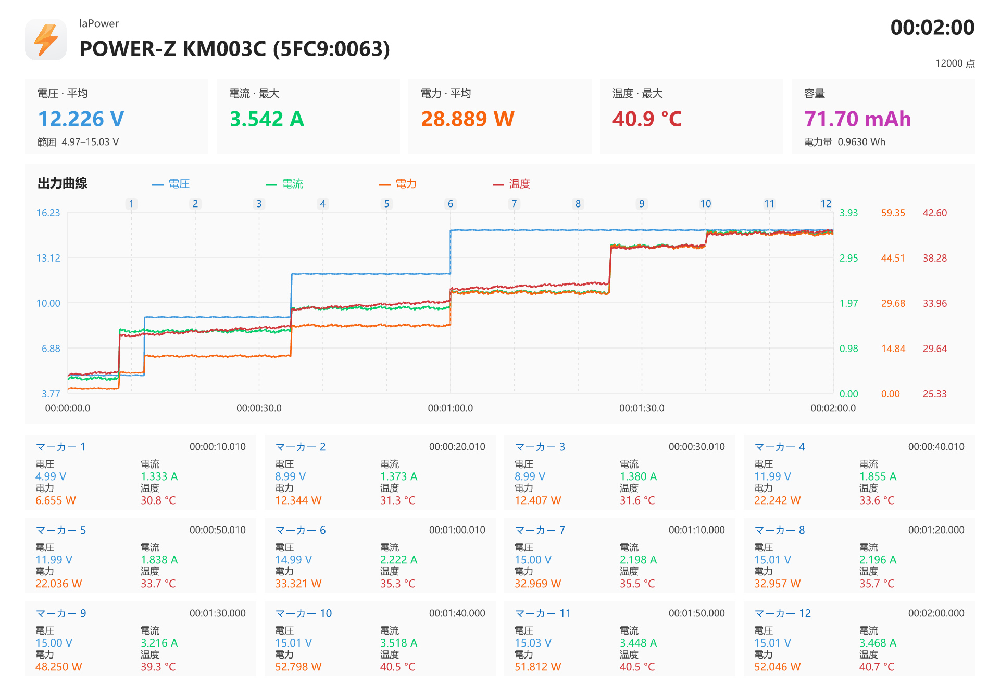
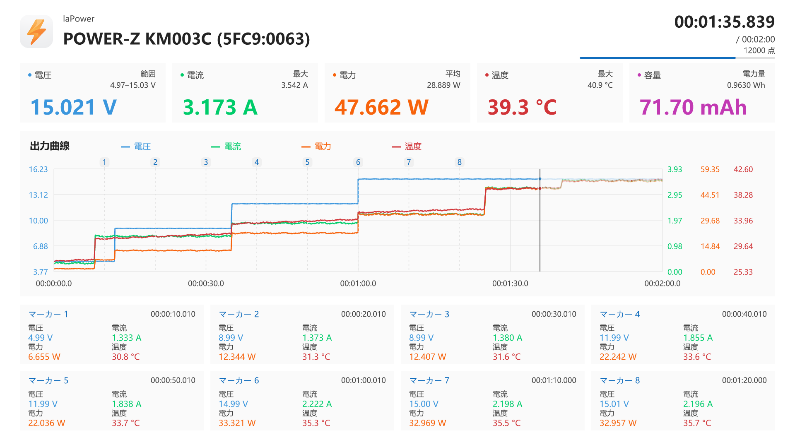
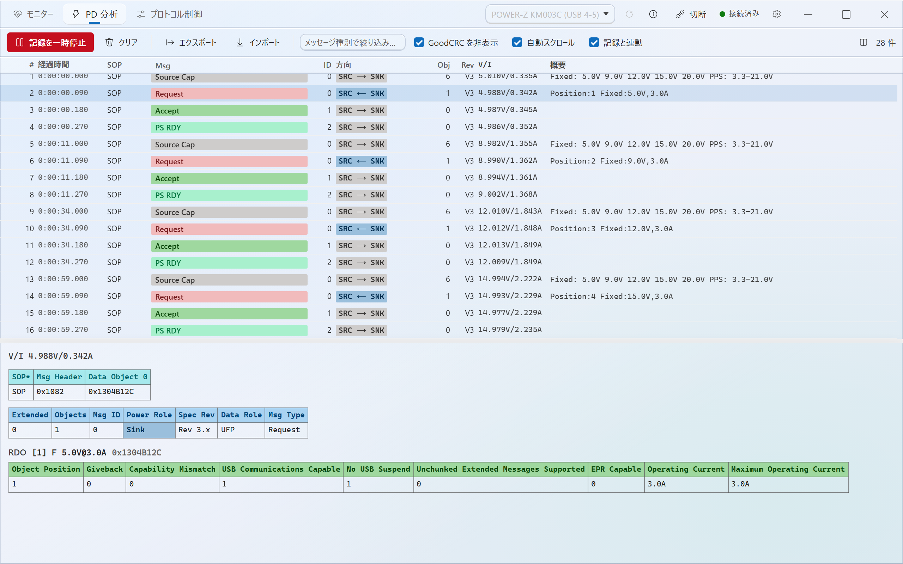
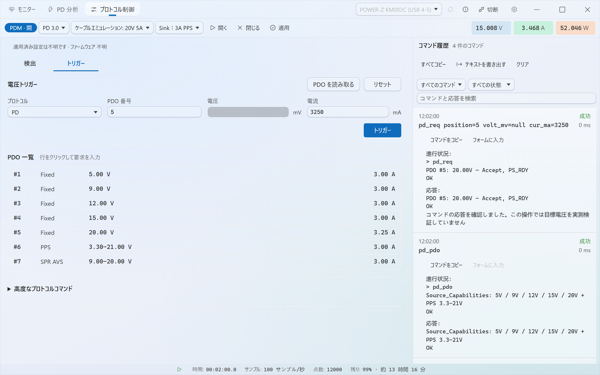
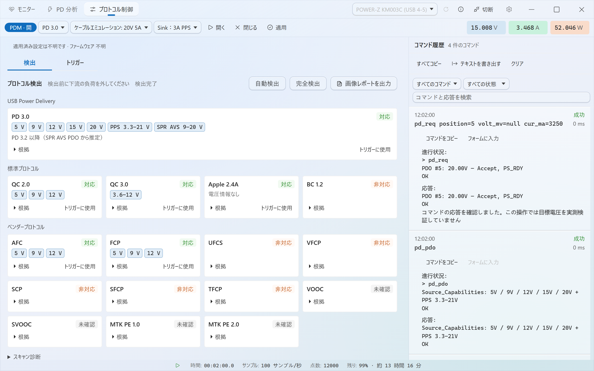
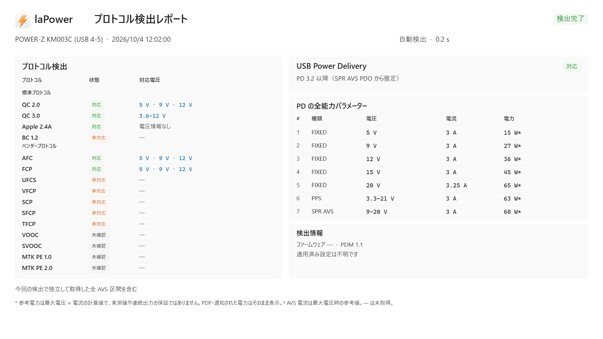
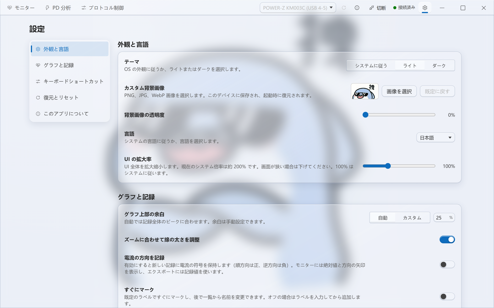

[English](../en/USAGE.md) | [简体中文](../USAGE.md) | [繁體中文](../zh-TW/USAGE.md) | **日本語**

← [README](../../README.ja.md) に戻る

# 使用ガイド

laPower **0.3.0** の操作手順を説明します。スクリーンショットは Windows の模擬環境で取得したもので、有効な温度・信号線・サンプルレートは初回起動時の既定値ではありません。ダークテーマでも操作は同じです。

- [使い始める](#使い始める)
- [画面の概要](#画面の概要)
- [モニターワークスペース](#モニターワークスペース)
- [PD 分析ワークスペース](#pd-分析ワークスペース)
- [POWER-Z プロトコル制御](#power-z-プロトコル制御)
- [設定](#設定)
- [ファイル形式](#ファイル形式)
- [よくある問題](#よくある問題)

## 使い始める

1. 計器のデータ端子をパソコンに接続し、タイトルバーの更新アイコンを押して計器を選び `接続` をクリックします。Linux では先に [udev ルール](DEVELOPMENT.md#udev-ルール必須)を設定してください。
2. `モニター` を開き、`サンプルレート`（既定は `4 サンプル/秒`）を選択します。接続すると大きな現在値プレビューが更新されますが、まだ記録は始まりません。
3. `記録開始`（または `P` キー）を押すと、グラフ、記録点数、最小・平均・最大統計、積算電力量・容量の記録が始まります。他の画面へ移動しても記録は継続します。
4. 温度を記録するには、[温度サービス](#温度サービス)から取得元を個別に接続してください。
5. `記録を一時停止` でデータを確認し、`記録を続行` で同じ記録へ追記できます（一時停止中もプレビューは変化しますが、グラフと積算値は増えません）。
6. 長期保存には `CSV をエクスポート` で保存先を指定します（一時復元ファイルは長期保存の代わりになりません）。温度や同時出力を使う場合は右側の矢印から設定します。

## 画面の概要

### タイトルバー

左側に `モニター`、`PD 分析`、`プロトコル制御` が常駐し、右側にデバイス選択、更新、情報アイコン、接続／切断ボタン、設定の歯車があります。Windows／Linux は右側に Windows スタイルのウィンドウボタン、macOS は左側に標準のボタンを配置します。

| 入口 | 用途 |
| --- | --- |
| `モニター` | 現在値表示、グラフ記録、マーカー、CSV 入出力、レポート出力 |
| `PD 分析` | USB-PD キャプチャ、フィールドツリー解析、PD JSON 入出力 |
| `プロトコル制御` | POWER-Z の PDM、プロトコル検出、電圧トリガー（常に表示され、対応 KM003C/KM002C 接続時に操作可能） |
| 設定の歯車 | 外観と言語、グラフと記録、ショートカット、復元とリセット、このアプリについて |

狭いウィンドウでは文字が省略されアイコンのみになる場合があります（ホバーで名前を確認できます）。窮屈な場合は設定で `UI の拡大率` を下げてください。

### デバイス接続と情報

更新と接続ボタンの間にある情報アイコンから、モデル、`VID`、`PID`、`SN`、説明をいつでも確認できます（接続中の計器を優先し、未接続時は選択中の計器を表示）。

一覧には取得できた USB ポート（例：`WITRN K2 (USB 4-4)`）や複数 HID インターフェイスの区別が付きます。WITRN は製造ロットによりシリアル番号が重複する場合があるため、同型機はポート名で見分けてください。接続中に別の計器へ切り替える場合は先に `切断` を押します。

### ステータスバー

下部中央に記録操作のアイコンボタン、記録時間、サンプルレート、記録点数、残容量／推定時間を表示します。計器接続後、左端のアイコンボタン（停止中は再生アイコン、記録中は一時停止アイコン）をクリックしてもモニター記録を開始／一時停止できます。時間と点数は記録データの情報であり、接続時間ではありません。

## モニターワークスペース



[ダークテーマを見る](../screenshots/ja/dark-record.png)

### コマンドバー

| 操作 | 動作と制限 |
| --- | --- |
| `記録開始` / `記録を続行` / `記録を一時停止` | 空なら開始、既存データがあれば追記、記録中なら一時停止。切断してもデータを保持し再接続後に続行可能 |
| `サンプルレート` | 取得間隔を設定（下表を参照） |
| `CSV をエクスポート` 本体 | 保存済みオプションで全記録を出力（グラフの選択範囲には限定されない） |
| `CSV をエクスポート` の矢印 | CSV 出力項目と CSV/PD 同時出力を設定 |
| `レポートを書き出す` | 記録全体を PNG 画像（16:9 または縦長）または短い動画として出力。2 点以上の記録で使用可能。詳しくは[レポートの書き出し](#レポートの書き出し) |
| `CSV をインポート` | CSV を読み込みます。既存データがある場合や記録中は置換を確認したうえで停止状態にし、マーカーも読み込んだものに置換 |
| `リセット` | 一時停止中のみ有効。確認後にグラフ、統計、積算値、マーカーを消去（PD 連動時は PD メッセージも消去） |
| `表示` | 曲線の表示、塗りつぶし、不透明度、色、太さ、上下ずらし、統計範囲を設定 |
| `自動一時停止` 本体 / 矢印 | 本体で有効／無効、矢印で条件・しきい値・継続時間を設定 |
| `温度サービス` 本体 / 矢印 | 本体で接続／切断、矢印で取得元（デバイス／外部 TCP）・IP・ポートを設定 |

スプリットボタンの本体と矢印は独立しており、設定パネルを開くだけでは記録や接続は始まりません。外側クリックまたは Escape キーで閉じられます（Escape 後はボタンへフォーカスが戻ります）。

### サンプルレート

| 選択肢 | 間隔 |
| --- | --- |
| `1000 サンプル/秒` | 1 ms（POWER-Z KM003C/KM002C のみ） |
| `100 サンプル/秒` | 10 ms |
| `10 サンプル/秒` | 100 ms |
| `4 サンプル/秒`（既定） | 250 ms |
| `2 サンプル/秒` | 500 ms |
| `1 サンプル/秒` | 1000 ms |
| `0.2 サンプル/秒（5 秒に 1 回）` | 5000 ms |
| `0.1 サンプル/秒（10 秒に 1 回）` | 10000 ms |

POWER-Z 高速モードに非対応または認証失敗時は自動で `100 サンプル/秒` に戻り理由を表示します。低速設定では区間内の複数フレームを平均するため短いスパイクが平準化されます。過渡変化の観測には高速側を選んでください。CSV インポート時はファイルの時刻を使用し、実測レート設定は変更しません。

### 測定値と統計

左パネルに電圧、電流、電力、温度、積算電力量、積算容量、信号線を表示します。主要カード下の `最小` / `平均` / `最大`（温度は `最低` / `平均` / `最高`）は記録サンプルのみを集計し、一時停止中のプレビュー変化は含みません。

電力量（Wh）と容量（mAh）はサンプルからソフトウェアで積分し、一時停止や長い時間ギャップを除外します。`電流の方向を記録` がオンの場合は方向矢印を表示しつつ、電力と積算値は絶対値で計算します。右の仕切りをドラッグして幅を変更でき、縦に溢れた場合はスクロールバー領域を占有せずにスクロールできます。

### 表示・グラフ・タイムライン

- `表示` からチャンネルを選択します。電圧・電流・電力・温度は既定でオン（温度の選択だけでは取得元へ接続しません）、D+ / D− と CC1 / CC2 はオフです。
- 上部の `曲線の塗りつぶし` スイッチは既定でオンで保存されます。オフにしても各主曲線の不透明度（0–100%、既定 15%、0 は塗りのみ無効）は保持され、再びオンにすると復元されます。記録・停止・ズームで自動的に切り替わることはありません。凡例は現在の表示チャンネルを示します。
- 既定では全 Y 軸を 0 基準（負値がある場合は負側へ拡張）とし、共通の量子化ステップで 4 本の Y 軸の目盛りを厳密に揃えます。`表示` パネルでチャンネル別の色・塗り不透明度・線の太さ（自動／手動）・上下ずらし（`0` で既定位置）を調整できますが、表示投影のみを変え、元のサンプルや積算値は変更しません。
- 主グラフのホバーでその時点の有効値を参照できます。主グラフと下部タイムラインの両方でホイールによる横ズーム（過去範囲では現在位置へ戻らず、最新追従中は追従を維持したまま表示幅を変更）ができ、拡大後は主グラフを左右にドラッグして移動できます。操作中は縦軸を再計算せず、記録中の新ピークは操作完了後に反映されます。
- `選択範囲のみ`（既定オフ）をオンにすると、最小・平均・最大および電力量・容量を選択範囲だけで計算します（大きな現在値はプレビューのまま）。データ削除やエクスポート範囲制限は行いません。

描画と積分の詳細は [Performance benchmarks and limits](../en/PERFORMANCE.md) と [Architecture](../en/ARCHITECTURE.md)（英語）を参照してください。

### マーカー

1. 主グラフ右上の `マーク` または `M` キーでラベルを入力します（既定名は `マーカー 1` 等）。記録中は次の到着点、停止中は最終点、グラフ上で `M` を押すとポインター位置に最も近い点をマークします。
2. マーカーが存在すると右の矢印から一覧を開け、クリックで改名、空欄または削除アイコンで削除できます。

`設定 → グラフと記録` の `すぐにマーク` を有効にすると入力を省略して既定名で付与します。最大 40 文字（CSV 区切り文字を除去）で CSV の `Marker` 列に保存・復元され、`リセット` で消去されます。

### 自動一時停止

1. `自動一時停止` の矢印から `電圧 <`、`電流 <`、`電力 <` を選び、`しきい値` と `継続時間`（秒）を設定して閉じます。
2. 本体の `自動一時停止` ボタンを有効（強調表示）にしてから記録を開始／続行します。

値がしきい値以下（等しい場合を含む）のまま指定時間経過すると停止し、継続時間 `0` では最初の成立サンプルで停止します。既定は無効、`なし`、0 です。

### 温度サービス

温度取得、温度曲線の表示、CSV の温度列は独立しています：

1. `温度サービス` の矢印で `取得元` を選択します：`デバイス` は計器温度を直接取得（先に計器接続が必要）、`外部` は TCP サーバーへ接続します（既定 `127.0.0.1:1573`）。
2. 閉じて本体の `温度サービス` ボタンで接続すると、有効値がカードと記録に反映されます。
3. グラフ表示は `表示` の温度、CSV 保存は `CSV をエクスポート` 矢印の `温度を含める` を個別に設定します。

接続中は取得元・IP・ポートを変更できず（先に切断）、再起動時は手動再接続が必要です。`デバイス` は計器切断でリセットされますが、`外部` TCP は独立して動作し、切断後も履歴は残ります。プロトコルと Python 例は [外部温度サービス](DEVELOPMENT.md#外部温度サービス)を参照してください。

### CSV オプションと同時エクスポート

`温度を含める`（既定オフ）、`デバイス情報を含める`（既定オン）、`マーカーを含める`（既定オン）は保存されます。データがない列も空欄のまま出力され、出所不明の計器情報を現在の接続計器で補完しません。

`CSV と PD データを同時にエクスポート…` は両方のデータが必要です。保存先を 1 回選ぶと内容を固定し、`名前.csv` と `名前.pd.json` に全データを書き出します（選択範囲やフィルターは無視し、上書き前に確認）。記録連動がオフの場合、2 ファイルの時間範囲は自動調整されません。

### レポートの書き出し



[ダークテーマを見る](../screenshots/ja/dark-report-image.png)



[ダークテーマを見る](../screenshots/ja/dark-report-long.png)



[ダークテーマを見る](../screenshots/ja/dark-report-video.png)

モニターコマンドバーの `レポートを書き出す` から記録全体を PNG 画像または短い動画として出力できます（種類・720p〜4K 解像度・テーマ・内容を記憶）。**レポートの内容**で電圧・電流・電力・温度・**マーカー**・**マーカーの詳細**を独立して選択できます（曲線上の印のみ／下部詳細のみ／両方オン・オフに対応）。

- **PNG 画像レポート**：静的レイアウトで全曲線、記録時間、点数、時間加重平均電圧・電力、最大電流・温度、容量・電力量を表示します（欠測は明示）。**16:9** は先頭 8 マーカーまで（超過時は通知）、**縦長画像**は全マーカーを保持して高さを拡張します（安全サイズ超過時は省略せずエラーで通知）。
- **動画レポート**：MP4/MOV、H.264/H.265、24/30/60 fps、1〜60 秒に対応し、記録全体を早送りしながら 5 枚の測定値カードを更新します（カード右上は全記録の要約、マーカーは先頭 8 個まで）。

**画像を生成**／**動画を生成**でデータを固定し単一の背景タスクとして実行します（ダイアログを閉じても継続し、再度開くと進捗を復元）。成功時のみ対象ファイルへ確定し、中止や失敗時は一時ファイルを削除します。

#### 動画の画質とエンコード方式

`エンコード方式`（既定 `自動`）と `画質`（既定 `高画質`）を選択すると対応状況を検証し目標ビットレートを表示します：

| 画質 | H.264（1080p / 30 fps） | H.265（1080p / 30 fps） |
| --- | --- | --- |
| 標準 | 10 Mbps | 6.5 Mbps |
| 高画質（既定） | 20 Mbps | 13 Mbps |
| 最高画質 | 30 Mbps | 19.5 Mbps |

ビットレートは画素数とフレームレートに比例します（H.264 下限 4 Mbps／H.265 下限 3 Mbps、上限 240 Mbps）。`自動` はハードウェア優先で失敗時にソフトウェアへ切り替え理由を表示し、`ハードウェアエンコード` は実ハードウェアを必須とします（Windows は GPU テクスチャ失敗時に CPU 描画＋ハードウェア経路を試行）。`ソフトウェアエンコード` は直接ソフトウェアを使用します（Linux は自動／ソフトウェア H.264 のみ、macOS ソフトウェア HEVC はシステム対応が必要）。ffmpeg は不要です。

## PD 分析ワークスペース



[ダークテーマを見る](../screenshots/ja/dark-pd.png)

### 記録モードを選ぶ

`記録と連動` は既定でオンになっており、モードごとに記録ボタンの役割が異なります：

| モード | ボタンと取得動作 | 消去 |
| --- | --- | --- |
| 連動オン | `記録開始` / `記録を一時停止` でモニターと PD を同時制御。モニター停止中の新着 PD は保持しない（モニターにデータがあっても PD 停止時は `記録開始` 表示） | どちらを消去しても両方を消去 |
| 連動オフ | `記録を一時停止` / `記録を続行` は一覧表示のみを制御し、バックグラウンドで受信を蓄積（モニター記録に影響しない） | 各画面で個別に消去 |

バックグラウンドで受信を続けながら一覧を止めて確認したい場合は、`記録と連動` をオフにしてから一覧を一時停止してください。タブの切り替えでは取得は止まりません。

### 一覧と詳細

| 操作 | 用途 |
| --- | --- |
| `インポート` / `エクスポート` | PD キャプチャ JSON の入出力（フィルターに関係なく全体を出力、置換前確認あり） |
| `クリア` | 確認後に消去（上表の連動規則に従う） |
| メッセージ種別フィルター | メッセージ種別名で絞り込み |
| `GoodCRC を非表示` | リンク層確認フレームを非表示（既定オン） |
| `自動スクロール` | 新着メッセージに追従して末尾へスクロール（既定オン） |
| レイアウトアイコン | 上下／左右配置を保存（左右は幅 1400 px 以上のみ有効）。仕切りドラッグで比率調整 |

列は `#`、`経過時間`、`SOP`、`Msg`、`ID`、`方向`、`Obj`、`Rev`、`V/I`（付近の計器サンプル）、`概要` です。行を選択すると生バイト列、ヘッダー、PDO／RDO デコード表を確認できます。充電ネゴシエーションを捕らえるには記録開始後にケーブルを挿し直してください。

## POWER-Z プロトコル制御



[ダークテーマを見る](../screenshots/ja/dark-trigger.png)

常に表示され、対応する POWER-Z KM003C／KM002C 接続時のみ操作が有効になります。既定では `トリガー` タブを開き、上部の `PD タイプ`、`ケーブルエミュレーション`、`Sink` 設定と現在値（モニターと接続共有）は `検出` と `トリガー` で共有します。

### PDO の読み取りとトリガー

1. 上部で `PD タイプ`、`ケーブルエミュレーション`、`Sink` を選び、`開く` で PDM を開始します（上部に選択設定と適用済み設定を区別し、認識したファームウェア版を表示。切断・再接続後は開き直しが必要）。
2. `PDO を読み取る` で充電器能力を取得するか、`自動検出` / `完全検出` を実行します。
3. PDO 行をクリックして要求欄に反映し、番号・電圧（mV）・電流（mA）を確認して `トリガー` を押します（行選択だけでは送信しません）：
   - 既知の固定 PD PDO は電圧が読み取り専用で `volt` を省略し、UFCS は元の `NUM` を保持、PPS／AVS と未知番号は手入力できます。
4. ログで応答を確認します。PDM 設定変更後は `適用`、`リセット` で既定 5 V 復帰、`閉じる` で PDM を終了します。

**コマンド履歴と高度なコマンド：**

- 実行中は他コマンドがロックされ `キャンセル` が表示されます（同時実行は 1 件のみ）。
- 右側固定のコマンド履歴はコマンド単位で時刻・引数・所要時間・状態・進行状況・応答を保持し、絞り込み・コピー・テキスト出力・フォームへの再入力（再実行はしない）が可能です。履歴はセッション内のみ最大 64 KB 保持（完了済みの古い順や行単位の省略あり、重複状態も受信順で保持）。
- 高度な領域には PD/UFCS とカスタムコマンドがあります（カスタムコマンドは PDM なしでも送信可能で、実行後に状態を再確認。`pd data` は標準区切り文字付きの hex に対応し不正文字を拒否します）。

### プロトコル検出



[ダークテーマを見る](../screenshots/ja/dark-detection.png)



[ダークテーマを見る](../screenshots/ja/dark-protocol-report.png)

> **注意：** 検出はプロトコルを切り替え 5 V 実測検証を行うため、必ず**下流の負荷を外してから**実行してください。

- **検出モードと結果マトリクス**：`自動検出`（約 4 分枠）は通常スキャンと不確定な通常プロトコルの個別確認を行い、`完全検出`（約 7 分枠）は先に `entry list+` で VOOC/SVOOC・MTK PE などを確認します（終了マーカーがない場合は通常スキャンへ移行、旧 PDM は「未確認」扱い）。PD・標準・ベンダーに分類し「対応」「非対応」「未確認」「確認できず」を明示し、VOOC/SVOOC や MTK PE 1.0/2.0 を混同せず、PD 電力からの認証推定は行いません。「根拠」展開で応答を確認でき、`トリガーに使用` はフォームへ入力するのみで自動送信しません。
- **独立した PD 取得とバージョン判定**：スキャン内の PD 判定を無視し、他プロトコル終了後に独立して `reset → entry pd → pd pdo` を実行します（キャンセル時は停止）。PD バージョンは `Get_Revision` 完全応答 → スキャン明示の PD 3.0/3.1/3.2 → PDO 下限（PPS ≥ 3.0、EPR ≥ 3.1、SPR AVS ≥ 3.2、通常固定 PDO のみでは判定不可）の順に優先します。`Get_Revision` が低い場合は SPR AVS の PD 3.2 下限を上書きせず矛盾を通知します。
- **5 V 実測検証とリセット**：個別 5 V 確認は応答確認から 500 ms 以降の新鮮な連続 5 サンプルの中央値を `max(200 mV, 3%)` 許容差で判定します（最大 12 秒）。終了後およびキャンセル後は 15 秒以内にリセットと 5 V 確認を試み、未確認時は明示します。
- **画像レポート出力**：完了後に **画像レポートを出力** から 16:9 PNG（1920×1080 / 2560×1440 / 3840×2160、テーマは監視レポートと独立保存）を出力できます。ダイアログを開いた時点でスナップショットを固定し、全プロトコル結果・PD バージョン・全 PDO（SPR AVS 各区間を保持、`*` は最大電圧参考電力、`†` は最大電圧時 AVS 参考電流、`—` は未取得；一部完了／キャンセル時も警告付きで出力可）を含みます。

## 設定



[ダークテーマを見る](../screenshots/ja/dark-settings.png)

タイトルバー右の歯車（macOS は `⌘,` または Settings… メニュー）から単一のスクロールページを開きます。広い画面では左に固定目次、980 px 未満では上部横並びに配置され、設定は変更と同時に自動保存されます。

### 外観と言語

| 設定 | 選択肢と既定値 |
| --- | --- |
| `テーマ` | `システムに従う`（既定）、`ライト`、`ダーク` |
| `言語` | `システムに従う`（既定）、简体中文、繁體中文、English、日本語 |
| `日本語フォント` / `英数字フォント`（表示言語に応じて切替） | インストール済みシステムフォントから日本語テキスト用（`Yu Gothic UI` / `Hiragino Sans` / `Noto Sans CJK JP` など）と英数字用（UI・測定値・グラフ目盛り）のフォントを個別に選択（英語表示時は `Interface font` / `Monospace & numeric font`、中国語表示時は中文字体／英数字体として言語ごとに独立保存され互いに干渉しません；既定項目にシステム既定フォント名を表示し、プレビューと`フォントをリセット`に対応） |
| `カスタム背景画像` | ローカルの PNG、JPG、WebP（≤ 25 MB）を選択・保存し、`クリア` で既定へ戻す（既定壁紙なし） |
| `背景画像の不透明度` | 0–100%、既定 100%（0% 非表示、100% 完全表示） |
| `背景画像のぼかし` | 0–40 px、既定 14 px（0 px でぼかしなし） |
| `UI の拡大率` | 50–200%、既定 100%、離すと適用。窮屈な場合は下げる |

言語変更は接続とデータを維持したまま即座に反映されます。ロケール判定と Linux 起動例は[言語の選択](DEVELOPMENT.md#言語の選択)を参照してください。

### グラフと記録

| 設定 | 意味と既定値 |
| --- | --- |
| `グラフ上部の余白` | 既定 `自動`（表示チャンネル全体のピーク基準）；`カスタム` は 0–100% |
| `ズームに合わせて線の太さを調整` | 既定オン。ズーム倍率に応じて線幅を自動調整 |
| `電流の方向を記録` | 既定オフ。オン時は新規記録・インポートで電流符号を保持し、出力も実測値を維持 |
| `すぐにマーク` | 既定オフ。オン時は入力画面なしで既定ラベルを付与 |
| `システム時刻で記録を開始` | 既定オフ。オン時はグラフ X 軸、タイムライン範囲、ツールチップ、マーカー時刻を記録開始時のシステム時刻で表示（記録時間と CSV 形式は不変） |
| `記録容量の上限` | 64–8192 MB、既定 512 MB。現在のグラフ全体（既存・読み込み済み含む）を対象とし上限で一時停止 |

### キーボードショートカット

| 操作 | 既定 | 画面 |
| --- | --- | --- |
| 記録の開始・一時停止・続行 | `P` | モニター |
| マーク | `M` | モニター |
| インポート | `Ctrl+O` | モニター CSV、PD JSON |
| エクスポート | `Ctrl+S` | モニター CSV、PD JSON |
| CSV/PD 同時出力 | `Ctrl+Shift+S` | モニター |
| 消去 | 未割り当て | モニター、PD（確認と連動規則は適用） |

macOS では `Command` に置き換わります。ボタンをクリックして新しいキーを登録（Escape で中止）、個別の解除・初期化、全リセットが可能です。テキスト入力やメニュー／ダイアログ操作中は一時的に無効になります。

### 復元とリセット

`一時復元ファイルを保持`（既定オン）は記録中に約 1 秒間隔でキャッシュ保存し、異常終了からの `復元`／`削除` を提供します（復元時は既存モニターデータを置換、PD JSON は含みません）。正常な消去・インポート・終了時は同期後に削除されます。

`すべての設定をリセット` は設定とショートカットのみを初期化し、モニターの `リセット` とは別機能です。

### このアプリについて

アプリ情報、`Copyright (C) 2026 KHWLGH`（自作部分）、LGPL-3.0-or-later プロトコルライブラリ表示（`usbpd-parser`・`witrn-hid` は `Copyright (c) 2025 JohnScotttt` を保持）のほか、`オープンソースライセンス`（コピーと閲覧位置記憶対応のオフライン閲覧）、`GitHub`、`更新を確認`（クリック時のみ GitHub 正式リリースを確認、自動取得なし）を備えます。サードパーティーカードで主要依存と `すべての実行時コンポーネント` 一覧をオフライン閲覧できます。全文・範囲は [`COPYRIGHT`](../../COPYRIGHT)、[`LICENSE`](../../LICENSE)、[`LICENSE.LGPL-3.0`](../../LICENSE.LGPL-3.0) を参照してください。

## ファイル形式

### CSV

モニターは見出し行の前に点数・時間・取得間隔・日付および任意のソフトウェア／機器／取得規則行を出力します（以下は温度とマーカーを有効にした 1 点例）：

```csv
SUM,1
TotalTime,00:00:00.250
SampTime(ms),250
DateTime,2026-10-17 12:00:00
Software,laPower 0.3.0
Device,WITRN K2 (0716:5060)
Points,mean

SystemTime,SoftwareTime(s),Voltage(V),Current(A),Power(W),Temp(°C),D+(V),D-(V),CC1(V),CC2(V),RecordingSegment,SampleInterval(ms),Marker,
2026-10-17 12:00:00.250,0.25,5,0.5,2.5,25,0.6,0.1,1.6,0.3,1,250,Start,
```

- `SystemTime` はローカルのシステム時刻（`YYYY-MM-DD HH:MM:SS.mmm`）、`SoftwareTime(s)` は正確なソフトウェア相対秒数を記録します（`="..."` を使わない標準 CSV 形式）。
- `RecordingSegment` は停止区間を、`SampleInterval(ms)` は点ごとの間隔を、`CurrentMagnitude(A)`（任意）は容量再計算用の電流絶対値を保持します。
- インポートは列名照合のため、旧形式（`Time(D.hh:mm:ss.ms)` / `RelativeTime(s)` / `Timestamp(ms)`）および温度・信号線・追加列のない CSV もそのまま読み込めます。

### PD キャプチャ

PD は独立した JSON（現行 `app: "laPower"`、`kind: "pd-capture"`、`version: 2`、version 1 互換）を使用し、検証後に現在の一覧を置換します。同時出力した `.csv` と `.pd.json` も各ワークスペースから個別に読み込んでください。

## よくある問題

### 計器が見つからない・接続に失敗する

計器のデータ端子とデータ対応ケーブルを使用し、他ソフトを閉じて一覧更新や挿し直しを行ってください。Linux は [udev ルール](DEVELOPMENT.md#udev-ルール必須)が必要です。対応機種は[対応デバイス](../../README.ja.md#-対応デバイス)を参照してください。

### 接続済みでもグラフが空

接続直後は現在値プレビューのみのため `記録開始`（一時停止中は `記録を続行`）を押してください。非対応レポート形式でも有効値が得られないことがあります。

### 温度が `--` のまま

[温度サービス](#温度サービス)で取得元を選び本体ボタンで接続してください（既定は外部 TCP のため計器温度は `デバイス` を選択）。表示や CSV の設定だけでは取得が始まりません。

### PD メッセージが増えない

計器接続と `記録と連動`（オン時はモニター記録が必要）を確認し、新しい交渉を見るには充電ケーブルを挿し直してください。独立モードで一覧を一時停止中の場合は `記録を続行` を押し、フィルターも確認してください。

### macOS の長時間記録

記録中は自動スリープを抑止し（画面消灯は可）、接続のみや一時停止中は抑止しません。macOS 14+ は WebView 背景抑制を無効化していますが、macOS 12–13 ではウィンドウを表示したままにしてください。ふたを閉じる操作や手動スリープでは取得が中断される場合があります。

> 旧プロジェクト名は WITRN-RS です。laPower は独立した設定領域を使用しますが、既存 CSV と互換 PD キャプチャはそのまま読み込めます。
