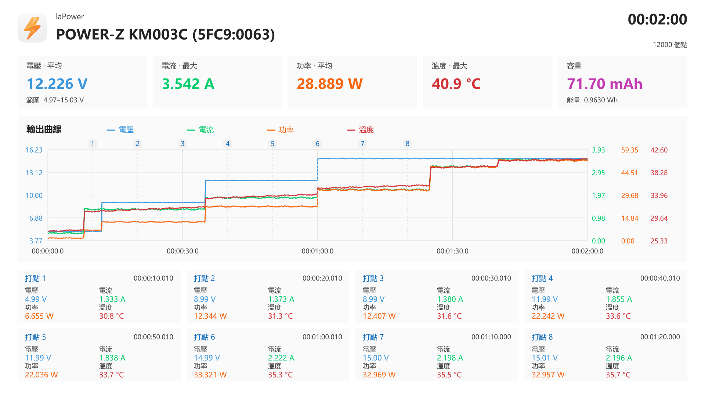
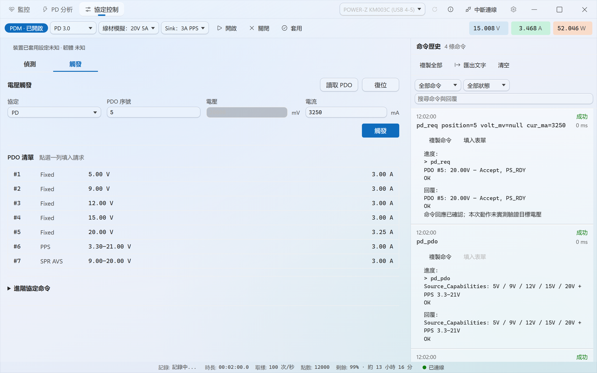
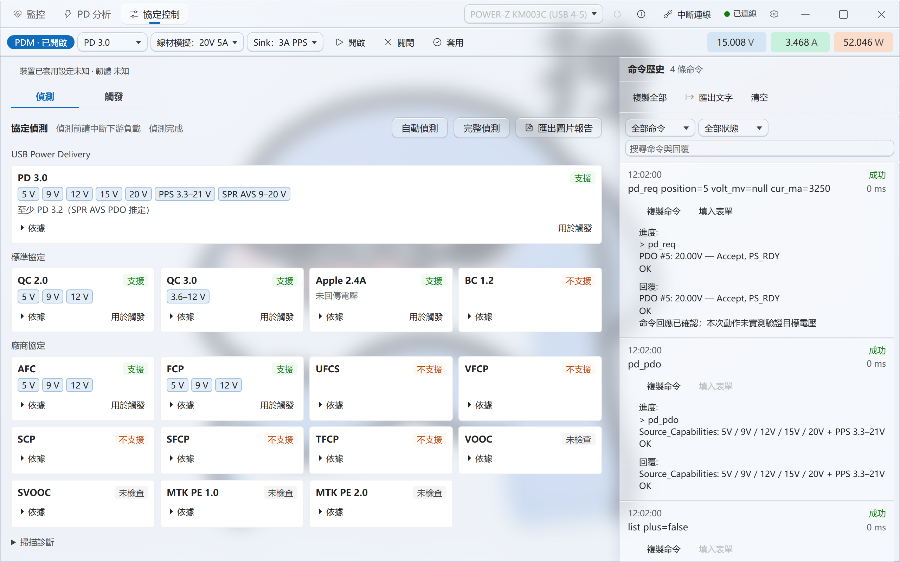
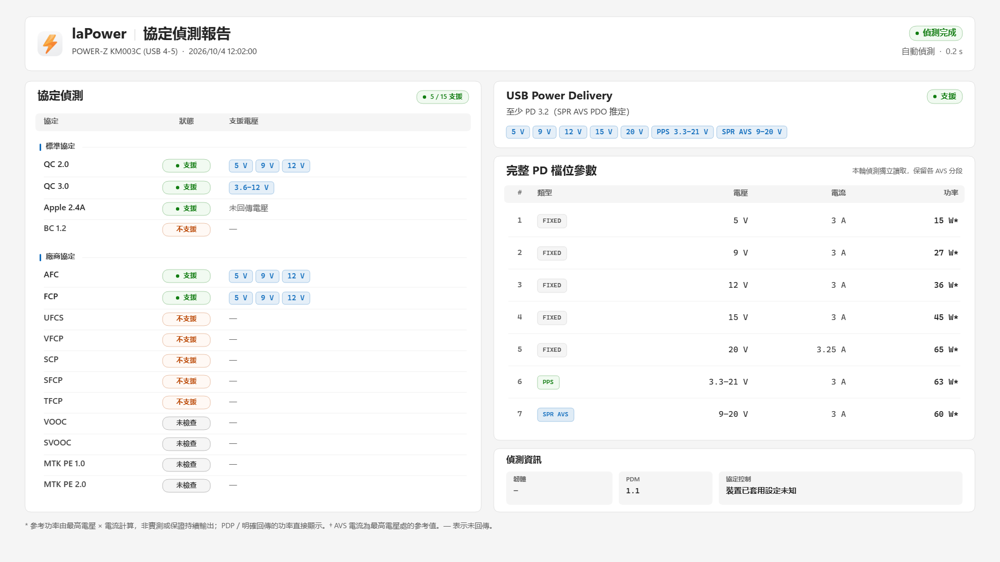

[English](../en/USAGE.md) | [简体中文](../USAGE.md) | **繁體中文** | [日本語](../ja/USAGE.md)

← 返回 [README](../../README.zh-TW.md)

# 使用指南

本指南對應 laPower **0.3.0**。截圖源自 Windows 模擬環境，所啟用的溫度、訊號線與取樣率不代表首次啟動預設值；深色主題操作一致。

- [開始使用](#開始使用)
- [介面總覽](#介面總覽)
- [監控工作區](#監控工作區)
- [PD 分析工作區](#pd-分析工作區)
- [POWER-Z 協定控制](#power-z-協定控制)
- [設定頁](#設定頁)
- [檔案格式](#檔案格式)
- [常見問題](#常見問題)

## 開始使用

1. 將儀表資料介面連接至電腦，點擊標題列重新整理圖示後選中儀表並點擊 `連線`。Linux 使用者請先設定 [udev 規則](DEVELOPMENT.md#udev-規則必需)。
2. 開啟 `監控`，選擇 `取樣率`（首次預設 `4 次/秒`）。連線後大字即時讀數開始更新，但此時尚未開始記錄。
3. 點擊 `開始記錄`（或快速鍵 `P`），曲線、取樣點數、最小/平均/最大統計與能量積分同步啟動；切換工作區不會中斷記錄。
4. 如需溫度資料，依[溫度服務](#溫度服務)步驟單獨連線來源。
5. 點擊 `暫停記錄` 可檢視目前記錄，再點 `繼續記錄` 可接續同一記錄（暫停期間即時預覽仍更新，不計入圖表與累計量）。
6. 長期保存請點擊 `匯出 CSV` 明確匯出，暫存復原檔案不能取代正式匯出；需要溫度或聯合匯出時，先展開 `匯出 CSV` 右側箭頭。

## 介面總覽

### 標題列

左側常駐 `監控`、`PD 分析`、`協定控制` 三個工作區入口；右側依序為裝置下拉清單、重新整理圖示、裝置資訊圖示、連線/中斷按鈕及設定齒輪。Windows / Linux 使用右側 Windows 風格視窗按鈕，macOS 使用左側原生視窗按鈕。

| 入口 | 用途 |
| --- | --- |
| `監控` | 檢視即時讀數、記錄曲線、打點、匯入/匯出 CSV 與匯出報告 |
| `PD 分析` | 擷取與分析 USB-PD 報文、匯入/匯出 PD JSON |
| `協定控制` | POWER-Z 的 PDM 會話、協定偵測與電壓觸發（始終可見，連接支援的 KM003C/KM002C 後啟用操作） |
| 設定齒輪 | 外觀與語言、圖表與記錄、快速鍵、復原與重設、關於 |

窄視窗下部分按鈕會精簡為圖示（可懸停檢視名稱），顯示擁擠時可在設定中調低 `介面縮放`。

### 裝置連線與裝置資訊

位於重新整理與連線按鈕之間的資訊圖示可隨時檢視型號、`VID`、`PID`、`SN` 及裝置說明（優先顯示已連線儀表，否則顯示目前選擇的儀表，無需先連線）。

裝置清單會儘量附帶 USB 拓撲連接埠（如 `WITRN K2 (USB 4-4)`）及多餘介面後綴；WITRN 儀表的 USB 序號可能依生產批次重複，需配合連接埠區分同型號裝置。連線狀態下切換其他儀表前需先點擊 `中斷連線`。

### 狀態列

底部置中顯示記錄狀態圖示按鈕、記錄時長、取樣率、已記錄點數以及剩餘記錄容量/預計時長。連接儀表後，點擊左側記錄圖示按鈕（暫停時顯示播放圖示，記錄中顯示暫停圖示）即可快捷開始或暫停主監控記錄。時長與點數僅反映目前記錄資料，不代表儀表連線時長。

## 監控工作區


[查看深色主題](../screenshots/zh-TW/dark-record.png)

### 命令列

| 控制項 | 操作與限制 |
| --- | --- |
| `開始記錄` / `繼續記錄` / `暫停記錄` | 無資料時開始，已有資料時接續，記錄中暫停；中斷重連後保留資料並可繼續 |
| `取樣率` | 設定即時取樣間隔，見下表 |
| `匯出 CSV` 主按鈕 | 依已儲存選項匯出全部記錄（不受圖表選取範圍限制） |
| `匯出 CSV` 右側箭頭 | 設定 CSV 匯出內容並呼叫 CSV/PD 聯合匯出 |
| `匯出報告` | 將整段記錄匯出為 PNG 圖片（16:9 或長圖）或短影片；至少兩個記錄點後可用，詳見[匯出報告](#匯出報告) |
| `匯入 CSV` | 匯入 CSV 檔案；若已有資料或正在記錄則先確認取代並暫停目前記錄，匯入後保持暫停並取代標記 |
| `一鍵重設` | 僅暫停時可用，確認後清空圖表、統計、累計量與標記（PD 開啟`跟隨記錄`時同步清空 PD 報文） |
| `顯示` | 調整曲線顯隱、曲線陰影、填色不透明度、顏色、線寬、上下錯開與統計範圍 |
| `自動暫停` 主按鈕 / 箭頭 | 主按鈕開關自動暫停；箭頭設定觸發條件、閾值與持續時間 |
| `溫度服務` 主按鈕 / 箭頭 | 主按鈕連線或中斷溫度來源；箭頭設定來源（儀表/外部 TCP）、IP 與連接埠 |

分體按鈕的主操作與箭頭互不干涉，開啟設定浮層不會觸發啟停或連線。點擊浮層外部或按 Escape 可關閉（按 Escape 後焦點返回觸發按鈕）。

### 取樣率

| 選項 | 間隔 |
| --- | --- |
| `1000 次/秒` | 1 ms；僅 POWER-Z KM003C/KM002C 可用 |
| `100 次/秒` | 10 ms |
| `10 次/秒` | 100 ms |
| `4 次/秒`（預設） | 250 ms |
| `2 次/秒` | 500 ms |
| `1 次/秒` | 1000 ms |
| `0.2 次/秒（5 秒 1 次）` | 5000 ms |
| `0.1 次/秒（10 秒 1 次）` | 10000 ms |

POWER-Z 高速模式不支援或驗證失敗時將自動回退 `100 次/秒` 並提示原因。較低取樣率會對視窗內多訊框求平均，可能平滑短暫尖峰；分析瞬態波形建議啟用較高速率。匯入 CSV 採用檔案自帶時間與間隔，不改變即時記錄取樣率設定。

### 讀數卡片

左側面板展示電壓、電流、功率、溫度、累計能量、累計容量與訊號線即時讀數；主卡下方的 `最小` / `平均` / `最大`（溫度為 `最低` / `平均` / `最高`）僅統計已記錄樣本，暫停時即時預覽變化不計入統計。

累計能量（Wh）與容量（mAh）由軟體對取樣點積分，自動排除暫停時段及異常時間空檔，並在接續或匯入後保持/重算。開啟 `記錄電流方向` 後側欄顯示電流方向箭頭，功率與累計量依幅值計算。拖動欄右緣分隔線可調寬；內容溢出時支援滾輪/觸控板捲動且不占用額外捲軸空間。

### 顯示、圖表與時間線

- 開啟 `顯示` 選擇通道：預設勾選電壓、電流、功率和溫度（勾選溫度不會自動連線溫度來源），D+ / D−、CC1 / CC2 預設關閉。
- 頂部的 `曲線陰影` 總開關預設開啟並儲存選擇，關閉後保留各主通道原有填充透明度（範圍 0–100%，預設 15%；0 僅關閉填色），再次開啟時恢復原值；錄製、暫停或縮放均不自動更改陰影。圖例僅指示目前可見通道。
- 預設從零起算並依全域等分步長量化所有 Y 軸（存在負值時向負側延伸），確保四條 Y 軸保持整齊共線刻度；可在 `顯示` 調整通道顏色、填色不透明度、線條粗細（自動/手動）與 `上下錯開`（歸零恢復預設位置），僅影響視覺投影而不改寫原始取樣與積分結果。
- 懸停主圖可檢視對應時刻所有有效顯示通道的真實值。在主圖或底部時間線總覽上捲動滾輪可橫向縮放（縮放歷史區間時不跳回即時跟隨；跟隨最新點時僅改變顯示時長並保持跟隨），放大後可在主圖區域按住左右拖動平移；拖曳時間線兩端手把可調整統計/瀏覽視窗。滾輪與拖動互動期間暫不重算縱軸，錄製中的新峰值在手勢結束後納入量程。
- `僅統計選取範圍` 預設關閉，開啟後最小/平均/最大統計與能量/容量積分僅針對目前時間窗計算（即時大字讀數仍為目前值），不會裁切原始資料或限制匯出範圍。

長記錄渲染調度與積分規則詳見 [效能基準與邊界](../PERFORMANCE.md)（簡體中文）與 [技術架構](../ARCHITECTURE.md)（簡體中文）。

### 打點標註

1. 點擊主圖右上角 `打點` 或按預設快速鍵 `M` 輸入標籤（預設如 `標記 1`）。記錄中點擊標記下一到達點，暫停時標記末點；游標懸停主圖按 `M` 時標記指標最近樣本。
2. 右側箭頭在已有標記時可用，點擊標籤可重新命名，留空或點擊刪除圖示可移除。

在 `設定 → 圖表與記錄` 開啟 `立即打點` 後將跳過輸入直接依預設名稱標註。標籤最長 40 字元（自動清理 CSV 非法分隔符），隨 CSV 的 `Marker` 欄匯出並可匯入還原，`一鍵重設` 會同步清空標記。

### 自動暫停

1. 展開 `自動暫停` 箭頭選擇 `電壓 <`、`電流 <` 或 `功率 <`，填入 `閾值` 與 `持續時間`（秒）後關閉浮層。
2. 點擊 `自動暫停` 主按鈕啟用（反白代表生效），再開始或繼續記錄。

當測量值不高於閾值（判斷包含等於）並持續達設定秒數時自動暫停；持續時間為 0 時首個符合條件的樣本即觸發。預設關閉、條件為 `無` 且閾值為 0；僅修改條件不會啟用該功能。

### 溫度服務

溫度擷取、圖表溫度曲線與 CSV 溫度欄三者相互獨立：

1. 展開 `溫度服務` 箭頭選擇 `來源`：`儀表` 直接讀取裝置報文溫度（需先連表，無需外部程式）；`外部` 透過 TCP 連線外部溫度源（預設 `127.0.0.1:1573`）。
2. 關閉浮層後點擊 `溫度服務` 主按鈕連線；收到有效讀數後顯示於溫度卡並隨主監控記錄儲存。
3. 需在圖表顯示或寫入 CSV 時，分別在 `顯示` 勾選溫度與在 `匯出 CSV` 勾選 `包含溫度`。

連線期間不可更改來源、IP 與連接埠（需先中斷）；軟體重啟需手動重連。`儀表` 溫度隨儀表中斷自動復位，而 `外部` TCP 連線獨立運行；斷線後歷史記錄保留，缺失溫度留空。外部 TCP 協定及示例伺服器見 [外部溫度服務](DEVELOPMENT.md#外部溫度服務)。

### CSV 選項與聯合匯出

`匯出 CSV` 箭頭中的選項會持久化：`包含溫度` 預設關閉，`包含裝置資訊` 和 `包含標記` 預設開啟。勾選但無資料時保留空欄；未知裝置來源不會以目前連線裝置代填。

`同時匯出 CSV 和 PD 資料…` 需監控與 PD 兩側均有資料：選定路徑後一次性匯出完整資料的 `名稱.csv` 與 `名稱.pd.json`（快照在選定路徑時即凍結，不受選區或篩選影響，覆寫前確認）。若關閉了 PD `跟隨記錄`，兩份檔案的時間跨度可能不同且不會自動裁切對齊。

### 匯出報告



[深色主題](../screenshots/zh-TW/dark-report-image.png)


[深色主題](../screenshots/zh-TW/dark-report-long.png)


[深色主題](../screenshots/zh-TW/dark-report-video.png)

點擊監控命令列 `匯出報告`，可將整段凍結記錄輸出為無損 PNG 圖片或短影片（記住類型、720p–4K 解析度、主題與內容選項）。`報告內容` 中包含電壓、電流、功率、溫度、`打點` 與 `打點詳細資訊`：後兩項獨立控制，可僅顯示曲線標記、僅展示底部打點詳情，或同時開關。

- **圖片報告（PNG）**：靜態版式展示完整曲線、總時長、點數、時間加權平均電壓/功率、峰值電流、最高溫度及累計容量/能量（缺測明確保留）。`16:9` 橫版最多保留前 8 個打點（超出時提示）；`長圖` 保留全部打點並依需增高（超限報錯提示降解析度或關閉詳情，絕不默默捨棄）。
- **影片報告**：支援 MP4/MOV、H.264/H.265、24/30/60 fps、1–60 秒時長，將整段記錄快放至目標時長並隨時間更新五張參數卡主讀數（右上角保留整段統計摘要，最多含前 8 個打點）。

點擊 `產生圖片` / `產生影片` 後凍結快照並在背景單槽運行，關閉對話方塊不中斷任務（重開可恢復進度），僅成功後寫入目標位置，取消或失敗會清理暫存檔案。

#### 影片畫質與編碼模式

匯出對話框提供 `編碼模式`（預設 `自動`）與 `畫質`（預設 `高清`），切換組合後會自動偵測可用性並顯示目標位元率：

| 畫質 | H.264（1080p / 30 fps） | H.265（1080p / 30 fps） |
| --- | --- | --- |
| 標準 | 10 Mbps | 6.5 Mbps |
| 高清（預設） | 20 Mbps | 13 Mbps |
| 極清 | 30 Mbps | 19.5 Mbps |

位元率依像素數與影格率線性縮放（H.264 最低 4 Mbps、H.265 最低 3 Mbps，上限 240 Mbps）。`自動` 優先使用硬體編碼並在失敗時回退軟體編碼並說明原因；`硬體編碼` 僅使用真實硬體編碼器（Windows 支援 GPU 紋理與 CPU 幀轉硬體兩級路徑）；`軟體編碼` 直接使用內建軟體編碼器（Linux 僅支援自動或軟體模式的 H.264；macOS 軟體 HEVC 需系統實際支援）。無需額外安裝 ffmpeg。

## PD 分析工作區


[查看深色主題](../screenshots/zh-TW/dark-pd.png)

### 選擇記錄模式

`跟隨記錄` 預設開啟，同一記錄按鈕在不同模式下語意不同：

| 模式 | 記錄按鈕與資料行為 | 清空行為 |
| --- | --- | --- |
| 跟隨記錄開啟 | `開始記錄` / `暫停記錄` 連動主監控與 PD；主監控暫停時不保留新報文（監控已有資料時，PD 暫停後按鈕仍顯示 `開始記錄`） | 任一側清空均同步清空監控與 PD |
| 跟隨記錄關閉 | `暫停記錄` / `繼續記錄` 僅暫停/恢復清單重新整理，背景繼續緩衝連線報文，不影響主監控 | 兩側獨立清空 |

若需在保持背景緩衝的同時固定清單檢視，請先關閉 `跟隨記錄` 再暫停清單。切換工作區不會暫停擷取。

### 清單與詳情

| 控制項 | 用途 |
| --- | --- |
| `匯入` / `匯出` | 讀寫 PD 擷取 JSON（匯出全部擷取不受篩選影響；匯入前確認取代） |
| `清空` | 確認後清空（受跟隨模式連動影響） |
| 報文類型篩選框 | 依訊息類型名稱篩選檢視 |
| `隱藏 GoodCRC` | 隱藏鏈路層確認訊框（預設開啟） |
| `自動捲動` | 新報文到達時自動捲至底部（預設開啟） |
| 分欄圖示 | 切換並儲存上下/左右版面配置（左右佈局僅在視窗寬度 ≥ 1400 px 時生效），拖動分隔線可調比例 |

清單展示 `#`、`經過時間`、`SOP`、`Msg`、`ID`、`方向`、`Obj`、`Rev`、`V/I`（報文附近的儀表取樣）及 `摘要`；選取任意列可在詳情區檢視原始位元組、報文頭及對應 PDO / RDO 解碼樹。擷取充電器握手協商時，請先開始記錄再插拔被測連線。

## POWER-Z 協定控制



[查看深色主題](../screenshots/zh-TW/dark-trigger.png)

此入口始終可見；未連線裝置或連線 WITRN 時顯示提示並停用操作，連接支援的 POWER-Z KM003C / KM002C 後啟用。工作區預設開啟 `觸發` 頁籤，頂部的 `PD 類型`、`線材模擬`、`Sink` 設定與即時 V/I/P 讀數在 `偵測` 與 `觸發` 間共用（與監控共用同一儀表連線）。

### 讀取 PDO 並觸發

1. 在頂部選擇 `PD 類型`、`線材模擬` 和 `Sink` 參數，點擊 `開啟` 建立 PDM 會話（頂部狀態區分目前介面選擇與裝置已確認套用設定，並展示可辨識的韌體版本；中斷或重建連線後需重新開啟 PDM）。
2. 點擊 `讀取 PDO` 取得充電器檔位，或執行 `自動偵測` / `完整偵測`。
3. 點擊 PDO 列將參數填入請求表單，核對序號、電壓（mV）與電流（mA）後點擊 `觸發`（僅點擊列表列不會傳送請求）：
   - 已知固定 PD PDO 電壓為唯讀並省略 `volt`；UFCS 保留原始 `NUM` 物理編號；PPS / AVS 與未知編號保留手動輸入。
4. 在回應記錄檢視確認狀態；`套用` 用於更新 PDM 參數，`復位` 退出目前協定並恢復預設 5 V，`關閉` 結束 PDM 會話。

**命令歷史與進階命令：**

- 命令執行期間其他操作鎖定，命令列顯示 `取消` 與活動狀態；同一時間僅可執行一條命令。
- 右側常駐命令歷史依命令分組記錄時間、參數、耗時、狀態、完整過程及回覆（支援依命令/狀態/文字篩選、複製、匯出文字與參數回填，複製和回填不重送命令）。歷史僅保留於目前工作階段，上限 64 KB（超限時優先淘汰最舊已完成項目，單筆超長依完整行裁剪並給出提示），重複出現的狀態/連線回覆依接收順序保留。
- 進階區域提供 PD/UFCS 與自訂命令：自訂命令可在未開啟 PDM 時傳送（執行後會自動重新確認協定狀態並使舊選定設定失效），`pd data` 支援連續 hex、`0x` 前綴及常見分隔符，非法字元將報錯拒收。

### 協定偵測



[深色主題](../screenshots/zh-TW/dark-detection.png)



[深色主題](../screenshots/zh-TW/dark-protocol-report.png)

> **注意：** 偵測會切換協定並包含 5 V 實測驗證，請務必在**中斷下游負載**後執行。

- **偵測模式與結果矩陣**：`自動偵測`（約 4 分鐘預算）執行常規掃描並對未出明確結果的常規協定逐項補測；`完整偵測`（約 7 分鐘預算）優先傳送 `entry list+` 探測 VOOC/SVOOC、MTK PE 等擴充協定（缺少結束標記時回退常規掃描），舊 PDM 不支援擴充結果時標為「未檢查」。結果依 PD、標準協定、廠商協定分組，明確區分「支援」「不支援」「未檢查」「未確認」；VOOC/SVOOC 與 MTK PE 1.0/2.0 分列（不互相推斷，也不憑 PD 功率推斷私有認證）。點擊「依據」可檢視來源與原始回應；對支援且有觸發實作的協定點擊 `用於觸發` 僅跳轉並填表，不會自動觸發。
- **獨立 PD 讀取與版本判定**：偵測忽略清單掃描附帶的 PD 狀態，在其餘協定完成後獨立執行 `reset → entry pd → pd pdo` 判定 PD 支援與完整檔位（取消則跳過）。PD 版本依序優先採用：`Get_Revision` 完整回應 → 完整掃描明確回報的 PD 3.0/3.1/3.2 → PDO 能力證明的最低版本（PPS ≥ PD 3.0、EPR ≥ PD 3.1、SPR AVS ≥ PD 3.2；一般固定 PDO 無法推斷）。版本展示同時校驗獨立讀取的 PDO，低版本 `Get_Revision` 回應不可覆蓋 SPR AVS 的 PD 3.2 下限，衝突時會明確提示。
- **5 V 實測驗證與復位**：單項 5 V 補測在命令確認至少 500 ms 後取連續 5 個新鮮樣本的中位數，依 `max(200 mV, 3%)` 容差判定（最長等待 12 秒，逾時或偏差記為未確認）。正常結束或取消後都會在 15 秒內嘗試復位並實測確認恢復 5 V，未確認時給出明確提示。
- **匯出圖片報告**：偵測完成後可點擊 **匯出圖片報告** 儲存 16:9 PNG（1920×1080 / 2560×1440 / 3840×2160，淺色/深色主題獨立記憶）。開啟視窗即凍結本輪報告，包含全部協定狀態、PD 版本與完整 PDO（保留 SPR AVS 分段，`*` 標示最高電壓參考功率，`†` 標示最高電壓 AVS 參考電流，缺失顯示 `—`；部分完成或取消也可匯出並標明警示）。

## 設定頁


[查看深色主題](../screenshots/zh-TW/dark-settings.png)

點擊標題列齒輪（macOS 可按 `⌘,` 或選單 `Settings…`）開啟單頁設定。寬螢幕目錄固定於左側，寬度小於 980 px 時切至頂部橫向目錄；設定項修改即自動持久化，無需手動儲存。

### 外觀與語言

| 設定 | 可選值與預設 |
| --- | --- |
| `主題` | `跟隨系統`（預設）、`淺色`、`深色` |
| `語言` | `跟隨系統`（預設）、简体中文、繁體中文、English、日本語 |
| `自訂背景圖片` | 選擇本機 PNG、JPG 或 WebP 圖片（≤ 25 MB）並持久化，點擊 `清除背景` 還原預設（無內建桌布） |
| `背景圖片不透明度` | 0–100%，預設 100%（0% 完全透明，100% 完全顯示） |
| `背景圖片模糊程度` | 0–40 px，預設 14 px（0 px 不模糊） |
| `介面縮放` | 50–200%，預設 100%，鬆手生效；視窗擁擠時可調低 |

語言切換立即生效且保留所有記錄與連線資料；`跟隨系統` 括號中顯示的偵測語言及 Linux 啟動環境變數規則詳見 [語言選擇](DEVELOPMENT.md#語言選擇)。

### 圖表與記錄

| 設定 | 含義與預設 |
| --- | --- |
| `圖表縱向餘量` | 預設 `自動`（依整段已顯示通道峰值定標）；`自訂` 可設 0–100% |
| `縮放時自動調整線條粗細` | 預設開啟；隨縮放層級自動調整曲線線寬 |
| `記錄電流方向` | 預設關閉；開啟後新記錄與新匯入保留電流正負號，匯出保留實錄值 |
| `立即打點` | 預設關閉；開啟後打點跳過標籤輸入彈窗直接使用預設標籤 |
| `單次記錄上限` | 64–8192 MB，預設 512 MB；涵蓋目前全部圖表資料（含已有及匯入），達限自動暫停 |

### 快速鍵

| 操作 | 預設按鍵 | 生效頁面 |
| --- | --- | --- |
| 開始/暫停/繼續記錄 | `P` | 監控 |
| 打點 | `M` | 監控 |
| 匯入 | `Ctrl+O` | 監控 CSV；PD JSON |
| 匯出 | `Ctrl+S` | 監控 CSV；PD JSON |
| 同時匯出 CSV 和 PD 資料 | `Ctrl+Shift+S` | 監控 |
| 清空 | 未綁定 | 監控、PD（仍需確認並遵循跟隨連動） |

macOS 自動對應為 `Command`。點擊按鍵按鈕後按新組合可重綁（Escape 取消），支援單鍵解除/恢復或全部恢復；輸入文字、操作選單/彈窗或錄製快速鍵期間全域快速鍵暫停生效。

### 復原與重設

`保留暫存復原檔案` 預設開啟，錄製時每秒快取一次供異常退出復原；未完成記錄將在本組列出並提供 `復原` / `刪除`（復原會確認並取代目前監控資料，但不含獨立 PD JSON）。正常清空、匯入或退出會在同步成功後清理暫存檔。

`重設所有設定` 僅恢復偏好與快速鍵，與監控頁清空資料的 `一鍵重設` 相互獨立。

### 關於

底部展示應用資訊、`Copyright (C) 2026 KHWLGH`（自有貢獻）及協定庫 LGPL-3.0-or-later 聲明（`usbpd-parser` 與 `witrn-hid` 保留 `Copyright (c) 2025 JohnScotttt`），並提供 `開源授權條款`（離線全文閱讀彈窗，支援複製與記住位置）、`GitHub` 與 `檢查更新`（僅手動點擊時請求 GitHub 正式發佈，不自動下載安裝）。第三方元件卡列出主要相依與可展開的 `全部執行元件` 離線清單及授權閱讀入口。原始碼完整聲明見 [`COPYRIGHT`](../../COPYRIGHT)、[`LICENSE`](../../LICENSE) 與 [`LICENSE.LGPL-3.0`](../../LICENSE.LGPL-3.0)。

## 檔案格式

### CSV

監控頁讀寫 CSV。表頭前包含點數、時長、取樣間隔、日期以及可選的軟體/裝置/取樣規則來源行（以下範例啟用了溫度與標記）：

```csv
SUM,1
TotalTime,="00:00:00.250"
SampTime(ms),250
DateTime,2026-10-17 12:00:00
Software,laPower 0.3.0
Device,WITRN K2 (0716:5060)
Points,mean

Time(D.hh:mm:ss.ms),Voltage(V),Current(A),Power(W),Temp(°C),D+(V),D-(V),CC1(V),CC2(V),RelativeTime(s),Timestamp(ms),RecordingSegment,SampleInterval(ms),Marker,
="00:00:00.250",5,0.5,2.5,25,0.6,0.1,1.6,0.3,0.25,1792209600250,1,250,Start,
```

- `="HH:MM:SS.mmm"` 確保試算表保留文字格式（超 24 小時帶天數前綴）；`RelativeTime(s)` 為相對秒，`Timestamp(ms)` 為絕對時間戳記。
- `RecordingSegment` 區分暫停前後的錄製段，`SampleInterval(ms)` 記錄逐點間隔；可選 `CurrentMagnitude(A)` 保留正反向相抵前的電流幅值以保證容量重算一致。
- 匯入依表頭名匹配，相容缺少溫度、訊號線或額外尾欄的舊 CSV；缺失來源保持未知。

### PD 擷取

PD 擷取使用獨立 JSON 格式（現行 `app: "laPower"`、`kind: "pd-capture"`、`version: 2`，相容讀取 version 1）。匯入會校驗格式並取代目前 PD 清單；聯合匯出的 `.csv` 與 `.pd.json` 需分別在對應頁面匯入。

## 常見問題

### 找不到裝置或連線失敗

確認接入儀表的資料連接埠並使用具備資料傳輸能力的線材，關閉占用裝置的其他上位機後點擊重新整理重試或重插。Linux 需先設定 [udev 規則](DEVELOPMENT.md#udev-規則必需)；支援清單見 [支援的裝置](../../README.zh-TW.md#-支援的裝置)。

### 已連線但圖表沒有資料

連線僅開啟即時數值預覽，需點擊 `開始記錄` 才寫入圖表；暫停後需點擊 `繼續記錄`。若持續無有效數值，請確認裝置韌體報告格式相容。

### 溫度一直是 `--`

請依[溫度服務](#溫度服務)選擇來源並點擊主按鈕連線（預設來源為外部 TCP，用儀表溫度須切為 `儀表`）。僅勾選圖表顯示或 CSV 溫度欄不會啟動溫度擷取；部分韌體可能不輸出有效溫度。

### PD 頁沒有新報文

檢查裝置連線與 `跟隨記錄` 狀態（跟隨開啟時須先啟動主監控記錄），重新插拔充電器以觸發新握手；獨立模式下若暫停了清單更新，需點擊 `繼續記錄` 顯示背景緩衝報文，並檢查篩選條件。

### macOS 長時間記錄

錄製期間應用會阻止系統自動睡眠（允許熄屏）；僅連線或暫停時不阻止睡眠。macOS 14+ 已停用 WebView 背景節流，macOS 12–13 長時錄製請保持視窗可見；合蓋或手動睡眠仍會中斷 USB 擷取。

> 舊專案名為 WITRN-RS；laPower 採用獨立設定目錄，舊版 CSV 與相容 PD 擷取檔案均可直接匯入。
