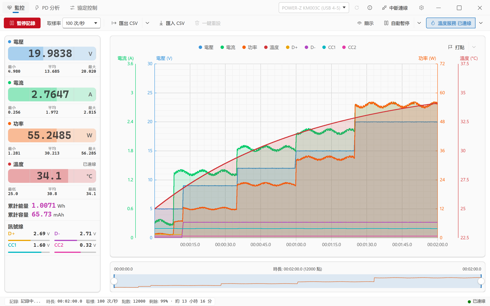
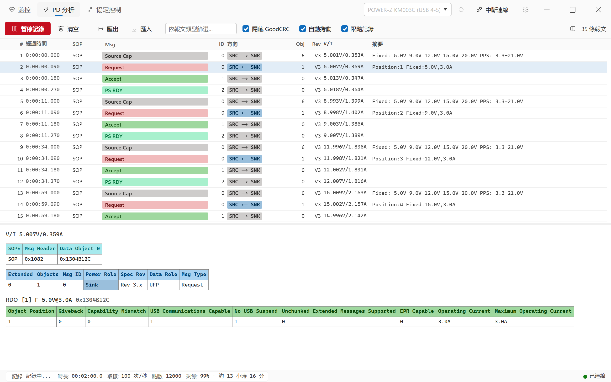
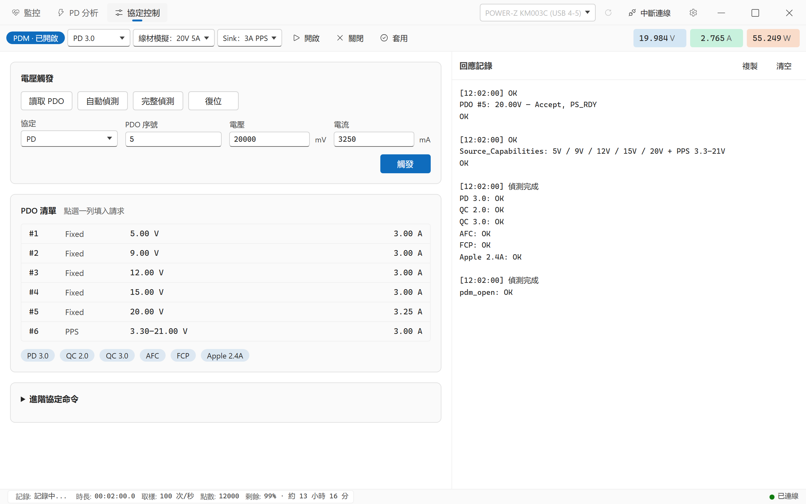
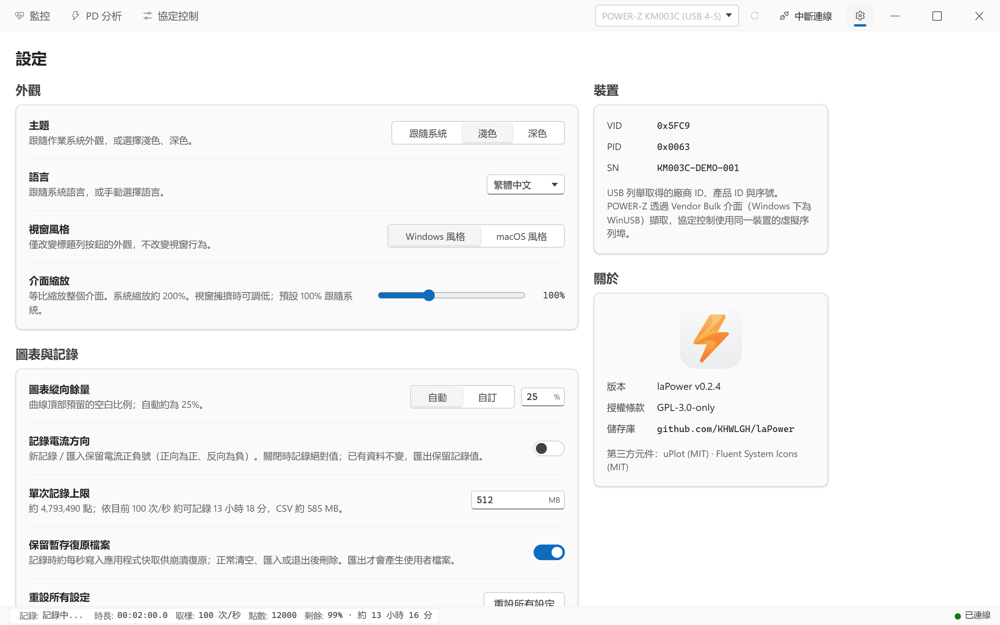

[English](../en/USAGE.md) | [简体中文](../USAGE.md) | **繁體中文** | [日本語](../ja/USAGE.md)

← 返回 [README](../../README.zh-TW.md)

# 使用指南

本指南對應 laPower **0.2.5**。下列截圖來自 Windows，使用模擬裝置與資料；截圖中啟用的溫度、訊號線和取樣率不代表首次啟動的預設設定。深色主題的操作相同。

- [開始使用](#開始使用)
- [介面總覽](#介面總覽)
- [監控工作區](#監控工作區)
- [PD 分析工作區](#pd-分析工作區)
- [POWER-Z 協定控制](#power-z-協定控制)
- [設定頁](#設定頁)
- [檔案格式](#檔案格式)
- [常見問題](#常見問題)

## 開始使用

1. 將儀表的資料介面連接至電腦。在標題列點擊重新整理圖示，從裝置下拉清單選擇儀表，再點擊 `連線`。Linux 使用者請先設定 [udev 規則](DEVELOPMENT.md#udev-規則必需)。
2. 開啟 `監控`，選擇 `取樣率`；首次預設是 `4 次/秒`。連線後的大字讀數會即時更新，但尚未開始記錄。
3. 點擊 `開始記錄`。圖表開始累積資料，底部點數增加，記錄的統計值和累計量隨之更新。切換工作區不會暫停記錄。
4. 如需溫度，依 [溫度服務](#溫度服務) 的步驟單獨啟用；只連接儀表不會自動啟用溫度。
5. 點擊 `暫停記錄` 查看資料，或點擊 `繼續記錄` 接續同一份記錄。暫停期間即時讀數仍可變化，圖表和累計量不再增加。
6. 點擊 `匯出 CSV` 選擇儲存位置。需要溫度或調整匯出內容時，先開啟右側箭頭。長期保存請明確匯出，暫存復原檔案不能取代匯出檔案。

## 介面總覽

### 標題列

左側常駐 `監控`、`PD 分析`、`協定控制` 三個工作區入口。右側依序是裝置選擇、重新整理圖示、資訊圖示、連線／中斷按鈕和設定齒輪。視窗按鈕位置隨系統和視窗風格而異。

| 入口 | 用途 |
| --- | --- |
| `監控` | 即時讀數、圖表記錄、打點及 CSV 匯入匯出 |
| `PD 分析` | USB-PD 擷取、報文檢視及 PD JSON 匯入匯出 |
| `協定控制` | POWER-Z 的 PDM、協定偵測和電壓觸發；入口一直顯示，連接支援的 KM003C/KM002C 後才啟用控制操作 |
| 設定齒輪 | 外觀與語言、圖表與記錄、快速鍵、復原與重設、關於 |

窄視窗下部分入口只顯示圖示，懸停可查看名稱；文字顯示不全時，可在設定中調低 `介面縮放`。

### 裝置連線與裝置資訊

資訊按鈕只顯示資訊圖示，位於重新整理與連線之間。點擊可查看型號、`VID`、`PID`、`SN` 及說明：優先顯示已連接儀表，否則顯示目前選擇的儀表；沒有裝置時顯示空狀態。未連接也能查看，選擇裝置或更新清單後會同步更新。

裝置名稱可能含 USB 連接埠，例如 `WITRN K2 (USB 4-4)`；同一實體裝置篩選後仍有多個 HID 介面時，還會追加介面資訊。WITRN 序號可能重複，請配合連接埠區分同型號儀表。連線期間不能改選儀表，請先點擊 `中斷連線`。

### 狀態列

底部顯示記錄狀態、時長、取樣率、已記錄點數、剩餘記錄容量／預計時間及連線狀態。點擊左側記錄狀態也能開始或暫停主監控記錄；開始需要已連接的儀表。時長和點數反映記錄資料，不是儀表連線時間。

## 監控工作區



[查看深色主題](../screenshots/zh-TW/dark-record.png)

### 命令列

| 控制項 | 操作與限制 |
| --- | --- |
| `開始記錄` / `繼續記錄` / `暫停記錄` | 無資料時開始、已有資料時接續、記錄中暫停。中斷連線保留資料，重新連接後可以繼續 |
| `取樣率` | 設定即時取樣間隔，見下表 |
| `匯出 CSV` 主按鈕 | 依已儲存選項匯出全部記錄；圖表選取範圍不限制匯出範圍 |
| `匯出 CSV` 右側箭頭 | 開啟 CSV 內容選項及聯合匯出 |
| `匯入 CSV` | 選擇檔案；已有資料或正在記錄時先確認取代，確認後暫停目前記錄。匯入後維持暫停，原有標記由檔案中的標記取代 |
| `一鍵重設` | 記錄中停用；暫停後點擊並確認，清空圖表、統計、累計量和標記。PD 開啟跟隨記錄時也清空 PD 報文 |
| `顯示` | 設定曲線顯隱、填色不透明度和統計範圍 |
| `自動暫停` 主按鈕 / 箭頭 | 主按鈕啟用或停用，箭頭設定觸發條件 |
| `溫度服務` 主按鈕 / 箭頭 | 主按鈕連接或中斷溫度來源，箭頭設定來源、IP 和連接埠 |

主操作與箭頭獨立。開啟設定不會開始記錄、啟用自動暫停或連接溫度來源。點擊浮出面板外可關閉；Escape 關閉後焦點返回開啟面板的按鈕。

### 取樣率

| 選項 | 間隔 |
| --- | --- |
| `1000 次/秒` | 1 ms；僅 POWER-Z KM003C/KM002C 可用 |
| `100 次/秒` | 10 ms |
| `10 次/秒` | 100 ms |
| `4 次/秒`（預設） | 250 ms |
| `2 次/秒` | 500 ms |
| `1 次/秒` | 1000 ms |
| `0.2 次/秒（5 秒 1 次）` | 5000 ms |
| `0.1 次/秒（10 秒 1 次）` | 10000 ms |

POWER-Z 不支援高速取樣或驗證失敗時，會退回 `100 次/秒` 並說明原因。慢速取樣將多個訊框彙整為一個點，短暫尖峰可能被平均；觀察瞬態時請選擇裝置支援的較高速率。匯入使用檔案的時間與間隔，不改變下次即時記錄的取樣率偏好。

### 讀數卡片

左側顯示電壓、電流、功率、溫度、累計能量、累計容量及訊號線。連線後大字數值是即時預覽；主卡下方的 `最小` / `平均` / `最大`（溫度為 `最低` / `平均` / `最高`）來自記錄資料。暫停後即時預覽的變化不是新的記錄點。

能量（Wh）及容量（mAh）由軟體對記錄積分計算；不計入暫停時間，繼續記錄保留累計值，匯入時依檔案重新計算。過長的資料空檔也會排除。啟用 `記錄電流方向` 後會顯示電流方向箭頭，功率與累計量依幅值計算。

拖動讀數欄右側分欄線可調整寬度，窄視窗會限制實際寬度。讀數放不下時，可在欄內使用滾輪或觸控板上下捲動；此區域隱藏捲軸且不保留空白。

### 顯示、圖表與時間線

- 開啟 `顯示` 選擇曲線。電壓、電流、功率和溫度預設勾選，D+/D-、CC1/CC2 預設關閉；勾選溫度不會連接溫度來源。
- 四條主曲線各有 0–100% 填色不透明度，預設 15%；0 只關閉填色，不隱藏曲線。圖例表示目前可見通道，不能點擊切換。
- 懸停主圖查看該時刻可見且有效的通道值；在主圖使用滾輪，以游標位置為中心縮放時間範圍。
- 底部時間線兩端控制點調整範圍，拖動中間選區可平移。記錄時選區右端貼著最新資料會繼續跟隨；移到歷史區間則停留於該處。
- `僅統計選取範圍` 預設關閉。開啟後，最小／平均／最大與能量、容量只統計選區；大字即時讀數仍是目前預覽。不會刪除資料或限制匯出範圍，缺失值不參與統計。

繪製與資料擷取的頻率不同，細節見 [效能說明](../PERFORMANCE.md)（簡體中文）和 [架構說明](../ARCHITECTURE.md)（簡體中文）。

### 打點標註

1. 點擊主圖右上角 `打點` 或按預設的 `M`，輸入標籤後確認；預設標籤如 `標記 1`。
2. 記錄中按鈕標記隨後到達的下一個點，暫停時標記最後一點。游標位於主圖時按 `M`，則標記游標下最近的點；位置在開啟輸入框前確定。
3. 右側箭頭開啟標記清單；有標記時才可開啟。點擊標籤改名，留空或點擊刪除圖示可刪除。

在 `設定 → 圖表與記錄` 開啟 `立即打點` 後直接使用預設標籤，不再先詢問。標籤最多 40 字元，不適合 CSV 的分隔符會被清理。標記儲存在 CSV 的 `Marker` 欄，匯入會還原檔案中的標記；`一鍵重設` 會清空標記。

### 自動暫停

1. 點擊 `自動暫停` 右側箭頭，選擇 `電壓 <`、`電流 <` 或 `功率 <`。
2. 填入 `閾值` 與 `持續時間`（秒），關閉面板。
3. 點擊 `自動暫停` 主按鈕啟用，反白代表啟用；再開始或繼續記錄。

數值不高於閾值且持續指定時間時暫停。介面條件雖標示 `<`，目前判斷也包含等於閾值。持續時間為 0 時，首個符合條件的記錄點即可觸發。預設未啟用、條件為 `無`，閾值和時間均為 0；更改設定不會自動啟用，`無` 不會觸發。

### 溫度服務

溫度擷取、曲線顯示和 CSV 溫度欄是三項獨立操作。

1. 點擊 `溫度服務` 右側箭頭，選擇 `來源`。
2. 使用儀表溫度時選 `儀表` 並先連接儀表，不需外部程式。TCP 選 `外部`，輸入 `IP` 和 `連接埠`，預設 `127.0.0.1:1573`。首次來源預設外部且未連線。
3. 關閉面板，點擊 `溫度服務` 主按鈕連接。有效數值到達後顯示於溫度卡，並隨主監控記錄寫入資料。
4. 需顯示曲線時在 `顯示` 勾選溫度；要寫入 CSV，另行勾選 `包含溫度`。

連接期間不能修改來源、IP 和連接埠；請先透過主按鈕中斷。重新啟動後需手動連接。儀表溫度隨儀表中斷，外部 TCP 獨立；斷線保留歷史資料，缺失溫度留空。TCP 伺服器每行發送一個攝氏數字，範例見 [外部溫度服務](DEVELOPMENT.md#外部溫度服務)。

### CSV 選項與聯合匯出

CSV 箭頭中的三項設定會儲存：`包含溫度` 預設關閉，`包含裝置資訊` 和 `包含標記` 預設開啟。勾選但無資料時，溫度和標記欄仍保留空白欄位；來源未知時不會以目前連接的儀表補填。

同一面板的 `同時匯出 CSV 和 PD 資料…` 需要監控與 PD 兩側都有資料。選擇一次位置產生 `名稱.csv` 與 `名稱.pd.json`，覆寫前會確認。匯出全部資料，不受圖表選區或 PD 篩選影響；選好位置後固定快照，後續樣本不會追加到這次匯出。關閉跟隨記錄時，兩份資料的時間範圍可能不同，不會自動裁切或對齊。

## PD 分析工作區



[查看深色主題](../screenshots/zh-TW/dark-pd.png)

### 先選擇記錄模式

`跟隨記錄` 預設開啟；同一個記錄按鈕在兩種模式的用途不同：

| 模式 | 按鈕與資料行為 | 清空行為 |
| --- | --- | --- |
| 開啟跟隨記錄 | `開始記錄` / `暫停記錄` 控制主監控與 PD；主監控暫停時不保留新報文。即使監控已有資料，PD 暫停後仍顯示 `開始記錄` | 任一側清空都清空監控與 PD，確認框會說明連動 |
| 關閉跟隨記錄 | `暫停記錄` / `繼續記錄` 只暫停／恢復清單更新；已連接儀表仍在背景緩衝報文，恢復後補入清單，不控制主監控 | 兩側分別清空 |

要暫停整個連動擷取，使用記錄按鈕；只想停留檢視清單並繼續緩衝，請先關閉跟隨記錄再暫停清單。切換工作區本身不暫停擷取。

### 清單與詳情

| 控制項 | 用途 |
| --- | --- |
| `匯入` / `匯出` | 讀取／儲存 PD JSON；匯出全部擷取，不受篩選限制。匯入會取代目前 PD 擷取，已有內容時先確認 |
| `清空` | 確認後清空，注意上表的連動 |
| 報文類型篩選框 | 依訊息類型名稱篩選 |
| `隱藏 GoodCRC` | 隱藏鏈路確認報文，預設開啟；取消勾選可查看 GoodCRC |
| `自動捲動` | 新報文到達時跟隨清單底部，預設開啟 |
| 分欄圖示 | 儲存上下／左右偏好；左右僅在視窗寬度至少 1400px 時生效。拖動清單與詳情的分欄線可調整比例 |

欄位為 `#`、`經過時間`、`SOP`、`Msg`、`ID`、`方向`、`Obj`、`Rev`、`V/I`、`摘要`。`V/I` 是報文附近的儀表取樣，不保證精確同步。選擇一列，在詳情中檢視原始資料、報文頭及適用的 PDO、RDO 等解碼表；沒有資料物件的訊息不會顯示 PDO 表。篩選與隱藏只影響檢視。

擷取充電協商時，先開始記錄再重新插接充電器與被測連線，才能看到新的握手；只開啟 PD 頁不會讓已完成的協商重新發生。

## POWER-Z 協定控制



[查看深色主題](../screenshots/zh-TW/dark-trigger.png)

此入口一直顯示。未連接或連接 WITRN 時顯示提示，控制按鈕停用；連接支援協定控制的 POWER-Z KM003C/KM002C 後才可操作。

### 讀取 PDO 並觸發

1. 在頂部選擇 PD 類型、線材模擬和 Sink，點擊 `開啟` 開啟 PDM。
2. 點擊 `讀取 PDO` 取得充電器檔位，或使用 `自動偵測` / `完整偵測` 偵測協定。
3. 點擊 PDO 列填入請求，檢查所選協定的序號、電壓（mV）、電流（mA）後點擊 `觸發`；選擇 PDO 列不會立即觸發。
4. 在回應記錄檢視結果。更改頂部 PDM 參數後按 `套用`；`復位` 退出目前協定並恢復預設 5 V，`關閉` 關閉 PDM。

命令執行期間其他命令停用，記錄區會出現 `取消`。自動偵測與完整偵測可能分別需要約 90 秒、3 分鐘。進階區提供 PD/UFCS 和自訂命令，自訂命令可在未開啟 PDM 時傳送，其餘協定操作需要 PDM。中斷或重新建立儀表擷取連線後，需重新開啟 PDM。此頁即時讀數與監控共用儀表連線。

## 設定頁



[查看深色主題](../screenshots/zh-TW/dark-settings.png)

點擊標題列右側齒輪進入；macOS 也可使用 ⌘, 或應用程式的 Settings… 選單。設定為單一捲動頁面，順序為 `外觀與語言`、`圖表與記錄`、`快速鍵`、`復原與重設`、`關於`，關於位於最下方。

寬螢幕目錄固定左側，小於 980px 時改為頂部橫向目錄；點擊跳轉，手動捲動同步反白，也支援 Tab 聚焦和 Enter 跳轉。減少動態效果時不使用平滑捲動。切換工作區後返回會還原本次工作階段的位置。設定通常修改即儲存，不需額外點擊儲存按鈕。

### 外觀與語言

| 設定 | 選項與預設 |
| --- | --- |
| `主題` | `跟隨系統`（預設）、`淺色`、`深色` |
| `語言` | `跟隨系統`（預設）、简体中文、繁體中文、English、日本語 |
| `視窗風格` | Windows/Linux 可選 `Windows 風格`（預設）或 `macOS 風格`；macOS 使用原生按鈕，不顯示此項 |
| `介面縮放` | 50–200%，預設 100%，拖動結束後套用；視窗擁擠時可調低 |

語言立即切換並保留記錄和資料。不支援的系統語言回退英文，跟隨系統括號中的偵測語言不隨手動選擇改變。偵測規則和 Linux 啟動範例見 [開發指南](DEVELOPMENT.md#語言選擇)。

### 圖表與記錄

| 設定 | 說明與預設 |
| --- | --- |
| `圖表縱向餘量` | 預設 `自動`，約 25%；`自訂` 可填 0–100% |
| `記錄電流方向` | 預設關閉；開啟後新記錄和新匯入保留電流符號，已有資料不改寫，匯出保留記錄值 |
| `立即打點` | 預設關閉，開啟後打點不先詢問標籤 |
| `單次記錄上限` | 64–8192 MB，預設 512 MB；涵蓋目前整份圖表資料，已有與匯入資料也占用額度。達上限自動暫停，不會自動分割儲存檔案 |

### 快速鍵

| 操作 | 預設 | 工作區 |
| --- | --- | --- |
| 開始／暫停／繼續記錄 | `P` | 監控 |
| 打點 | `M` | 監控 |
| 匯入 | `Ctrl+O` | 監控 CSV；PD JSON |
| 匯出 | `Ctrl+S` | 監控 CSV；PD JSON |
| 同時匯出 CSV 和 PD | `Ctrl+Shift+S` | 監控 |
| 清空 | 未綁定 | 監控、PD；仍需確認並遵循跟隨連動 |

macOS 使用 Command 代替 Ctrl。點擊目前按鍵後按新組合，Escape 取消；`解除` 解除，`恢復預設` 還原單項，`恢復全部快速鍵` 還原全部。衝突組合、純修飾鍵及保留的關閉／結束組合不可使用。編輯文字、操作下拉選單、浮出面板、對話框或錄入新按鍵時，記錄、匯入、匯出等快速鍵暫停生效。

### 復原與重設

`保留暫存復原檔案` 預設開啟，記錄時約每秒儲存至應用快取，用於異常退出後復原。未完成記錄會列在此分組，提供 `復原` / `刪除`；復原後回到監控，可繼續記錄或匯出。復原會取代目前監控資料，已有內容時先確認。

正常清空、匯入或退出後，成功同步才會清理暫存檔；失敗則保留並提示。暫存檔不是長期歸檔，也不含獨立 PD JSON，請分別匯出所需檔案。

`重設所有設定` 確認後還原設定偏好與快速鍵，與監控頁清空資料的 `一鍵重設` 不同。設定儲存失敗時請以錯誤提示為準，畫面已還原不代表已成功持久儲存。

### 關於

底部應用資訊卡顯示圖示、名稱、說明、版本和授權條款。帶 GitHub 標誌的 `GitHub` 按鈕在系統瀏覽器開啟專案首頁，窄視窗下操作按鈕會換行。

只有點擊 `檢查更新` 才請求 GitHub 正式發佈；檢查時停用按鈕，結果保留至本次工作階段結束。啟動、進入設定和切換工作區不自動檢查。同版或較舊發佈顯示已是最新，無正式版另行提示，失敗可重試。發現新版後以 `前往 GitHub 下載` 開啟對應發佈頁，不自動下載或安裝。

第三方元件卡顯示主要元件名稱、版本、用途和授權條款。展開全部執行元件可離線查看依名稱排序的完整清單，涵蓋四個桌面發佈目標的直接與間接執行相依套件；不包含本專案工作區及純開發、建置依賴。

## 檔案格式

### CSV

監控頁讀寫 CSV。表頭前包含點數、時長、取樣間隔和日期，之後可能有軟體、裝置及取樣規則來源。此單點範例啟用了溫度與標記：

```csv
SUM,1
TotalTime,="00:00:00.250"
SampTime(ms),250
DateTime,2026-10-17 12:00:00
Software,laPower 0.2.5
Device,WITRN K2 (0716:5060)
Points,mean

Time(D.hh:mm:ss.ms),Voltage(V),Current(A),Power(W),Temp(°C),D+(V),D-(V),CC1(V),CC2(V),RelativeTime(s),Timestamp(ms),RecordingSegment,SampleInterval(ms),Marker,
="00:00:00.250",5,0.5,2.5,25,0.6,0.1,1.6,0.3,0.25,1792209600250,1,250,Start,
```

- `包含溫度` 控制 `Temp(°C)`，`包含標記` 控制 `Marker`，`包含裝置資訊` 只控制 `Device` 來源行，不改變擷取和圖表資料。
- `="HH:MM:SS.mmm"` 使試算表以文字保留時間，超過一天會加天數。`RelativeTime(s)` 為精確相對秒，`Timestamp(ms)` 為絕對時間戳記。
- `RecordingSegment` 區分暫停前後的記錄段，`SampleInterval(ms)` 保存逐點間隔。可選的 `CurrentMagnitude(A)` 保留正反相抵前的電流幅值，維持容量重算一致。
- 數值保留匯出精度，缺失值留空；勾選溫度欄不代表有有效溫度。`Marker` 的標籤會在匯入時還原。
- 舊 CSV 缺少溫度、訊號線或新增尾欄仍可匯入，依表頭名稱辨識，不需手動補欄。來源缺失時保持未知，不使用目前儀表補填。

### PD 擷取

PD 使用 JSON，與監控 CSV 分開。現行格式標識為 `app: "laPower"`、`kind: "pd-capture"`、`version: 2`；version 1 舊擷取仍可匯入。匯入會驗證並取代目前 PD 擷取。只匯入 CSV 不會載入 PD JSON，聯合匯出的兩份檔案也需在各自工作區分別匯入。

## 常見問題

### 找不到裝置或連線失敗

使用儀表資料介面和支援資料傳輸的線材，重新整理後選擇儀表。關閉可能占用裝置的其他軟體，再重試或重新插拔。Linux 需設定 HID/Bulk 權限，見 [udev 規則](DEVELOPMENT.md#udev-規則必需)。支援型號見 [裝置清單](../../README.zh-TW.md#-支援的裝置)。

### 已連接但圖表沒有資料

連線只啟用即時預覽，請按 `開始記錄`。暫停後讀數仍可變化，但點數不增加，需按 `繼續記錄`。不相容或無效的儀表報告也可能沒有有效讀數。

### 溫度一直是 `--`

依 [溫度服務](#溫度服務) 選擇並連接來源。預設為外部 TCP，要使用儀表溫度需手動選擇儀表。曲線和 CSV 選項都不會啟用擷取。檢查伺服器、位址、連接埠與型號支援，部分韌體可能不提供有效溫度。

### PD 頁沒有新報文

檢查連線與跟隨模式，連動時需開始主監控記錄。重新插接被測連線才能產生新協商。獨立模式若暫停清單，需按 `繼續記錄` 才會顯示緩衝報文，也請檢查篩選條件。

### macOS 長時間記錄

記錄期間阻止自動睡眠，螢幕仍可熄滅；只連接或暫停不阻止睡眠。macOS 14+ 設定停用 WebView 背景節流；macOS 12–13 長時間記錄請保持視窗可見。合蓋或手動睡眠仍可能中斷 USB 擷取。

舊專案名為 WITRN-RS；laPower 使用獨立設定目錄，既有 CSV 與相容 PD 擷取可直接匯入。
